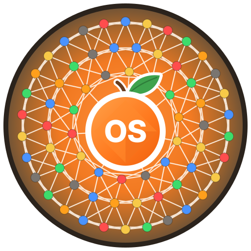

# Orange Social

<p align="center"></p>

[](https://github.com/matheushaliski/orange_social_velion/actions/workflows/ci.yml)
[](https://github.com/matheushaliski/orange_social_velion/actions/workflows/codeql.yml)

Rede social do ecossistema **Velion** com categorização visual de usuários (6 cores), quatro feeds
independentes (Profile · Post · Audio · Alert), filtro multidimensional de 6 eixos e conformidade
LGPD por construção.

## Stack

| Camada | Tecnologia |
|---|---|
| Runtime | Java 21+ (alvo 25 LTS) · Spring Boot 4.1 · virtual threads |
| Fonte da verdade | PostgreSQL 17 + PostGIS (`VSusercontrolist`, consentimentos, outbox) |
| Cache / ranking / sessões | Valkey 9 (ZSET para o Trending Score) |
| Timeline / logs / notificações | Apache Cassandra 5 |
| Mídias | API S3 (AWS S3 sa-east-1 em produção, Garage em desenvolvimento) |

## Estrutura

```
design/brand/              logo principal (SVG) e mark
docs/                      diagramas Mermaid, pesquisa de tecnologias, design system, backlog Trello
scripts/wcag_contrast.py   verificação de contraste da paleta
src/main/resources/
  schema.sql               DDL PostgreSQL (VSusercontrolist · consent_event · user_key · outbox_event)
  cassandra/schema.cql     keyspace e tabelas Cassandra
src/main/java/com/orangesocial/
  domain/model/            UserControlList, UserCategoryEnum, AccountStatus, GeoLocation, ...
  infrastructure/          persistence/postgres · persistence/cassandra · cache/redis (Valkey)
```

## Documentação

- **[Requisitos funcionais — diagramas por RF](docs/rf/README.md)** (mantidos junto com o código; verificados no CI)
- [Casos de uso](docs/DIAGRAMA_CASOS_DE_USO.md) · [Diagrama de classes](docs/DIAGRAMA_CLASSES.md) ·
  [Máquinas de estados](docs/MAQUINA_ESTADOS.md) · [Componentes](docs/DIAGRAMA_COMPONENTES.md) ·
  [Sequências](docs/DIAGRAMA_SEQUENCIA.md) · [Atividades](docs/DIAGRAMA_ATIVIDADES.md)
- [Taxonomia: atores, tipos de usuário, atributos e anatomia dos cards](docs/TAXONOMIA_ATORES_E_CARDS.md)
  ([desenhos](design/prototype/anatomia/))
- [Pesquisa de tecnologias (ADRs)](docs/PESQUISA_TECNOLOGIAS.md) · [Design system](docs/DESIGN_SYSTEM.md) ·
  [Background Studio e Aura Plus (pesquisa)](docs/PESQUISA_BACKGROUND_STUDIO.md)
- [Backlog para o Trello](docs/TRELLO_BACKLOG.md)
- [Protótipo de interface](design/prototype/index.html) · [telas renderizadas](design/prototype/screens/) ·
  [marca e logo](design/brand/) ([regras](docs/DESIGN_SYSTEM.md#8-marca))

## API (até agora)

| Método e rota | RF | O que faz |
|---|---|---|
| `GET /api/v1/posts/{id}` | RF24 | Post completo para o modal: autor, `publishedAt`, contagens, estado dos botões, `shareUrl` |
| `GET /api/v1/users/{id}/profile` · `GET /api/v1/users/{id}/posts?cursor=` | RF25 | Perfil público (dados mínimos) e feed do autor paginado por cursor |
| `PUT`/`DELETE /api/v1/posts/{id}/like` · `…/save` | RF26 | Curtir e salvar, idempotentes |
| `GET`/`POST /api/v1/posts/{id}/comments` · `DELETE …/comments/{cid}` | RF26 | Caixa de mensagens do post |
| `POST /api/v1/posts/{id}/shares` `{channel}` | RF26 | Registra o compartilhamento e devolve link e total |
| `POST /api/v1/posts` · `PATCH`/`DELETE /api/v1/posts/{id}` · `…/archive` · `…/restore` | RF29 | Publicar (texto), editar, arquivar, restaurar e apagar o próprio post, com a moldura (`background`) |
| `GET /api/v1/backgrounds/catalog` · `GET /api/v1/backgrounds/recommendations?category=` | RF28 | Catálogo público da moldura (ETag, cartela do dia) e direção recomendada |

| `GET /api/v1/auth/csrf` · `POST /api/v1/auth/register` · `POST /api/v1/auth/login` · `…/login/2fa` · `…/reactivate` · `…/logout` · `GET /api/v1/auth/session` | RF1, RF27 | Cadastro com tipo de usuário e aceite dos Termos da Velion; login em etapas (senha → 2FA → reativar) |
| `GET/PATCH /api/v1/me/profile` · `GET/PATCH /api/v1/me/preferences` · `POST /api/v1/me/verify-email` | RF1, RF2 | Perfil, configurações (tema, fundo do app, privacidade, notificações) e verificação de e-mail |
| `POST /api/v1/me/password` · `GET/DELETE /api/v1/me/sessions` · `/api/v1/me/mfa/**` | RF27 | Senha, sessões ativas e 2FA (TOTP + 10 códigos de recuperação) |
| `POST /api/v1/me/deletion` | RF23 | Excluir conta: 30 dias para reativar, depois eliminação |
| `GET /api/v1/legal/terms` | RF1 | Versão vigente dos [Termos de Uso](docs/legal/TERMOS_DE_USO.md) |

Erros em Problem Details (RFC 9457) com mensagem em pt-BR. Sessão opaca no Valkey: cookie sem `Max-Age`,
`HttpOnly`, `SameSite=Lax` (aba anônima abre deslogada); toda escrita leva `X-XSRF-TOKEN` (pegue em
`GET /api/v1/auth/csrf`).

## Ambiente local

```bash
docker compose up -d                  # PostgreSQL+PostGIS :5432 · Valkey :6379 · Garage (S3) :3900
docker compose --profile full up -d   # + Cassandra 5 :9042 (aplica cassandra/schema.cql)
mvn spring-boot:run                   # perfil dev; Flyway aplica db/migration/V1..V3
                                      # o código de verificação de e-mail aparece no log (só em dev)
```

Fora do perfil `dev`, defina `ORANGE_APP_SECRET` (Base64, 32+ bytes — ex.: `openssl rand -base64 32`).
Credenciais de desenvolvimento: PostgreSQL `orange`/`orange`; Garage access key `GK0000000000000000orangedev`
(secret em `infra/garage/init.sh`), bucket `orange-social-media`.

## Build e testes

```bash
mvn test                        # unitários (sem Docker)
mvn verify                      # + testes de integração *IT com Testcontainers (PostGIS, Valkey, Cassandra 5)
python3 scripts/wcag_contrast.py
```

`mvn package` também gera o SBOM CycloneDX em `target/classes/META-INF/sbom/application.cdx.json` (exposto em `/actuator/sbom` quando o Actuator estiver habilitado); `mvn package jib:dockerBuild` constrói a imagem
OCI `orange-social:local` no daemon Docker sem Dockerfile.

Para reproduzir o scan de imagem do CI localmente:
`docker run --rm -v /var/run/docker.sock:/var/run/docker.sock aquasec/trivy image --severity HIGH,CRITICAL --ignore-unfixed orange-social:local`.

Os testes de integração usam `@ServiceConnection` (`src/test/java/com/orangesocial/support/PolyglotContainers.java`)
e o perfil `it`. Com `testcontainers.reuse.enable=true` em `~/.testcontainers.properties` os containers
são reaproveitados entre execuções.
