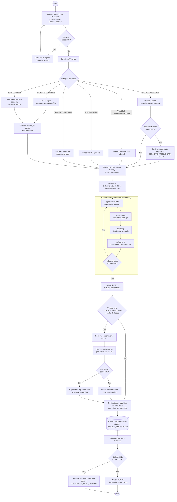

# Diagrama de Atividades — Cadastro por Tipo de Usuário

Cobre o RF1/RF2 (cadastro e perfil), a cadeia de seleção de comunidades de interesse
(`typeofcommunity → selectcountry → selectcity`) e a captura opcional de GPS
(`LastSavedLocation`) sob consentimento (LGPD Art. 7º, I).

## Regras aplicadas no fluxo

| Regra | Origem |
|---|---|
| Nenhum toggle de consentimento vem ligado; reconhecimento facial e localização começam desligados | Privacy by Default (Art. 46 §2º) |
| `sexualpreference` só é gravado com consentimento específico e destacado | Art. 11, I |
| Listas de país e cidade são filtradas pelo item anterior (`typeofcommunity → selectcountry → selectcity`) | Requisito de UX |
| Contas `VERMELHO` e `PRETO` entram com verificação manual antes de ganhar selo | Alert Feed só aceita fontes verificadas |
| Cadastro não confirmado em 7 dias é eliminado | Princípio da necessidade (Art. 6º, III) |
