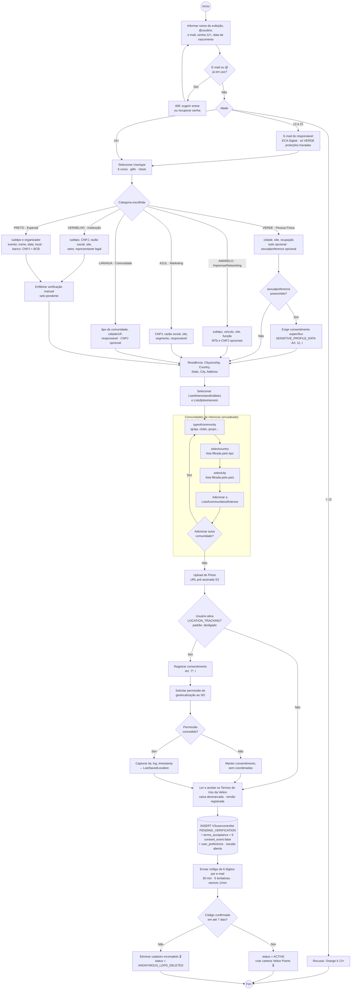

# Diagrama de Atividades — Cadastro por Tipo de Usuário

Cobre o RF1/RF2 (cadastro e perfil; campos por tipo em `PESQUISA_DADOS_USUARIO.md` §3 e regras em
`RegistrationService`/`UserTypeDetailsValidator`), a cadeia de seleção de comunidades de interesse
(`typeofcommunity → selectcountry → selectcity`) e a captura opcional de GPS
(`LastSavedLocation`) sob consentimento (LGPD Art. 7º, I).

## Regras aplicadas no fluxo

| Regra | Origem |
|---|---|
| Nenhum toggle de consentimento vem ligado; reconhecimento facial e localização começam desligados | Privacy by Default (Art. 46 §2º) |
| `sexualpreference` só é gravado com consentimento específico e destacado | Art. 11, I |
| Listas de país e cidade são filtradas pelo item anterior (`typeofcommunity → selectcountry → selectcity`) | Requisito de UX |
| Contas `VERMELHO` e `PRETO` entram com verificação manual antes de ganhar selo | Alert Feed só aceita fontes verificadas |
| Cadastro não confirmado em 7 dias é eliminado (⏳ job de limpeza) | Princípio da necessidade (Art. 6º, III) |

Passos marcados com ⏳ ainda não estão no código; foto por URL pré-assinada (OS-18), comunidades encadeadas
(OS-15) e GPS dependem de telas e endpoints que virão.

## Outros diagramas de atividades

| Fluxo | Onde |
|---|---|
| Regras por tipo de usuário no cadastro | [RF1](rf/RF01-cadastro-usuario.md#atividades--regras-por-tipo-de-usuário) |
| O que muda com cada campo do perfil | [RF2](rf/RF02-editar-perfil.md#atividades--o-que-muda-junto-com-cada-campo-do-perfil) |
| Paginação por cursor do feed do autor | [RF25](rf/RF25-perfil-publico-autor.md#paginação-por-cursor) |
| Regras de visibilidade do post | [RF24](rf/RF24-visualizar-post.md#regras-de-visibilidade) |
