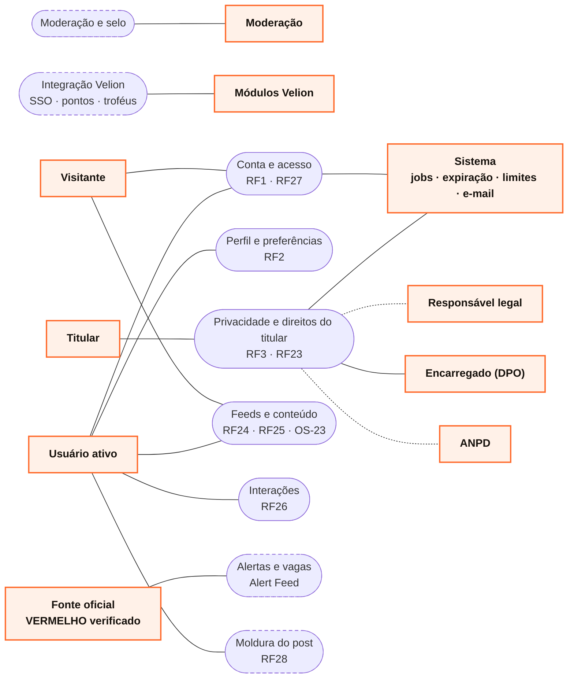
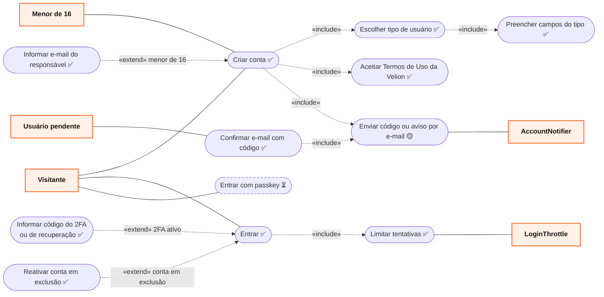
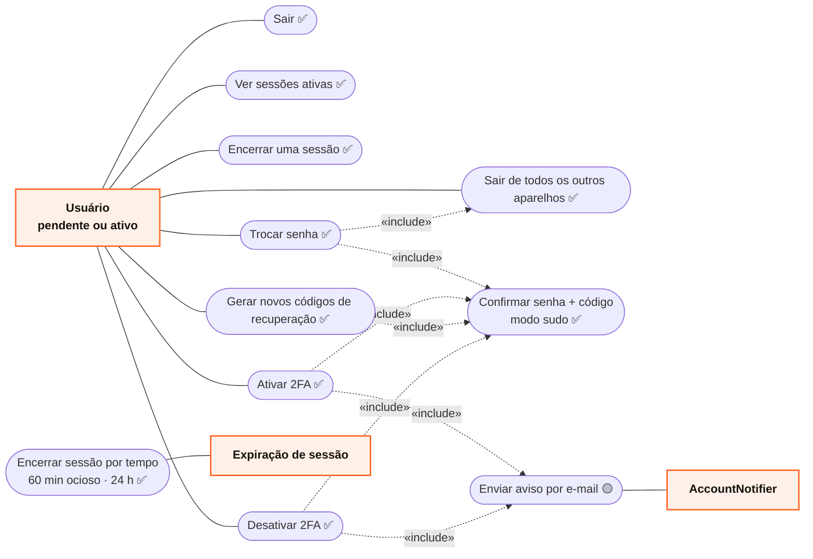
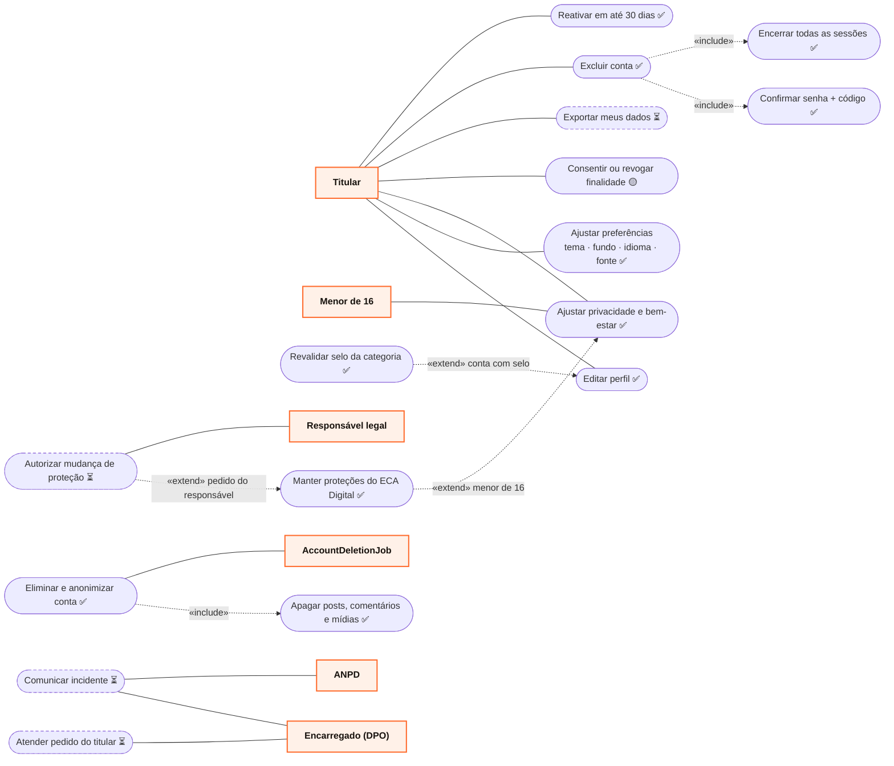
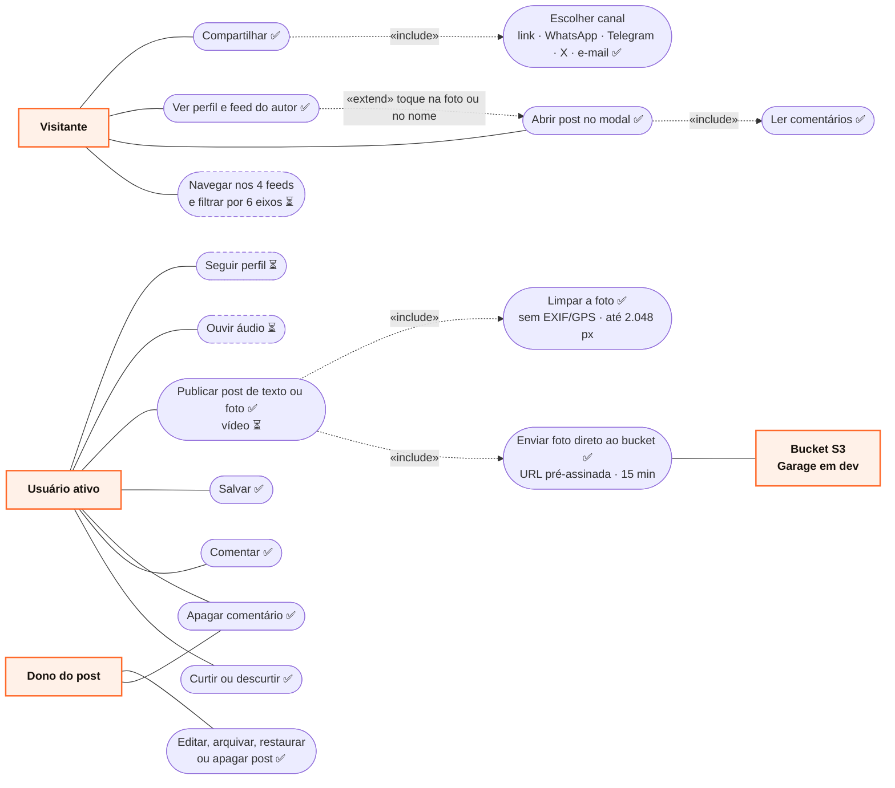
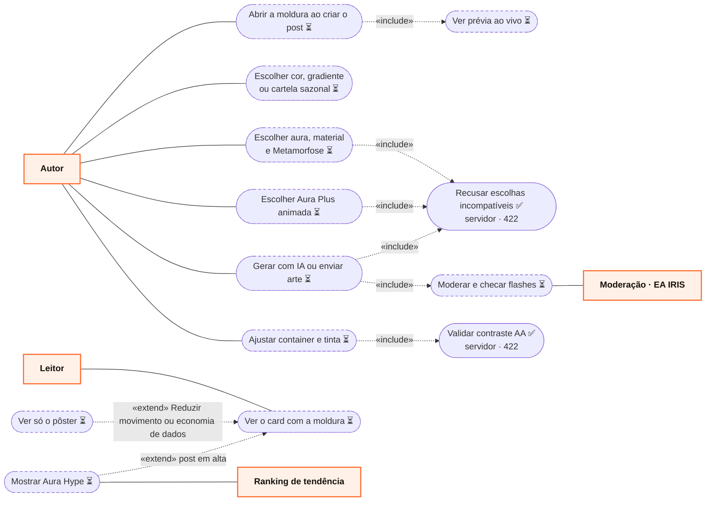
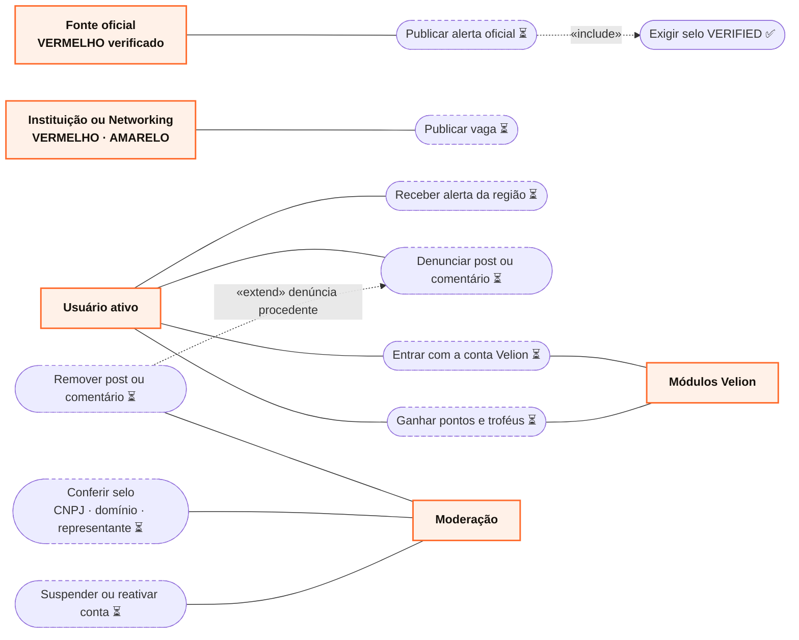

# Diagrama de Casos de Uso — Orange Social

Visão do sistema pelos **atores** ([taxonomia, §1](TAXONOMIA_ATORES_E_CARDS.md#1-atores)) e pelo que cada um
consegue fazer. Cada RF tem o seu caso de uso detalhado em `docs/rf/`; aqui ficam o mapa geral e as relações
entre os casos.

**Como ler.** Mermaid não tem notação UML de caso de uso, então a convenção é:

| Elemento UML | Aqui |
|---|---|
| Ator | retângulo laranja com o nome em negrito; **principais à esquerda**, de apoio e de sistema à direita |
| Caso de uso | cápsula (oval) |
| Fronteira do sistema | implícita: toda cápsula está dentro do Orange Social; atores ficam fora, nas laterais (a moldura foi omitida porque o Mermaid desorganiza o layout quando há ligações cruzando um `subgraph`) |
| Associação ator–caso | linha contínua |
| `«include»` (sempre acontece junto) | seta tracejada com `«include»` |
| `«extend»` (só em certa condição) | seta tracejada com `«extend»` e a condição |
| Generalização entre atores | ver [diagrama de classes de atores](TAXONOMIA_ATORES_E_CARDS.md#11-hierarquia-de-atores) |
| Situação | cápsula contínua = implementado ✅ · tracejada = planejado ⏳ |

---

## 1. Visão geral (pacotes)

---

## 2. Conta e acesso (RF1 · RF27)

### 2.1 Cadastro e entrada

### 2.2 Sessões, senha e 2FA

---

## 3. Perfil, preferências e direitos do titular (RF2 · RF3 · RF23)

---

## 4. Feeds, conteúdo e interações (RF24 · RF25 · RF26)

Usuário ativo também faz tudo o que o Visitante faz (generalização). Visitante que toca em Curtir, Comentar
ou Salvar recebe `401` e é levado ao login; conta pendente recebe `403` ("confirme seu e-mail").

### 4.1 Moldura do post — Background Studio (RF28)

Telas ainda planejadas no app. A API ([RF28](rf/RF28-moldura-post.md) e [RF29](rf/RF29-publicar-post.md)) já valida e guarda a
moldura, e o fluxo inteiro roda no protótipo (telas 22–28) e no teste `design/prototype/studio-smoke.mjs`.

---

## 5. Alertas, vagas e moderação

A regra "só VERMELHO verificado publica alerta" já está no domínio (`UserCategoryEnum.canPublishOfficialAlerts`);
o fluxo de publicação ainda não.

---

## 6. Especificação resumida

| Caso de uso | Atores | RF | Endpoint / componente | Situação |
|---|---|---|---|---|
| Criar conta (tipo, campos, Termos) | Visitante, Menor de 16 | [RF1](rf/RF01-cadastro-usuario.md) | `POST /api/v1/auth/register` | ✅ |
| Confirmar e-mail | Usuário pendente | RF1 | `POST /api/v1/me/verify-email` (+ `/resend`) | ✅ |
| Entrar · 2FA · reativar | Visitante | [RF27](rf/RF27-autenticacao-sessao.md) | `POST /api/v1/auth/login`, `/login/2fa`, `/reactivate` | ✅ |
| Limitar tentativas | LoginThrottle | RF27 | `LoginThrottle` (Valkey) | ✅ |
| Sair | Usuário | RF27 | `POST /api/v1/auth/logout` + `BroadcastChannel` | ✅ |
| Ver e encerrar sessões | Usuário | RF27 | `GET/DELETE /api/v1/me/sessions[/{id}]` | ✅ |
| Ativar, regenerar e desativar 2FA | Usuário | RF27 | `/api/v1/me/mfa/*` | ✅ |
| Trocar senha | Usuário | RF27 | `POST /api/v1/me/password` | ✅ |
| Encerrar sessão por tempo | Expiração de sessão | RF27 | Spring Session TTL + `AbsoluteSessionTimeoutFilter` | ✅ |
| Editar perfil | Titular | [RF2](rf/RF02-editar-perfil.md) | `PATCH /api/v1/me/profile` | ✅ |
| Ajustar preferências e privacidade | Titular, Menor de 16 | RF2 | `PATCH /api/v1/me/preferences` | ✅ |
| Consentir ou revogar | Titular | [RF3](rf/RF03-consentimento-privacidade.md) | `consent_event` | 🟡 registro no cadastro; tela de troca ⏳ |
| Excluir conta · reativar | Titular | [RF23](rf/RF23-direitos-titular-lgpd.md) | `POST /api/v1/me/deletion`, `POST /api/v1/auth/reactivate` | ✅ |
| Eliminar e anonimizar | AccountDeletionJob | RF23 | `AccountService.eliminate` + `PostContentEraser` | ✅ |
| Exportar dados | Titular | RF23 | — | ⏳ OS-43 |
| Abrir post no modal | Visitante, Usuário | [RF24](rf/RF24-visualizar-post.md) | `GET /api/v1/posts/{id}` | ✅ |
| Ver perfil e feed do autor | Visitante, Usuário | [RF25](rf/RF25-perfil-publico-autor.md) | `GET /api/v1/users/{id}/profile`, `/posts` | ✅ |
| Curtir, comentar, apagar, compartilhar, salvar | Usuário ativo, Dono do post | [RF26](rf/RF26-interacoes-post.md) | `PUT/DELETE …/like` e `…/save`, `GET/POST …/comments`, `DELETE …/comments/{id}`, `POST …/shares` | ✅ |
| Publicar, editar, arquivar, restaurar e apagar post | Usuário ativo (instituição e banco com selo) | [RF29](rf/RF29-publicar-post.md) | `POST /api/v1/media/uploads`, `POST /api/v1/posts`, `PATCH`/`DELETE /api/v1/posts/{id}`, `…/archive`, `…/restore` | ✅ texto e foto · ⏳ vídeo e áudio |
| Moldura do post (Background Studio, Aura Plus) | Autor, Leitor, Moderação | [RF28](rf/RF28-moldura-post.md) | `GET /api/v1/backgrounds/catalog`, `/recommendations`, `background` no post | ✅ API e validação · protótipo ✅ · ⏳ arte própria e app |
| Navegar nos feeds com filtros | Visitante, Usuário | — | `FeedController` | ⏳ |
| Publicar alerta · vaga | Fonte oficial · Instituição | — | Alert Feed | ⏳ |
| Moderação (selo, remoção, suspensão) | Moderação | — | papel e painel de moderação | ⏳ |
| SSO e pontos Velion | Módulos Velion | — | Keycloak (OS-13), `VelionPointsService` | ⏳ |

Os diagramas de **sequência**, **estados** e **atividades** de cada caso implementado estão no documento do RF;
os transversais em [DIAGRAMA_SEQUENCIA.md](DIAGRAMA_SEQUENCIA.md), [MAQUINA_ESTADOS.md](MAQUINA_ESTADOS.md) e
[DIAGRAMA_ATIVIDADES.md](DIAGRAMA_ATIVIDADES.md).
