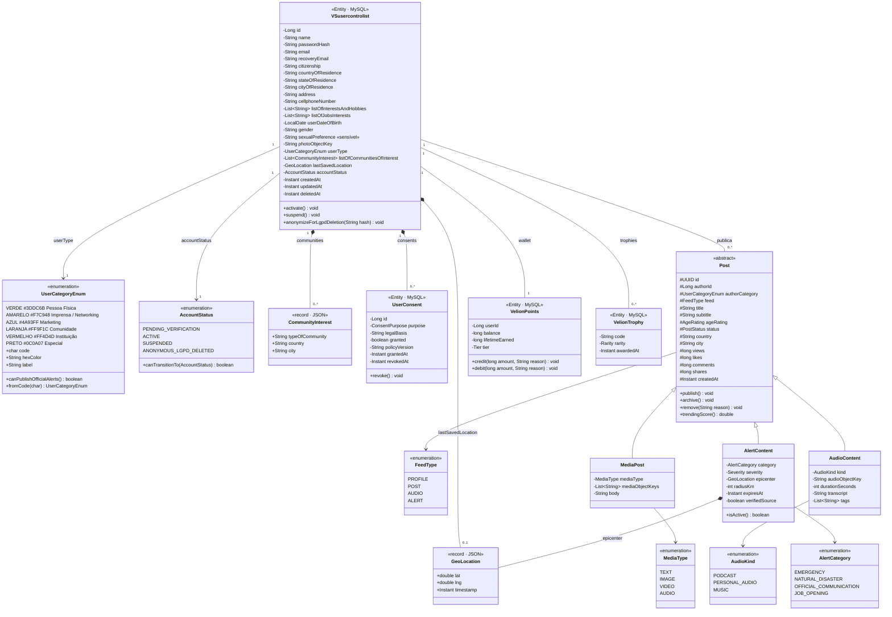

# Diagrama de Classes — Orange Social

Modelo de domínio central. `VSusercontrolist` é a tabela MySQL; a entidade Java correspondente é
`com.orangesocial.domain.model.UserControlList`. Os campos marcados como `«sensível»` são dados
pessoais sensíveis (LGPD Art. 5º, II) e só são tratados com consentimento específico (Art. 11).

## Onde cada classe é persistida

| Classe | Armazenamento | Observação |
|---|---|---|
| `VSusercontrolist`, `UserConsent`, `VelionPoints`, `VelionTrophy` | MySQL 8.0 | Fonte da verdade, transações ACID |
| `Post` (+ subclasses) — metadados | MySQL 8.0 | Registro canônico do post |
| `Post` — projeção de timeline | Cassandra `post_timeline` | Fan-out on write por seguidor/feed |
| `Post.trendingScore()` | Redis ZSET `trending:{feed}[:{categoria}]` | Ranking em tempo real |
| Mídias (`photoObjectKey`, `mediaObjectKeys`, `audioObjectKey`) | AWS S3 / MinIO | O banco guarda apenas a chave do objeto |

## Regras de domínio relevantes

- **Alert Feed:** somente `UserCategoryEnum.VERMELHO` verificado (`canPublishOfficialAlerts()`)
  ou conteúdo curado pela moderação publica `AlertContent` com `category ≠ JOB_OPENING`.
  Vagas (`JOB_OPENING`) podem ser publicadas por qualquer conta `VERMELHO` ou `AMARELO`.
- **Cor do autor desnormalizada:** `Post.authorCategory` é copiada no momento da publicação para
  permitir filtro por categoria na timeline sem join.
- **`ANONYMOUS_LGPD_DELETED` é terminal:** nenhum método de domínio aceita transição a partir dele.
