# Diagrama de Componentes — Orange Social

Arquitetura em camadas Spring Boot 4.1 / Java 21+ com persistência poliglota. Já implementados também:
`SecurityConfig`, `SessionService`, `LoginThrottle`, `AuthController`, `MeController`, `AuthService`,
`RegistrationService`, `MfaService`, `AccountService`, `PreferencesService`, `ProfileService` (RF1, RF2, RF23, RF27).
Componentes já implementados antes:
`PostController`, `UserProfileController`, `PostQueryService`, `PostInteractionService`, `PostContentEraser`,
`PostRepository`, `PostCommentRepository`, `UserControlListRepository`, `PostTimelineRepository`,
`TrendingScoreRepository` (RF24–RF26, RF23); os demais são o desenho alvo.

```mermaid
flowchart TB
    subgraph Clients["Clientes"]
        WEB["Web App<br/>(TopBar · Segmented Switcher)"]
        MOBILE["Mobile App"]
        VELION["Módulos Velion<br/>FriendlyEats · Sports · Points · Trophies · Post"]
    end

    subgraph App["Orange Social · Spring Boot"]
        direction TB

        subgraph Security["Camada de Segurança & LGPD (RF27)"]
            JWT["SessionRepositoryFilter + SecurityConfig<br/>(sessão opaca no Valkey · CSRF SPA ·<br/>AbsoluteSessionTimeoutFilter)"]
            RATE["LoginThrottle<br/>(conta e IP · Valkey)"]
            CONSENT["ConsentGuard<br/>(Art. 7º I / Art. 11)"]
            AUDIT["LgpdAuditInterceptor<br/>(Art. 37 – registro de operações)"]
        end

        subgraph Controllers["Controllers (REST /api/v1)"]
            AUTHC["AuthController<br/>(cadastro · login · 2FA · reativar · sair)"]
            USERC["MeController<br/>(perfil · preferências · sessões · 2FA · excluir)"]
            FEEDC["FeedController<br/>(profile · post · audio · alert)"]
            POSTC["PostController<br/>(detalhe · curtir · comentar · compartilhar · salvar)"]
            PROFC["UserProfileController<br/>(perfil público · feed do autor)"]
            VIEWER["ViewerResolver<br/>(identidade · Keycloak no OS-13)"]
            MEDIAC["MediaController<br/>(URLs pré-assinadas)"]
            PRIVC["PrivacyController<br/>(exportar · excluir · consentimentos)"]
            VELC["VelionIntegrationController"]
        end

        subgraph Services["Services (regras de negócio)"]
            AUTHS["AuthService · MfaService · StepUp"]
            USERS["RegistrationService · ProfileService ·<br/>PreferencesService · AccountService"]
            FEEDS["FeedService<br/>(filtro 6 eixos)"]
            POSTS["PostPublishingService"]
            POSTQ["PostQueryService<br/>(RF24 · RF25)"]
            POSTI["PostInteractionService<br/>(RF26 · contadores atômicos)"]
            ERASER["PostContentEraser<br/>(RF23 · passo da saga)"]
            TRENDS["TrendingService"]
            MEDIAS["MediaStorageService"]
            LGPDS["LgpdService<br/>(portabilidade · eliminação)"]
            POINTS["VelionPointsService"]
            EVENTS["DomainEventPublisher"]
        end

        subgraph Repositories["Repositories"]
            USERR["UserControlListRepository<br/>(JPA)"]
            CONSR["ConsentEventRepository<br/>(JPA)"]
            POSTR["PostRepository<br/>(JPA · reações · compartilhamentos)"]
            COMR["PostCommentRepository<br/>(JPA)"]
            TIMER["PostTimelineRepository<br/>(Spring Data Cassandra)"]
            TRENDR["TrendingScoreRepository<br/>(StringRedisTemplate · ZSET)"]
            SESSR["SessionRepository<br/>(Valkey)"]
            S3A["S3StorageAdapter<br/>(AWS SDK v2)"]
        end
    end

    subgraph Data["Persistência Poliglota"]
        MYSQL[("PostgreSQL 17 + PostGIS<br/>VSusercontrolist · consent_event<br/>post · post_reaction · post_comment<br/>post_share · velion_points")]
        REDIS[("Valkey<br/>trending:{feed}:{cor}<br/>session:{jwtId}")]
        CASS[("Cassandra<br/>post_timeline · activity_log<br/>notification")]
        S3[("AWS S3<br/>fotos · vídeos · áudios")]
    end

    WEB & MOBILE & VELION -->|HTTPS + cookie de sessão + X-XSRF-TOKEN| JWT
    JWT --> RATE --> CONSENT --> AUDIT
    AUDIT --> AUTHC & USERC & FEEDC & POSTC & PROFC & MEDIAC & PRIVC & VELC
    POSTC & PROFC --> VIEWER

    AUTHC --> AUTHS
    USERC --> USERS
    FEEDC --> FEEDS
    POSTC --> POSTS & POSTQ & POSTI
    PROFC --> POSTQ
    POSTQ --> POSTR & USERR
    POSTI --> POSTR & COMR & USERR
    MEDIAC --> MEDIAS
    PRIVC --> LGPDS
    VELC --> POINTS

    AUTHS --> USERR & SESSR
    USERS --> USERR & CONSR & MEDIAS
    FEEDS --> TIMER & TRENDR & USERR
    POSTS --> POSTR & TIMER & TRENDS & EVENTS
    TRENDS --> TRENDR
    MEDIAS --> S3A
    LGPDS --> ERASER & USERR & CONSR & TIMER & TRENDR & S3A & SESSR
    ERASER --> POSTR & COMR
    POINTS --> USERR
    EVENTS -.->|PostPublished| POINTS

    USERR & CONSR & POSTR & COMR --> MYSQL
    TRENDR & SESSR --> REDIS
    TIMER --> CASS
    S3A --> S3

    WEB -.->|upload direto<br/>via URL pré-assinada| S3
```

## Responsabilidades por camada

| Camada | Pacote | Responsabilidade |
|---|---|---|
| Segurança | `com.orangesocial.security` | Sessão opaca no Valkey, CSRF, tempo absoluto de sessão, limite de tentativas, TOTP e cifra de segredos (RF27); consentimento e auditoria a seguir |
| Controllers | `com.orangesocial.api` | DTOs de entrada/saída, validação Bean Validation, códigos HTTP |
| Services | `com.orangesocial.application` | Casos de uso, transações (`@Transactional` só no PostgreSQL), orquestração entre armazenamentos |
| Domínio | `com.orangesocial.domain.model` | Entidades, enums (`UserCategoryEnum`, `AccountStatus`, `FeedType`), regras de transição |
| Infraestrutura | `com.orangesocial.infrastructure.*` | Adaptadores PostgreSQL (`persistence.postgres`), Cassandra (`persistence.cassandra`), Valkey (`cache.redis`), S3 |

## Consistência entre armazenamentos

- **PostgreSQL é a fonte da verdade.** Cassandra e Valkey são projeções reconstruíveis a partir dele.
- A gravação no PostgreSQL acontece dentro da transação; Cassandra e Valkey são atualizados **após o commit**
  (`@TransactionalEventListener(phase = AFTER_COMMIT)`), com retentativa idempotente
  (o `post_id` é `timeuuid` gerado uma única vez).
- Mídia é enviada **antes** da publicação (URL pré-assinada); o post só referencia a chave do objeto.
- **Contadores de interação** (`like_count`, `comment_count`, `share_count`) vivem na linha do `post` e mudam
  na mesma transação da reação/comentário/compartilhamento, só quando a linha de associação realmente entrou
  ou saiu (`ON CONFLICT DO NOTHING`). O JPA nunca os grava (`insertable/updatable = false`).
