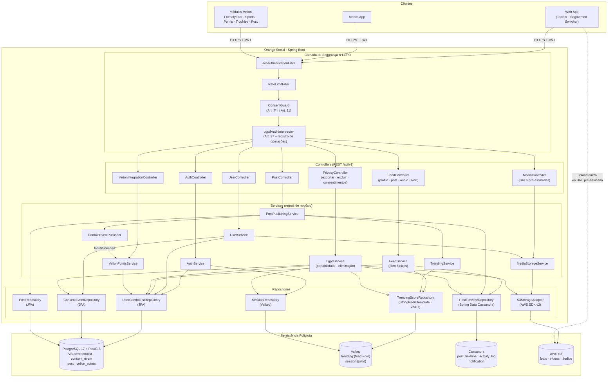

# Diagrama de Componentes — Orange Social

Arquitetura em camadas Spring Boot 3 / Java 21 com persistência poliglota.

## Responsabilidades por camada

| Camada | Pacote | Responsabilidade |
|---|---|---|
| Segurança | `com.orangesocial.security` | Validação JWT, rate limit, verificação de consentimento antes de tratar dados opcionais, trilha de auditoria |
| Controllers | `com.orangesocial.api` | DTOs de entrada/saída, validação Bean Validation, códigos HTTP |
| Services | `com.orangesocial.application` | Casos de uso, transações (`@Transactional` só no PostgreSQL), orquestração entre armazenamentos |
| Domínio | `com.orangesocial.domain.model` | Entidades, enums (`UserCategoryEnum`, `AccountStatus`, `FeedType`), regras de transição |
| Infraestrutura | `com.orangesocial.infrastructure.*` | Adaptadores PostgreSQL (`persistence.postgres`), Cassandra (`persistence.cassandra`), Valkey (`cache.redis`), S3 |

## Consistência entre armazenamentos

- **PostgreSQL é a fonte da verdade.** Cassandra e Valkey são projeções reconstruíveis a partir dele.
- A gravação no PostgreSQL acontece dentro da transação; Cassandra e Valkey são atualizados **após o commit**
  (`@TransactionalEventListener(phase = AFTER_COMMIT)`), com retentativa idempotente
  (o `post_id` é `timeuuid` gerado uma única vez).
- Mídia é enviada **antes** da publicação (URL pré-assinada); o post só referencia a chave do objeto.
