# Diagrama de Componentes — Orange Social

Arquitetura em camadas Spring Boot 4.1 / Java 21+ com persistência poliglota. Borda **contínua** = componente
que já existe no código; borda **tracejada** = desenho alvo (ainda não implementado). Quem usa cada
componente está no [diagrama de casos de uso](DIAGRAMA_CASOS_DE_USO.md).

```mermaid
flowchart TB
    subgraph Clients["Clientes"]
        WEB["Web App<br/>(TopBar · Segmented Switcher)"]:::planned
        MOBILE["Mobile App"]:::planned
        VELION["Módulos Velion<br/>FriendlyEats · Sports · Points · Trophies · Post"]:::planned
    end

    subgraph App["Orange Social · Spring Boot"]
        direction TB

        subgraph Security["Camada de Segurança & LGPD (RF27)"]
            SEC["SessionRepositoryFilter + SecurityConfig<br/>(sessão opaca no Valkey · CSRF SPA ·<br/>AbsoluteSessionTimeoutFilter)"]
            RATE["LoginThrottle<br/>(conta e IP · Valkey)"]
            CONSENT["ConsentGuard<br/>(Art. 7º I / Art. 11)"]:::planned
            AUDIT["LgpdAuditInterceptor<br/>(Art. 37 – registro de operações)"]:::planned
        end

        subgraph Controllers["Controllers (REST /api/v1)"]
            AUTHC["AuthController<br/>(cadastro · login · 2FA · reativar · sair)"]
            USERC["MeController<br/>(perfil · foto · preferências · sessões · 2FA · excluir)"]
            LEGALC["LegalController<br/>(Termos de Uso vigentes)"]
            POSTC["PostController<br/>(detalhe · curtir · comentar · compartilhar · salvar)"]
            PUBC["PostPublishingController<br/>(criar · editar · arquivar · restaurar · apagar)"]
            BGC["BackgroundController<br/>(catálogo público · recomendações)"]
            PROFC["UserProfileController<br/>(perfil público · feed do autor)"]
            VIEWER["ViewerResolver<br/>(OrangePrincipal da sessão)"]
            FEEDC["FeedController<br/>(profile · post · audio · alert)"]:::planned
            MEDIAC["MediaUploadController<br/>(URL pré-assinada da foto · RF29 · RF2)"]
            PRIVC["PrivacyController<br/>(exportar · consentimentos)"]:::planned
            VELC["VelionIntegrationController"]:::planned
        end

        subgraph Services["Services (regras de negócio)"]
            AUTHS["AuthService · MfaService · StepUp<br/>SessionService"]
            USERS["RegistrationService · ProfileService ·<br/>PreferencesService · AccountService ·<br/>EmailVerificationService"]
            LEGALS["LegalDocuments"]
            NOTIF["AccountNotifier<br/>(hoje LoggingAccountNotifier)"]
            JOB["AccountDeletionJob<br/>(diário 03:15)"]
            POSTQ["PostQueryService<br/>(RF24 · RF25)"]
            POSTI["PostInteractionService<br/>(RF26 · contadores atômicos)"]
            ERASER["PostContentEraser<br/>(RF23 · passo da saga)"]
            FEEDS["FeedService<br/>(filtro 6 eixos)"]:::planned
            POSTS["PostPublishingService<br/>(RF29 · publicar · editar · arquivar)"]
            BGS["BackgroundService · BackgroundCatalog ·<br/>BackgroundValidator · SeasonalCalendar<br/>(RF28 · moldura do post)"]
            TRENDS["TrendingService"]:::planned
            MEDIAS["MediaUploads · ImageSanitizer ·<br/>MediaJanitor<br/>(RF29 post · RF2 perfil · sem EXIF/GPS)"]
            LGPDS["LgpdService<br/>(portabilidade)"]:::planned
            POINTS["VelionPointsService"]:::planned
            EVENTS["DomainEventPublisher"]:::planned
        end

        subgraph Repositories["Repositories"]
            USERR["UserControlListRepository<br/>(JPA)"]
            ACCR["TermsAcceptance · UserMfa ·<br/>RecoveryCode · UserPreference<br/>Repositories (JPA)"]
            POSTR["PostRepository<br/>(JPA · reações · compartilhamentos)"]
            COMR["PostCommentRepository<br/>(JPA)"]
            TIMER["PostTimelineRepository<br/>(Spring Data Cassandra)"]
            TRENDR["TrendingScoreRepository<br/>(StringRedisTemplate · ZSET)"]
            SESSR["Spring Session<br/>(Valkey · indexado)"]
            CONSR["ConsentEventRepository<br/>(hoje JDBC no cadastro)"]:::planned
            S3A["S3MediaStorage<br/>(AWS SDK v2 · MediaStorage)"]
        end
    end

    subgraph Data["Persistência Poliglota"]
        PG[("PostgreSQL 17 + PostGIS<br/>VSusercontrolist · consent_event · terms_acceptance<br/>user_mfa · user_recovery_code · user_preference<br/>post · post_reaction · post_comment · post_share")]
        REDIS[("Valkey<br/>orange:session:* · auth:* (limites, códigos)<br/>trending:{feed}:{cor}")]
        CASS[("Cassandra<br/>post_timeline · activity_log<br/>notification")]
        S3[("S3 (Garage em dev)<br/>fotos · vídeos · áudios")]
    end

    WEB & MOBILE & VELION -->|HTTPS + cookie de sessão + X-XSRF-TOKEN| SEC
    SEC --> RATE --> CONSENT --> AUDIT
    AUDIT --> AUTHC & USERC & LEGALC & POSTC & PUBC & BGC & PROFC & FEEDC & MEDIAC & PRIVC & VELC
    POSTC & PROFC & USERC --> VIEWER

    AUTHC --> AUTHS & USERS
    USERC --> USERS & AUTHS
    LEGALC --> LEGALS
    FEEDC --> FEEDS
    POSTC --> POSTQ & POSTI
    PUBC --> POSTS
    BGC --> BGS
    PROFC --> POSTQ
    POSTQ --> POSTR & USERR & BGS
    POSTI --> POSTR & COMR & USERR
    MEDIAC --> MEDIAS
    PRIVC --> LGPDS
    VELC --> POINTS
    JOB --> USERS

    AUTHS --> USERR & ACCR & SESSR & RATE & NOTIF
    USERS --> USERR & ACCR & CONSR & SESSR & NOTIF & ERASER & MEDIAS
    FEEDS --> TIMER & TRENDR & USERR
    POSTS --> POSTR & USERR & BGS & POSTQ & MEDIAS
    POSTS -.->|alvo: ranking e timeline| TIMER & TRENDS & EVENTS
    TRENDS --> TRENDR
    MEDIAS --> S3A
    LGPDS --> USERR & CONSR & TIMER & S3A
    ERASER --> POSTR & COMR
    POINTS --> USERR
    EVENTS -.->|PostPublished| POINTS

    USERR & ACCR & CONSR & POSTR & COMR --> PG
    TRENDR & SESSR & RATE --> REDIS
    TIMER --> CASS
    S3A --> S3

    WEB -.->|upload direto<br/>via URL pré-assinada| S3

    classDef planned stroke-dasharray:6 4
```

## Responsabilidades por camada

| Camada | Pacote | Responsabilidade |
|---|---|---|
| Segurança | `com.orangesocial.security` | Sessão opaca no Valkey, CSRF, tempo absoluto de sessão, limite de tentativas, TOTP e cifra de segredos (RF27); consentimento e auditoria a seguir |
| Controllers | `com.orangesocial.api` | DTOs de entrada/saída, validação Bean Validation, códigos HTTP |
| Services | `com.orangesocial.application` | Casos de uso, transações (`@Transactional` só no PostgreSQL), orquestração entre armazenamentos |
| Domínio | `com.orangesocial.domain.model` | Entidades, enums (`UserCategoryEnum`, `AccountStatus`, `FeedType`), regras de transição |
| Infraestrutura | `com.orangesocial.infrastructure.*` | Adaptadores PostgreSQL (`persistence.postgres`), Cassandra (`persistence.cassandra`), Valkey (`cache.redis`), S3 (`storage`) |

## Consistência entre armazenamentos

- **PostgreSQL é a fonte da verdade.** Cassandra e Valkey são projeções reconstruíveis a partir dele.
- A gravação no PostgreSQL acontece dentro da transação; Cassandra e Valkey são atualizados **após o commit**
  (`@TransactionalEventListener(phase = AFTER_COMMIT)`), com retentativa idempotente
  (o `post.id` é um UUID v7 gerado uma única vez).
- Mídia é enviada **antes** da publicação (URL pré-assinada, direto ao bucket); o post só referencia a chave do objeto.
  Ao publicar, a API limpa a foto (sem EXIF/GPS) e grava a versão pública; o original sai **depois do commit** e a
  versão limpa sai se a transação voltar atrás (`MediaJanitor`). Apagar o post ou eliminar a conta (RF23) apaga a
  foto do bucket da mesma forma.
- **Contadores de interação** (`like_count`, `comment_count`, `share_count`) vivem na linha do `post` e mudam
  na mesma transação da reação/comentário/compartilhamento, só quando a linha de associação realmente entrou
  ou saiu (`ON CONFLICT DO NOTHING`). O JPA nunca os grava (`insertable/updatable = false`).
