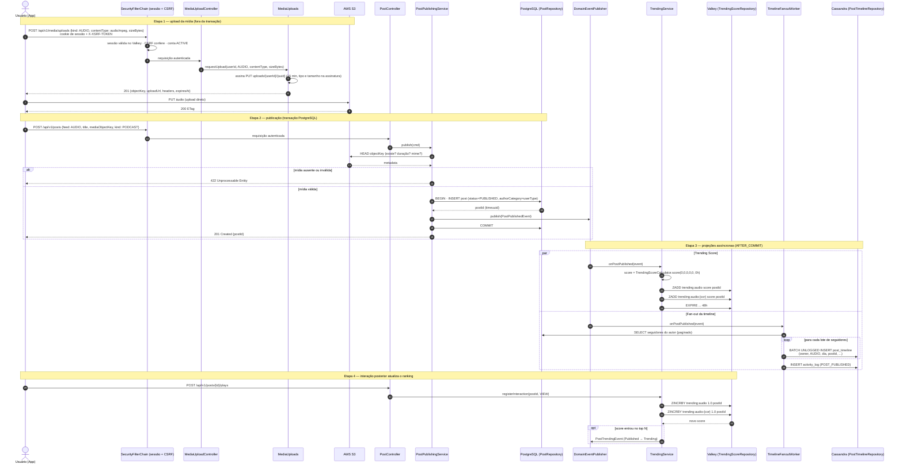

# Diagramas de Sequência — Orange Social

## Sequências implementadas (por RF)

| Fluxo | Onde |
|---|---|
| Cadastro com tipo de usuário e Termos | [RF1 · Sequência](rf/RF01-cadastro-usuario.md#sequência) |
| Editar preferências (fundo do app) | [RF2](rf/RF02-editar-perfil.md#sequência--editar-preferências-fundo-do-app) |
| Revogar localização | [RF3](rf/RF03-consentimento-privacidade.md#sequência--revogar-localização) |
| Excluir conta, reativar e eliminar após 30 dias | [RF23](rf/RF23-direitos-titular-lgpd.md#excluir-conta--modal-carência-de-30-dias-e-reativação) |
| Abrir post no modal | [RF24](rf/RF24-visualizar-post.md#sequência) |
| Perfil e feed do autor | [RF25](rf/RF25-perfil-publico-autor.md#sequência) |
| Curtir · comentar · compartilhar | [RF26](rf/RF26-interacoes-post.md#sequência--curtir-idempotente) |
| Login com 2FA · ativar 2FA | [RF27](rf/RF27-autenticacao-sessao.md#sequência--login-com-2fa) |
| Publicar post de texto com moldura | [RF29](rf/RF29-publicar-post.md#sequência--publicar) · [RF28](rf/RF28-moldura-post.md#sequência--publicar-com-moldura-e-ver-no-feed) |
| Publicar post com foto (URL pré-assinada, foto sem EXIF/GPS) | [RF29 · Sequência com foto](rf/RF29-publicar-post.md#sequência--publicar-com-foto) |
| Trocar a foto de perfil (quadrado de 512 px, a antiga sai do bucket) | [RF2 · Sequência](rf/RF02-editar-perfil.md#sequência--trocar-a-foto-de-perfil) |

## Publicação no Audio Feed (desenho alvo · ⏳ OS-23)

Ainda não implementado: áudio, `TrendingService` e o fan-out são o desenho alvo. O `PostPublishingService` e o envio
pré-assinado (`MediaUploadController` · `MediaUploads`) já existem para texto, foto do post e foto de perfil ([RF29](rf/RF29-publicar-post.md));
o áudio vai reaproveitar o mesmo envio. A autenticação já segue o que existe (RF27): sessão opaca no Valkey e `X-XSRF-TOKEN` em toda escrita —
nunca JWT no app.

Fluxo completo: upload do áudio para o S3, persistência canônica no PostgreSQL, atualização do
*Trending Score* no Valkey (ZSET) e fan-out da timeline no Cassandra.

## Pontos de decisão

| Passo | Decisão | Motivo |
|---|---|---|
| 1–9 | Upload direto ao S3 com URL pré-assinada | Áudios/podcasts são grandes; não passam pela JVM |
| 13 | `HEAD` no S3 antes do INSERT | Garante que o post nunca aponte para mídia inexistente |
| 15 | `authorCategory` copiada para o post | Permite filtro por cor sem join na leitura |
| 19+ | Valkey e Cassandra após o COMMIT | PostgreSQL é a fonte da verdade; projeções são idempotentes e reconstruíveis |
| 25 | `BATCH UNLOGGED` por partição | Fan-out barato; cada linha é independente |
| 28 | `ZINCRBY` incremental | O ranking reage em tempo real sem recalcular o score inteiro; um job periódico recalcula o *freshness* |
