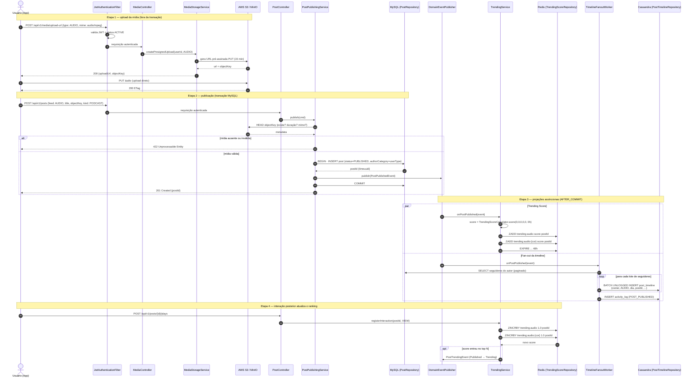

# Diagrama de Sequência — Publicação no Audio Feed

Fluxo completo: upload do áudio para o S3, persistência canônica no MySQL, atualização do
*Trending Score* no Redis (ZSET) e fan-out da timeline no Cassandra.

## Pontos de decisão

| Passo | Decisão | Motivo |
|---|---|---|
| 1–9 | Upload direto ao S3 com URL pré-assinada | Áudios/podcasts são grandes; não passam pela JVM |
| 13 | `HEAD` no S3 antes do INSERT | Garante que o post nunca aponte para mídia inexistente |
| 15 | `authorCategory` copiada para o post | Permite filtro por cor sem join na leitura |
| 19+ | Redis e Cassandra após o COMMIT | MySQL é a fonte da verdade; projeções são idempotentes e reconstruíveis |
| 25 | `BATCH UNLOGGED` por partição | Fan-out barato; cada linha é independente |
| 28 | `ZINCRBY` incremental | O ranking reage em tempo real sem recalcular o score inteiro; um job periódico recalcula o *freshness* |
