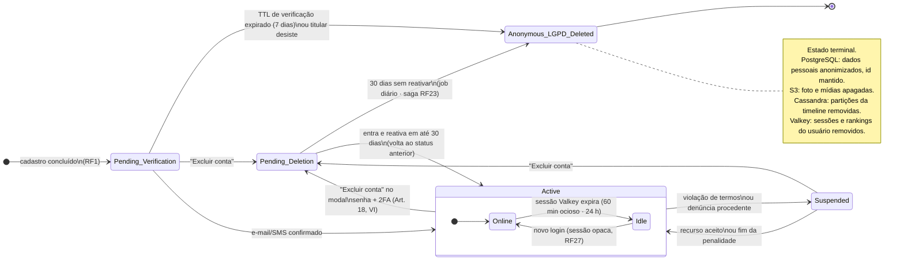
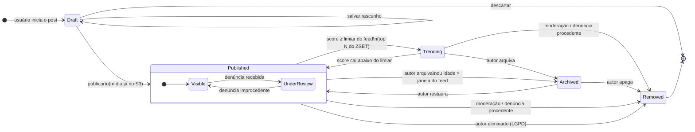
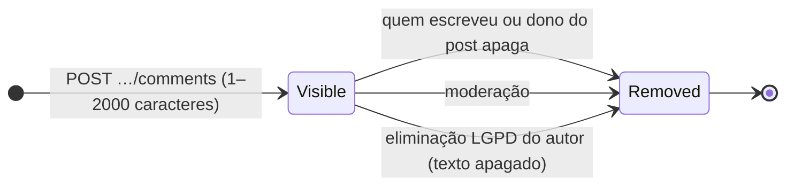

# Máquinas de Estados — Orange Social

## 1. Ciclo de vida do Usuário (`AccountStatus`)

Implementado em `com.orangesocial.domain.model.AccountStatus#allowedTransitions()`.

| Transição | Disparador | Efeitos colaterais |
|---|---|---|
| `[*] → Pending_Verification` | `POST /api/v1/users` | Grava `VSusercontrolist`, cria consentimentos com `granted=false` (Privacy by Default), envia código |
| `Pending_Verification → Active` | Código de e-mail validado (`POST /api/v1/me/verify-email`) | Grava `email_verified_at`; a sessão aberta no cadastro passa a poder interagir |
| `Active → Suspended` | Moderação | Apaga as sessões do usuário no Valkey, oculta posts do ranking |
| `Suspended → Active` | Recurso aceito | Restaura posts no ranking |
| `* → Pending_Deletion` | Titular confirma no modal com senha (+2FA) | Guarda o status anterior, agenda para +30 dias, apaga **todas** as sessões; perfil e posts somem |
| `Pending_Deletion → (status anterior)` | Login no prazo + "Reativar" | Limpa as datas da exclusão |
| `Pending_Deletion → Anonymous_LGPD_Deleted` | `AccountDeletionJob` após 30 dias | `PostContentEraser`, apaga 2FA/preferências, anonimiza (sem @ e `type_details`) + log em `activity_log` |

---

## 2. Ciclo de vida da Postagem (`PostStatus`)

| Estado | Visível no feed | No Valkey ZSET | Na timeline Cassandra |
|---|---|---|---|
| `Draft` | Não | Não | Não |
| `Published` | Sim | Sim | Sim |
| `Trending` | Sim (destaque 🔥/📈) | Sim (top N) | Sim |
| `Archived` | Só no perfil do autor | Removido (`ZREM`) | Mantido até TTL |
| `Removed` | Não | Removido | Removido |

Implementação: `PostStatus` + `Post.publish/archive/remove` (`Trending` é derivado do ZSET, não persistido).
Detalhe e interações por estado ([RF24](rf/RF24-visualizar-post.md), [RF26](rf/RF26-interacoes-post.md)):

| Estado | Abre no modal | Curtir / comentar / compartilhar | Feed do autor ([RF25](rf/RF25-perfil-publico-autor.md)) |
|---|---|---|---|
| `Draft` | Só o autor | Não (409) | Não |
| `Published` | Todos | Sim | Sim |
| `Archived` | Todos | Não (409); descurtir continua permitido | Sim |
| `Removed` | Ninguém (404) | Não | Não |

## 2.1 Comentário (`CommentStatus`)

Remover apaga o texto (`body = NULL`), decrementa `post.comment_count` e mantém o id para auditoria.
