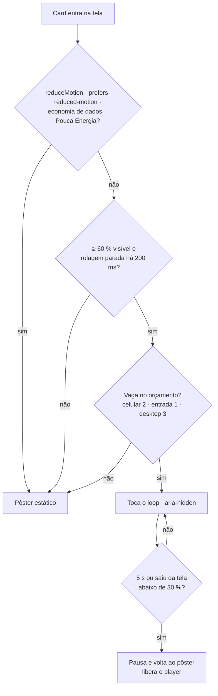
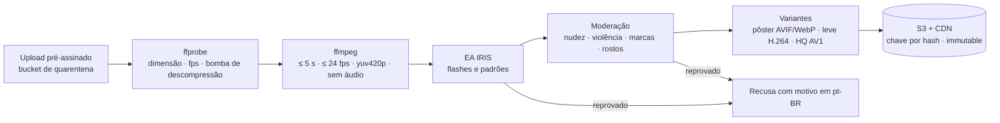

# Pesquisa — Background Studio (moldura dos cards) e Aura Plus

Estudo da proposta "Background Studio", adaptada do FashionAI, aplicada ao Orange Social. A arte de fundo decora a
**moldura** do card de post. Inclui uma variedade animada, tipo GIF, chamada **Aura Plus**.

- **Data:** 17/10/2026.
- **Método:** quatro agentes de pesquisa em paralelo — tendências visuais, formatos animados, licenças e receitas
  procedurais — mais a análise do código e dos documentos do Orange.
- **Ressalvas:** o que os agentes não confirmaram em fonte primária está marcado **[não confirmado]**. Os pontos
  jurídicos estão listados na §8 e **exigem parecer**.

Legenda: ✅ já existe no Orange · ⏳ a fazer.

> **Protótipo:** o estúdio já roda no protótipo — telas 22–28 em `design/prototype/screens/`, Aura Plus "Brasa" e
> "Aurora" em `design/brand/auras/` e o teste `design/prototype/studio-smoke.mjs`. O requisito está em
> [RF28](rf/RF28-moldura-post.md).

---

## 1. Conclusões que viram regra

1. **A moldura decora e nunca carrega informação.** Ficam no container, por cima da arte e sempre visíveis:
   - a categoria do autor (cor + glifo + rótulo);
   - a tendência ("Em alta");
   - o selo de publicidade.

   A arte não pode imitar as 6 cores de categoria nem o selo Hype.
2. **Catálogo inicial 100% procedural e próprio.** CSS/SVG no web e Skia no app, gerados por código da Velion.
   Materiais vêm de texturas **CC0** (ambientCG, Poly Haven) retrabalhadas. Ficam fora do catálogo:
   - Unsplash, Pexels e Pixabay: proíbem uso como "wallpaper" e em "serviço concorrente";
   - Freepik/Magnific, SVG Backgrounds, IconScout e Textures.com;
   - ShaderToy: não comercial por padrão.
3. **Aura Plus nunca é servida como GIF.** Toda arte animada vira **vídeo em loop sem alfa** (H.264 e, opcionalmente,
   AV1) mais **pôster estático** AVIF/WebP. Não precisa de alfa porque a arte fica atrás de um container opaco.
4. **Cada animação toca no máximo 5 s e volta ao pôster** (WCAG 2.2.2, técnica G152). Em cada momento, só 1–2 cards
   visíveis animam.
5. **O leitor manda sobre o autor.** Mostram só o pôster:
   - `reduceMotion` (✅ já existe em `user_preference`) ou `prefers-reduced-motion`;
   - economia de dados;
   - Modo de Pouca Energia do iOS.
6. **Flashes são barrados no upload.** Toda arte animada enviada passa pelo **EA IRIS** (BSD-3) antes de ser
   publicada (WCAG 2.3.1: no máximo 3 flashes/s).
7. **GIF de terceiros fica fora da moldura.**
   - A API do **Tenor foi desligada em 30/06/2026**.
   - A **GIPHY** proíbe guardar ou cachear mídia e exige "Powered by GIPHY". Isso é incompatível com uma moldura
     persistente.
8. **O JSON do post guarda só ids e chaves.**
   - Nada de URL externa: evita rastreamento de quem vê, hotlink e SSRF.
   - Nada de CSS livre: evita injeção. A proposta original aceitava `"gradient": "css"`.
9. **A Aura Hype é conquistada, não escolhida nem vendida.** Ela vem do ranking (✅ ZSET `trending`). O autor só
   escolhe o estilo; o efeito aparece quando o post entra em alta.
10. **Aura de marca é publicidade.** Leva o selo "Publicidade · Marca X" no container (CDC art. 36, guia CONAR 2026).
    Auras raras **não** são sorteadas: o ECA Digital proíbe loot box para menores.

---

## 2. A proposta dentro do Orange Social

### 2.1 O que já existe e se encaixa

| Proposta | O que o Orange já tem | Encaixe |
|---|---|---|
| Duas camadas: arte na moldura, container legível por cima | Card com borda da categoria, container `--surface`, regras de contraste do DESIGN_SYSTEM (§3) | ✅ Combina com "a cor nunca é o único sinal" e com o véu do fundo do app (RF2) |
| Mesmo estúdio para post, story, perfil e destaque | Anatomia comum de cards (TAXONOMIA §5.1, slots) | ✅ A moldura vira um **slot 0** comum a todos os cards de conteúdo |
| Animação leve; respeitar `prefers-reduced-motion` | Preferência `reduceMotion` já gravada em `user_preference` (RF2) | ✅ A preferência de **quem vê** sempre vence a escolha de **quem publica** |
| Catálogo público por endpoint | Leitura pública já liberada para `GET /api/v1/posts/**`, `/users/**`, `/legal/**` (RF27) | ✅ `GET /api/v1/backgrounds/catalog` entra na mesma regra pública, com cache/ETag |
| Salvar só a configuração JSON | `type_details` já é JSONB validado por lista de chaves (`UserTypeDetailsValidator`) | ✅ Mesmo padrão: `post.background JSONB` validado contra o catálogo |
| Aura Hype para posts em alta | Tendência já existe no card (ZSET `trending:{feed}`, ícone + texto) | ✅ O Hype é **derivado do ranking**, não escolhido pelo autor |
| Marcas parceiras | Selo "Publicidade" proposto no card de imagem (CDC art. 36) | ⚠️ Preset de marca paga exige o selo |

### 2.2 Conflitos e o que precisa mudar na proposta

| # | Conflito | Ajuste recomendado |
|---|---|---|
| 1 | **Fundo do app × moldura do post.** O Orange já tem "Fundo do app" (`appBackground`, escolha de quem **vê**). A proposta cria a arte do post (escolha de quem **publica**). | Nomes distintos na interface: **"Fundo do app"** (Configurações → Exibição) e **"Moldura do post"** (criação de post). No feed com fundo de app, a moldura fica por cima do véu. |
| 2 | **Borda da categoria.** Hoje o card tem um filete de 3 px na cor da categoria do autor. Uma moldura colorida pode competir com ele ou imitá-lo (ex.: moldura vermelha num autor VERDE). | A identidade da categoria sai da moldura e fica **no container**: filete interno de 3 px + bolinha (cor + glifo) + rótulo, sempre visíveis. A moldura nunca usa sozinha uma das 6 cores sólidas de categoria. |
| 3 | **Alerta oficial.** O Alert Feed precisa de sobriedade e reconhecimento imediato (faixa hazard, fonte verificada). | **Sem moldura** em `ALERT` (alertas e vagas): o card ignora `background`. |
| 4 | **Animação no feed.** Muitos cards animados ao mesmo tempo custam bateria e dados (celulares de entrada) e podem violar WCAG 2.2.2 (movimento > 5 s precisa de pausa). | Orçamento de animação por tela; animar só o card visível; loop ≤ 5 s ou com pausa; `reduceMotion` e economia de dados mostram o pôster estático (detalhes na §4). |
| 5 | **Flashes.** GIF ou animação com flashes pode provocar crises (WCAG 2.3.1). | Análise automática de flashes no upload; reprovação = só versão estática. |
| 6 | **Menores de 16.** Arte própria (upload/IA) e animações intensas aumentam o risco. | Para menor de 16: só presets do catálogo; sem upload, sem IA, sem Aura Plus de terceiros. |
| 7 | **URLs no JSON** (`aiArt.url`, `uploadUrl`). Aceitar URL externa abre rastreamento de quem vê o post, hotlink e SSRF. | Guardar **ids do catálogo** e **chaves de objeto no S3 do Orange**, nunca URL. A API monta a URL assinada/CDN na leitura. |
| 8 | **Contraste.** A proposta pede AA no container. | Validar **também no servidor**: tinta × container ≥ 4,5:1 (texto normal), mesmo cálculo do `scripts/wcag_contrast.py`; senão `422` com a sugestão de cor. |
| 9 | **Recomendação por tags.** Posts do Orange ainda não têm tags. | Recomendar por sinais que existem: categoria do autor, feed, tipo de mídia, data (sazonal) e, depois, tags/temas quando existirem. |
| 10 | **Arte gerada por IA e upload.** Direito autoral, marcas, pessoas reais e moderação. | Moderação antes de publicar, rótulo "arte gerada por IA", termos de uso atualizados (os Termos da Velion já têm marcadores `{{…}}`). |
| 11 | **Layouts que trocam a estrutura do card** (bento, revista, tela cheia). | Fase posterior: mexem no RF24/RF25 (modal e feed) e na anatomia. Começar só com a moldura. |

### 2.3 Onde a moldura entra na anatomia

```
┌ moldura (arte · 10–14 px) ───────────────────────────┐
│ ┌ container (cor do skin, contraste AA) ───────────┐ │
│ ▌ autor · bolinha + rótulo da categoria · meta     │ │
│ ▌ mídia                                            │ │
│ ▌ título · subtítulo                               │ │
│ ▌ ações · tendência                                │ │
│ └──────────────────────────────────────────────────┘ │
└───────────────────────────────────────────────────────┘
 ▌ = filete da categoria, agora dentro do container
```

### 2.4 Impacto no código e nos RFs

| Camada | Mudança | RF / card |
|---|---|---|
| Banco | `V4__post_background.sql`: `post.background JSONB` (nulo = moldura padrão) + tabela `background_asset` (uploads e artes de IA: chave S3, dono, status de moderação, resultado da checagem de flashes) | novo RF "Moldura do post" |
| Domínio | `PostBackground` (record) + `BackgroundCatalog` (ids válidos, versão) + regras de incompatibilidade (arte própria ⇄ preset) | idem |
| API | `GET /api/v1/backgrounds/catalog` (público, ETag), `GET /api/v1/backgrounds/recommendations?category=&feed=&media=`, `POST /api/v1/backgrounds/assets` (upload pré-assinado), `PATCH /api/v1/posts/{id}` com `background` | depende do OS-23 (publicar post) |
| Leitura | `PostCardView` e `PostDetailView` ganham `background` já resolvido (ids → tokens/URLs da CDN) | RF24, RF25 |
| Preferências | `reduceMotion` e uma nova `dataSaver` controlam o que o leitor vê | RF2 |
| Design system | Tokens `frame.*`, `aura.*`, `material.*`; slot 0 "Moldura" na anatomia | DESIGN_SYSTEM §5–6, TAXONOMIA §5 |
| Moderação | Fila de artes enviadas/geradas, checagem de flashes | moderação (planejado) |

---

## 3. Catálogo de estilos (tendências 2023–2026)

Hex de referência para o tema escuro `#17120D`; não são valores oficiais das plataformas.

| Aba do estúdio | Estilo | Técnica | Onde é visto |
|---|---|---|---|
| **Cor** | Cor lisa curada | sólido | TikTok text posts (2023), Instagram Notes coloridas (2025) |
| | Gradiente mesh / aurora | `radial-gradient` empilhados + `blur` | tendência de UI 2025 |
| | Cartela de tendência anual | tokens | Pinterest Palette 2026 |
| | Loop leve (3–8 s) | vídeo mudo | Spotify Canvas |
| **Aura** | Eco da mídia (cor tirada da foto) | amostragem de cor + blur | YouTube Ambient Mode |
| | Frutiger Aero, Y2K, mixtape analógica | gradientes + texturas | revival Gen Z; Spotify Wrapped 2025 |
| | Cenário com tinta própria (centro/borda/padrão/texto) | `radial-gradient` + padrão | Telegram Gifts (*backdrop*) |
| **Aura Hype** | Scanner / brilho que percorre a borda | `@property --angle` + `conic-gradient` com máscara | padrão comum de UI |
| | Efeito que toca uma vez ao abrir | WebP/APNG/Lottie | Discord Profile Effects |
| **Metamorfose** | Prisma | `conic-gradient` em oklch, matiz longo | derivado do holográfico |
| | Constelação | SVG com *seed* do post | Telegram (padrão de emoji no perfil) |
| | Fio Vivo | `stroke-dashoffset` em SVG | tutoriais web.dev e CodeTV |
| | Holografia | `color-dodge` + gradiente que segue o ponteiro ou o giroscópio | cartas Pokémon em CSS; "opalescent" no Pinterest 2026 |
| **Material** | Vidro (Liquid Glass) | `backdrop-filter` | Apple iOS 26 (com recuo por legibilidade) |
| | Grão / papel | SVG `feTurbulence` | Frontend Masters, CSS-Tricks |
| | Metal / cromo | `conic-gradient` + listras | AIGA (Y2K) |
| | Moldura colecionável | imagem 9-slice | Discord Profile Frames (2026) |
| **Layout** | Bento, polaroid, 4:5 / tela cheia, neobrutalismo, M3 Expressive | CSS Grid, `aspect-ratio`, tokens tonais | Instagram 4:5 (2025), BeReal, Material 3 Expressive |

O que as plataformas ensinam sobre **legibilidade**:

- **A Apple recuou na translucidez** do Liquid Glass e criou a opção "Tingido" no iOS 26.1. O material "vidro" do
  Orange precisa, por isso:
  - de uma variante opaca;
  - de respeitar `prefers-reduced-transparency` e `prefers-contrast`.
- **No Discord e no Telegram, o efeito fica fora do texto.** O tema já traz a cor do texto validada (`text_color`
  no cenário do Telegram). Cada preset de aura do Orange deve trazer a tinta do container já validada.
- **Grão acima de ~0,5 de opacidade vira estática.**
- **Paleta curada é melhor que cor livre**, como fazem o Instagram Notes e o TikTok.

---

## 4. Aura Plus — artes dinâmicas (tipo GIF)

### 4.1 Formatos

| Formato | Peso típico (loop 3–6 s, ~480 px) | Decodificação | Pausar | Veredito |
|---|---|---|---|---|
| GIF | 1–5 MB; 256 cores | CPU; todos os quadros na RAM (~69 MB por card, estimativa) | não no web | ❌ só como **entrada** de upload |
| WebP / APNG animado | 0,3–4 MB | CPU; quadros na RAM | não no web | ❌ no feed |
| AVIF animado | ~86 % menor que GIF | pesado; poucos fps no Android | sem API | ❌ |
| **MP4 H.264** em loop (`muted playsinline`) | **150–600 KB** | **hardware** | total | ✅ **primário** |
| WebM AV1 / VP9 | 100–400 KB | hardware quando existe | total | ✅ variante HQ (AV1) |
| Lottie / dotLottie, Rive | 5–200 KB | vetor a cada quadro | total | ✅ para auras **da Velion** (fase 2); não serve para upload |
| CSS / SVG / Skia procedural | < 10 KB | compositor (se animar `transform`/`opacity`) | total | ✅ **catálogo base** |

### 4.2 Orçamento

| Item | Limite |
|---|---|
| Pôster (AVIF/WebP) | ≤ 25 KB |
| Variante leve (H.264) | ≤ 150 KB · 15 fps · lado maior ≤ 480 px |
| Variante HQ (AV1, com H.264 de reserva) | ≤ 400 KB · 24 fps (máx. 30) · ≤ 720 px |
| Duração do loop | 2–5 s |
| Reprodução contínua | ≤ 5 s por entrada na tela; depois, pôster |
| Animações simultâneas no feed | celular ≤ 2 · celular de entrada 1 · desktop ≤ 3 |
| Upload na origem | ≤ 15 MB · ≤ 15 s · GIF, WebP, APNG, MP4 ou WebM |
| Flashes | ≤ 3/s; o IRIS reprova automaticamente |

### 4.3 Quando anima



- **Web:** `IntersectionObserver` com `preload="none"` e `poster`.
- **App:** `onViewableItemsChanged` da FlashList, mais um **pool** de players do `expo-video`. Manter um player ativo
  reduziu à metade o pico de memória num caso relatado.
- **iOS em Modo de Pouca Energia:** bloqueia `play()` (`NotAllowedError`). A falha é tratada como "fica no pôster".
- **Configurações → Exibição:** nova opção "Animações de fundo: Sempre / Só no Wi-Fi / Nunca". O padrão é **Só no
  Wi-Fi**.

### 4.4 Pipeline de upload



---

## 5. Fontes de arte e licenças

| Fonte | Licença | Pode entrar no catálogo do app? | Risco |
|---|---|---|---|
| **Arte procedural da Velion** | própria | ✅ sim | baixo |
| ambientCG · Poly Haven | CC0 | ✅ sim, inclusive redistribuir | baixo |
| uiGradients | MIT (manter o aviso) | ✅ sim | baixo |
| Hero Patterns | CC BY 4.0 | ✅ com tela de créditos | baixo/médio |
| LottieFiles (Lottie Simple License) | permissiva, arquivo a arquivo | ⚠️ curadoria; não "compilar serviço concorrente" | baixo/médio |
| Rive Community | CC BY 4.0 | ⚠️ créditos e checagem de autoria | médio |
| Haikei | sem licença clara do resultado | ❌ até haver autorização por escrito | médio |
| Unsplash · Pexels · Pixabay (fotos e vídeos) | licenças próprias | ❌ vetam wallpaper, uso standalone e serviço concorrente | **alto** |
| Freepik/Magnific · SVG Backgrounds · IconScout · Textures.com | licenças próprias | ❌ vetam redistribuição em ferramenta ou template | **alto** |
| ShaderToy (padrão) · LYGIA | CC BY-NC-SA · Prosperity | ❌ sem licença comercial explícita | **alto** |
| GIPHY | termos da API | ❌ proíbe cache e armazenamento; exige "Powered by GIPHY" | **alto** como moldura |
| Tenor | — | API desligada em 30/06/2026 | — |

**Proveniência obrigatória por item do catálogo:**

- `fonte`, `licença`, `url_origem`, `autor`, `exige_atribuição` e `data_verificação`;
- tela **"Créditos e licenças"** no app para os itens CC BY e MIT;
- revalidação a cada release, porque termos mudam (o Freepik virou Magnific).

### 5.1 Regras por tipo de arte

| Tipo | Regras |
|---|---|
| **Arte própria enviada** | Declaração de titularidade nos Termos. Licença à Velion só para exibir a arte. Moderação **antes** de publicar. Hash perceptual para barrar reenvio de conteúdo já removido (a tese do STF de 2025 sobre o art. 19 do Marco Civil exige remover cópias idênticas). Canal de notificação de direito autoral. |
| **Arte por IA** | Contrato enterprise com o provedor, com direito comercial e sublicença ao usuário. Filtro contra marcas, personagens e rostos de pessoas reais. Metadado `origem=IA` e selo **"Gerada por IA"**. Preservar C2PA quando houver. Rótulo obrigatório em propaganda eleitoral (Res. TSE 23.610, atualizada em 2026). O PL 2338/2023 segue na Câmara, **sem vigência**. |
| **Menor de 16** | Só presets do catálogo: sem upload, sem IA e sem Aura Plus enviada por terceiros. |
| **Marca parceira** | Selo "Publicidade · Marca X" fixo no container. Contrato de licença de marca. Revisão prévia, porque conteúdo pago tem responsabilidade **presumida** pela tese do STF. |

---

## 6. Receitas procedurais (catálogo base)

Cada aura é uma **especificação em JSON** (`{tipo, paleta[], seed, velocidade, material}`). Ela vira CSS/SVG no web e
Skia no app. A `seed` é o id do post, o que deixa Constelação e Confete determinísticos.

| Efeito | Técnica | Custo | Versão estática |
|---|---|---|---|
| Aurora / mesh | 3 `radial-gradient` + `blur`; move só com `transform` | compositor | congela o 1º quadro |
| Metal escovado | `repeating-linear-gradient` + `conic-gradient` | pinta uma vez | já é estático |
| Holografia | listras + `conic-gradient` com `mix-blend-mode: color-dodge`, seguindo `--mx`/`--my` | repinta ao mover; blend caro no celular [não confirmado] | `--mx: 30%` fixo |
| Grão / papel | SVG `feTurbulence` (papel: `baseFrequency=".03 .9"` + `feDiffuseLighting`) | **caro** se recalcular → pré-renderizar em WebP no build | já é estático |
| Cetim | faixa `soft-light` que desliza no hover/foco | barato | sem transição |
| Vidro | `backdrop-filter: blur(12px) saturate(140%)` | **o mais caro**; trava ao rolar no Firefox Android | só no PostView; no feed, "vidro falso" semiopaco |
| Prisma | `conic-gradient(in oklch longer hue)` + facetas com `clip-path` | estático | — |
| Constelação | gerador LCG com a seed do post → SVG em data URI | gera uma vez | sem a classe `.pisca` |
| Fio Vivo | `<rect pathLength="100">` com `stroke-dasharray` animado | repinta só a borda | traço parado |
| **Hype (scanner)** | `@property --angle` + `conic-gradient` recortado em anel por `mask-composite` | repinta o anel; a variante barata gira um `::before` com `transform` | ângulo fixo em 315° |

```css
/* Aura Hype — scanner na borda (Baseline 2024: Chrome 85, Firefox 128, Safari 16.4) */
@property --angle { syntax: "<angle>"; inherits: false; initial-value: 0deg }
.hype::before { content: ""; position: absolute; inset: 0; padding: 2px; border-radius: inherit;
  background: conic-gradient(from var(--angle), #0000 0 290deg, #FF6A2B 340deg, #FFF8 356deg, #0000 360deg);
  -webkit-mask: linear-gradient(#000 0 0) content-box, linear-gradient(#000 0 0);
  -webkit-mask-composite: xor; mask-composite: exclude; animation: scan 3.5s linear infinite }
@keyframes scan { to { --angle: 360deg } }
@media (prefers-reduced-motion: reduce) { .hype::before { animation: none; --angle: 315deg } }
```

### 6.1 Contraste do container

**Opacidade:** o container padrão é `#211A12`, **opaco**. Se for semiopaco, o alpha deve ser **≥ 0,85**. No pior
caso (aura branca por baixo):

| Alpha | Texto `#F5EDE3` | Texto secundário `#BFB3A3` |
|---|---|---|
| 0,85 | 9,37:1 | 5,28:1 |
| 0,80 | 7,81:1 | 4,40:1 ❌ |
| 0,70 | 5,45:1 | 3,07:1 ❌ |

**Tinta automática:**

- Testar contra a parada mais clara **e** a mais escura da paleta da aura, ficar com o pior caso e escolher entre
  `#F5EDE3` e `#17120D` a de maior razão.
- Nenhuma cor de categoria nem o laranja da marca chega a 4,5:1 com texto claro. Por isso, container com cor lisa
  nessas cores usa tinta **escura**.
- **Validar no servidor** com o mesmo cálculo de `scripts/wcag_contrast.py`.

**`contrast-color()`** (Baseline 2026) entra só com `@supports`, mantendo o token calculado. APCA fica como checagem
auxiliar; a trava é o WCAG 2.x (o código do `apca-w3` tem licença restrita).

### 6.2 Cartela sazonal (Hemisfério Sul)

**Regra de ativação:**

- Datas avaliadas em `America/Sao_Paulo`, fuso fixo em UTC−3 desde o fim do horário de verão (Decreto 9.772/2019).
- Janelas `[início, fim)`.
- Prioridade (1 = mais alta): data pontual > campanha > festa > estação.
- "Automática pela data" é opt-out. Campanhas comerciais (Black Friday) são opt-in.

| # | Cartela | Janela (prioridade) | Cores |
|---|---|---|---|
| 1 | Verão | 21/12–20/03 (4) | `#FFB703 #FB8500 #00B4D8 #90E0EF #F4E1C1` |
| 2 | Outono | 20/03–21/06 (4) | `#C8553D #E09F3E #9E2A2B #7A6C5D #F2D0A4` |
| 3 | Inverno | 21/06–22/09 (4) | `#2E4A62 #7FA7C9 #C9D6E3 #8C6E5D #E8DCC8` |
| 4 | Primavera (ipês) | 22/09–21/12 (4) | `#F6C90E #A05EB5 #F28AB2 #5CB85C #9AD0EC` |
| 5 | Carnaval | Páscoa −51 → −46 (2) | `#FF2E88 #FFD23F #00C2A8 #7B2FF7 #FF6A2B` |
| 6 | Festa Junina | 01/06–30/06 (3) | `#E63946 #F4A261 #2A9D8F #F1C453 #8D5524` |
| 7 | Dia dos Namorados | 05/06–12/06 (1) | `#E5383B #FF758F #FFB3C1 #9D0208 #FFF0F3` |
| 8 | Semana da Pátria | 01/09–07/09 (1) | `#009C3B #FFDF00 #002776 #3DA35D #F5EDE3` |
| 9 | Outubro Rosa | 01/10–31/10 (2) | `#F48FB1 #EC407A #AD1457 #FCE4EC #6D2C4A` |
| 10 | Novembro Azul | 01/11–30/11 (2) | `#1E88E5 #64B5F6 #0D47A1 #BBDEFB #263238` |
| 11 | Black Friday (opt-in) | dia seguinte à 4ª quinta de novembro (1) | `#2B2B2B #F7C948 #FF6A2B #8A8F96 #F5EDE3` |
| 12 | Natal e Réveillon (é verão) | 01/12–06/01 (3) | `#C1121F #2D6A4F #E9C46A #F5EDE3 #00B4D8` |

**Carnaval:** terça de Carnaval = Páscoa − 47 dias. A Páscoa sai do cômputo gregoriano (algoritmo de
Meeus/Jones/Butcher). Terças de Carnaval: 17/02/2026, 09/02/2027 e 29/02/2028.

**Regiões** (pela UF do perfil, nunca por GPS):

- **Norte e Nordeste:** trocam as quatro estações por "Tropical chuvoso / Tropical seco" [validar com o INMET].
- **Nordeste:** a Junina vai até São Pedro (29/06).
- **Sul:** ganha a variante "geada" no inverno.

**Cuidados:**

- **Semana da Pátria:** só cores, sem bandeira nem brasão (Lei 5.700/1971).
- **Outubro Rosa e Novembro Azul:** sem apelo comercial.

### 6.3 Doze auras iniciais

| Aura | Arquétipo | Paleta | Técnica |
|---|---|---|---|
| Trilha | Explorador | `#2D6A4F #95D5B2 #F4A261 #264653 #E9C46A` | curvas de nível (feTurbulence discreto) |
| Ateliê | Criador | `#FF6A2B #F7C948 #4A93FF #F5EDE3` | pincelada (conic + `feDisplacementMap`) |
| Biblioteca | Sábio | `#C9A66B #6B4F2A #2E3A59 #E8DCC8` | papel + pauta |
| Brasa | Herói | `#FF4D4D #FF6A2B #FFB703 #3A0E0A` | brasas subindo (Canvas2D/Skia, 24 fps) — Aura Plus |
| Asfalto | Rebelde | `#0C0A07 #FF2E88 #3DDC6B #F7C948` | meio-tom + grão |
| Eclipse | Mago | `#7B2FF7 #4A93FF #1A1033 #F5EDE3` | aurora + constelação |
| Varanda | Cara comum | `#E76F51 #2A9D8F #F4A261 #F1FAEE` | azulejo (`repeating-conic-gradient`) |
| Maré | Inocente | `#90E0EF #00B4D8 #0077B6 #F5EDE3` | ondas senoidais com `translateX` |
| Entardecer | Amante | `#FF758F #FF6A2B #9D0208 #FFB3C1` | mesh quente que "respira" (escala ±3 %) |
| Confete | Bobo da corte | `#FF2E88 #F7C948 #3DDC6B #4A93FF #FF6A2B` | dispersão com a seed do post |
| Colo | Cuidador | `#F2D0A4 #E09F3E #A7C957 #FFF3E0` | blobs desfocados, sem animação |
| Ouro Velho | Governante | `#E9C46A #B08D57 #2B2118 #F5EDE3` | metal escovado + chanfro |

Algumas paletas usam tons próximos das cores de categoria (Asfalto, Confete, Ateliê). Isso é aceitável **só** porque
a moldura nunca é o sinal da categoria (§1, regra 1). A revisão de design deve evitar uma aura **monocromática** numa
cor de categoria.

---

## 7. Modelo de dados e API (adaptados ao Orange)

```json
{
  "v": 1,
  "color": "#hex | null",
  "gradientId": "id | null",
  "seasonal": { "presetId": "id | null", "auto": false },
  "animationId": "NONE | id",
  "aura": { "presetId": "id", "variantId": "id", "format": "IMAGEM_UNICA | MOSAICO" },
  "auraPlusId": "id | null",
  "auraHypeStyle": "OFF | id",
  "metamorphose": { "mode": "OFF | PRISMA | CONSTELACAO | FIO_VIVO | HOLOGRAFIA", "presetId": "id | null" },
  "materialId": "id | null",
  "customArt": { "assetId": "uuid", "origin": "UPLOAD | IA" },
  "layoutId": "CLASSICO",
  "skinId": "id",
  "container": { "color": "#hex | null", "ink": "AUTO | #hex" }
}
```

**Mudanças em relação à proposta:**

- **Sem CSS livre nem URL.** `gradient` (CSS livre), `aiArt.url` e `uploadUrl` viram `gradientId` e
  `customArt.assetId`. O asset fica na tabela `background_asset` (dono, chave no S3, status de moderação, resultado
  do IRIS).
- **Hype conquistado.** `auraHype` vira `auraHypeStyle`: o autor escolhe o estilo, e o efeito só aparece quando o
  post está em alta.
- **Aura Plus como id.** `auraPlusId` aponta para um item do catálogo ou para um `background_asset` aprovado.
- **Regras de exclusão no servidor:**
  - `customArt` ⇄ `aura`/`auraPlusId`;
  - um layout com arte própria limpa os campos dele;
  - `ALERT` ignora tudo;
  - menor de 16 não usa `customArt` nem `auraPlusId` de upload.
- **Versão do esquema** (`v`), para migrar sem quebrar posts antigos.

**Validação:**

- todo id existe no catálogo da versão vigente;
- `container.ink` × `container.color` ≥ 4,5:1, senão `422` com a cor sugerida;
- JSON ≤ 2 KB.

| Endpoint | Acesso | Observação |
|---|---|---|
| `GET /api/v1/backgrounds/catalog` | público | Inclui `catalogVersion`, ETag e `Cache-Control`. Itens com `licença`/`créditos`, tokens para web e Skia, e `cartelaAtiva` calculada no servidor. |
| `GET /api/v1/backgrounds/recommendations?category=&feed=&media=` | público | Os posts ainda não têm tags; a recomendação usa sinais que existem. Tags entram quando houver. |
| `POST /api/v1/backgrounds/assets` | sessão + CSRF, conta `ACTIVE`, 16+ | Devolve URL pré-assinada para a quarentena. O processamento é assíncrono (§4.4). |
| `GET /api/v1/backgrounds/assets/{id}` | dono | Status: `PROCESSANDO`, `APROVADO` ou `RECUSADO` (com motivo). |
| `POST/PATCH /api/v1/posts…` com `background` | sessão + CSRF | Depende da publicação de post (OS-23). |

A leitura (`PostCardView`, `PostDetailView`) devolve `background` **já resolvido**: tokens e URLs da CDN com
`poster` e `variants`. O cliente não precisa baixar o catálogo para renderizar o feed.

---

## 8. Riscos e pontos para parecer jurídico

1. **Licenças de stock** (Unsplash, Pexels, Pixabay): se um catálogo de molduras conta como "wallpaper" ou "serviço
   concorrente". A recomendação é não usar.
2. **Provedor de IA:** contrato com uso comercial, sublicença ao usuário e indenização. Rótulo de IA em período
   eleitoral.
3. **Retirada por direito autoral:** ainda não há lei específica (art. 19 §2º e art. 31 do Marco Civil). É preciso
   desenhar o procedimento de notificação e contranotificação.
4. **Tese do STF sobre o art. 19 (2025) e embargos de 2026:** efeitos sobre uploads e sobre conteúdo pago (marcas).
5. **Marcas parceiras:** contrato, selo de publicidade e público infantil (ECA Digital).
6. **Fotossensibilidade:** o IRIS **não certifica** conformidade. Manter também a revisão manual de itens do catálogo
   e um canal de denúncia.
7. **Desempenho em celulares de entrada:** os limites da §4.2 são heurísticos. É preciso medir em aparelhos reais
   antes do lançamento.

---

## 9. Plano em fases e backlog

| Fase | Entrega | Cards |
|---|---|---|
| 1 | Moldura estática: Cor (lisa, gradientes, cartela sazonal), 12 auras procedurais estáticas, 4 materiais, contraste automático, catálogo público | OS-65, OS-66, OS-67 |
| 2 | Aura Hype (conquistada pelo ranking), Metamorfose (Prisma, Constelação, Fio Vivo, Holografia), animações leves com orçamento | OS-68 |
| 3 | **Aura Plus**: pipeline de vídeo, pôster, IRIS, preferência "Animações de fundo" | OS-69 |
| 4 | Arte própria (upload e IA) com moderação, créditos e selo de IA | OS-70 |
| 5 | Layouts e skins (bento, polaroid, revista, tela cheia), story, perfil e destaque | OS-71 |
| — | Parecer jurídico (itens da §8) | OS-72 |

Ao implementar, cada fase deve:

- criar o RF da moldura do post, com caso de uso, sequência e estados;
- atualizar a taxonomia (§3.4 conteúdo; §5 anatomia, com o novo slot "Moldura");
- atualizar os tokens do `DESIGN_SYSTEM.md`.

---

## 10. Fontes principais

**Tendências**
- Discord Profile Frames: https://discord.com/blog/introducing-profile-frames-decorative-borders-to-make-your-discord-profile-museum-worthy
- Discord Avatar Decorations e Shop: https://discord.com/blog/avatar-decorations-collect-and-keep-the-newest-styles
- Discord Reduced Motion: https://support.discord.com/hc/en-us/articles/360040613412
- Telegram Colors: https://core.telegram.org/api/colors
- Telegram Gifts (backdrop): https://core.telegram.org/constructor/starGiftAttributeBackdrop
- Apple, novo design (Liquid Glass): https://www.apple.com/newsroom/2025/06/apple-introduces-a-delightful-and-elegant-new-software-design/
- Macworld, iOS 26.1 "Tingido": https://www.macworld.com/article/2947565/ios-26-1-beta-4-does-the-unthinkable-you-can-control-how-glassy-liquid-glass-should-be.html
- Material 3 Expressive: https://design.google/library/expressive-material-design-google-research
- Spotify Canvas: https://support.spotify.com/us/artists/article/canvas-guidelines/
- Pinterest 2026: https://axios.com/2025/12/09/2026-pinterest-trend-report
- CSS-Tricks, cartas holográficas: https://css-tricks.com/holographic-trading-card-effect/
- Frontend Masters, grainy gradients: https://frontendmasters.com/blog/grainy-gradients/

**Animação**
- web.dev, trocar GIF por vídeo: https://web.dev/articles/replace-gifs-with-videos
- Jake Archibald, vídeo com transparência: https://jakearchibald.com/2024/video-with-transparency/
- Expo Video: https://docs.expo.dev/versions/v54.0.0/sdk/video/
- Tendbble, feed de vídeo: https://expo.dev/blog/shipping-a-performance-first-video-feed-how-tendbble-built-a-real-time-social-app-with-expo
- Telegram stickers: https://core.telegram.org/stickers
- Telegram, fundos animados: https://telegram.org/blog/animated-backgrounds
- WCAG 2.2.2: https://www.w3.org/WAI/WCAG22/Understanding/pause-stop-hide.html
- WCAG 2.3.1: https://www.w3.org/WAI/WCAG22/Understanding/three-flashes-or-below-threshold.html
- EA IRIS: https://github.com/electronicarts/IRIS
- Fim da API do Tenor: https://9to5google.com/2026/06/30/google-tenor-api-gif-updates/
- GIPHY API: https://developers.giphy.com/docs/api

**Licenças**
- Unsplash: https://unsplash.com/license
- Pexels: https://www.pexels.com/license/
- Pixabay: https://pixabay.com/service/terms/
- ambientCG: https://docs.ambientcg.com/license/
- Poly Haven: https://polyhaven.com/license
- LottieFiles: https://lottiefiles.com/page/license
- SVG Backgrounds: https://www.svgbackgrounds.com/license/
- Magnific (ex-Freepik): https://www.magnific.com/legal/terms-of-use
- uiGradients: https://github.com/ghosh/uiGradients
- PL 2338/2023 (tramitação): https://www.camara.leg.br/proposicoesWeb/fichadetramitacao?idProposicao=2487262
- Res. TSE 23.755/2026: https://www.tse.jus.br/legislacao/compilada/res/2026/resolucao-no-23-755-de-2-de-marco-de-2026
- CONAR, guia de influenciadores: https://www.meioemensagem.com.br/midia/conar-atualiza-guia-para-influenciadores-digitais
- ECA Digital: https://www.poder360.com.br/poder-governo/eca-digital-entra-em-vigor-nesta-3a-feira-entenda-o-que-muda/

**Técnica (CSS)**
- MDN `@property`: https://developer.mozilla.org/en-US/docs/Web/CSS/@property
- MDN `backdrop-filter`: https://developer.mozilla.org/en-US/docs/Web/CSS/backdrop-filter
- web.dev, bordas animadas: https://web.dev/articles/css-border-animations
- web.dev, plataforma web em abril/2026 (`contrast-color()`): https://web.dev/blog/web-platform-04-2026
- Mozilla bug 1732817 (`backdrop-filter` ao rolar): https://bugzilla.mozilla.org/show_bug.cgi?id=1732817
- Decreto 9.772/2019 (fim do horário de verão): https://planalto.gov.br/ccivil_03/_ato2019-2022/2019/decreto/d9772.htm
