# Taxonomia — atores, tipos de usuário, atributos e anatomia dos cards

Referência única para **quem** usa o Orange Social, **que dados** existem sobre cada um e **como** cada
card é montado. Fontes da verdade (este documento as descreve, não as substitui):

| Tema | Código | Documento |
|---|---|---|
| Atores e acesso | `SecurityConfig`, `AccountStatus`, `UserCategoryEnum` | [RF27](rf/RF27-autenticacao-sessao.md), [casos de uso](DIAGRAMA_CASOS_DE_USO.md) |
| Atributos do usuário | `UserControlList`, `UserTypeDetailsValidator`, `UserPreference` | [PESQUISA_DADOS_USUARIO.md](PESQUISA_DADOS_USUARIO.md) |
| Conteúdo | `Post`, `PostComment`, `ReactionKind`, `ShareChannel` | [DIAGRAMA_CLASSES.md](DIAGRAMA_CLASSES.md) |
| Cards | `design/prototype/index.html`, `design/prototype/anatomy.mjs` | [DESIGN_SYSTEM.md](DESIGN_SYSTEM.md) §6 |

Legenda de situação: ✅ implementado · ⏳ planejado/proposto (ainda não está no código).

---

## 1. Atores

Ator é qualquer pessoa, organização ou sistema que interage com o Orange Social. A taxonomia tem três
eixos independentes:

1. **Natureza** — humano, instituição externa ou processo do sistema.
2. **Estado de acesso** — o que a sessão e o `AccountStatus` permitem naquele momento.
3. **Papel contextual** — a relação com um objeto específico (dono do post, autor do comentário, titular dos dados).

O **tipo de usuário** (as 6 cores, §2) é um quarto eixo, só para quem tem conta.

### 1.1 Hierarquia de atores

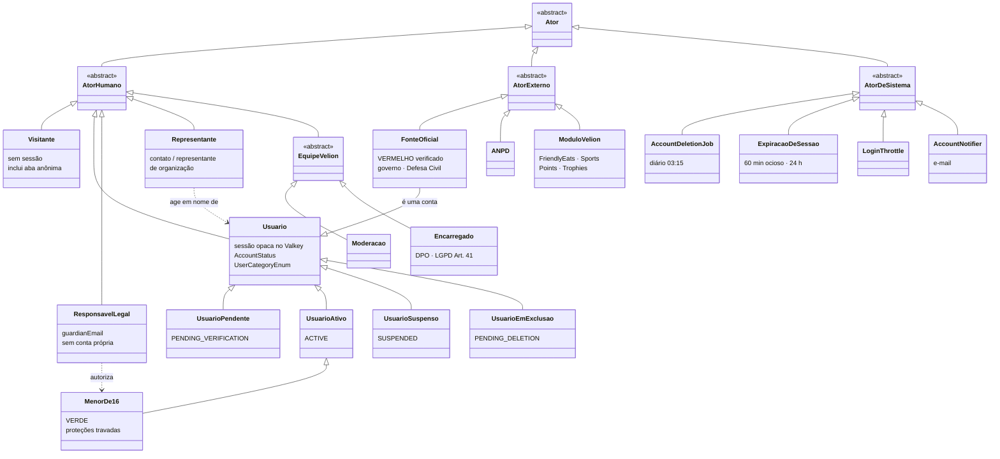

### 1.2 Catálogo de atores

| Ator | Natureza | Como o sistema o reconhece | Situação |
|---|---|---|---|
| **Visitante** | Humano · primário | Sem cookie de sessão (toda aba anônima começa assim) | ✅ |
| **Usuário pendente** | Humano · primário | Sessão + `PENDING_VERIFICATION` (e-mail ainda não confirmado) | ✅ |
| **Usuário ativo** | Humano · primário | Sessão + `ACTIVE` | ✅ |
| **Usuário suspenso** | Humano · primário | `SUSPENDED`: o login é recusado | ✅ (suspender ⏳ moderação) |
| **Usuário em exclusão** | Humano · primário | `PENDING_DELETION`: o login oferece reativar | ✅ |
| **Menor de 16** | Humano · primário | Idade calculada de `userDateOfBirth`; só VERDE; preferências protetivas travadas | ✅ |
| **Responsável legal** | Humano · secundário | `type_details.guardianEmail` do menor; não tem conta | 🟡 e-mail guardado; vínculo ⏳ OS-49 |
| **Representante / contato** | Humano · secundário | `contact*` (AZUL, LARANJA) ou `representative*` (VERMELHO) em `type_details`, privados | ✅ dados · ⏳ verificação |
| **Moderação** | Humano · equipe Velion | Papel interno (sem `ROLE_MODERATOR` ainda; hoje todos são `ROLE_USER`) | ⏳ |
| **Encarregado (DPO)** | Humano · equipe Velion | `{{ENCARREGADO_EMAIL}}` dos Termos; recebe pedidos LGPD | ⏳ canal |
| **Fonte oficial** | Externo · é uma conta | VERMELHO subtipo `GOVERNMENT` com selo `VERIFIED` (`canPublishOfficialAlerts`) | ✅ regra · ⏳ Alert Feed |
| **ANPD** | Externo · secundário | Destinatária de comunicação de incidente (Art. 48) | ⏳ processo |
| **Módulos Velion** | Externo · sistema | Integração (FriendlyEats, Sports, Points, Trophies); SSO via Keycloak (OS-13) | ⏳ |
| **AccountDeletionJob** | Sistema | `@Scheduled` diário às 03:15 (São Paulo) | ✅ |
| **Expiração de sessão** | Sistema | TTL do Spring Session (60 min) + `AbsoluteSessionTimeoutFilter` (24 h) | ✅ |
| **LoginThrottle** | Sistema | Contadores no Valkey por conta e por IP | ✅ |
| **AccountNotifier** | Sistema | Interface; hoje `LoggingAccountNotifier` (registra em log) | 🟡 e-mail real ⏳ OS-12 |

### 1.3 Papéis contextuais

Um mesmo usuário assume papéis diferentes conforme o objeto. A API calcula esses papéis a cada pedido
(`ViewerResolver` + regras de domínio); nada disso é guardado como "tipo".

| Papel | Em relação a | Regra no código | Efeito |
|---|---|---|---|
| **Quem está vendo** (`viewer`) | qualquer post | `ViewerResolver` lê o `OrangePrincipal` da sessão; `null` = visitante | Preenche `viewer.liked`, `viewer.saved` |
| **Dono do post** | post | `post.authorUserId = viewer` (`viewer.isAuthor`) | Vê o próprio rascunho; apaga comentários no post |
| **Autor do comentário** | comentário | `comment.authorUserId = viewer` | Apaga o próprio comentário (`canDelete`) |
| **Titular** | os próprios dados | qualquer usuário sobre a própria conta | Direitos do Art. 18: corrigir (RF2), consentir/revogar (RF3), exportar e excluir (RF23) |
| **Autor indisponível** | post de terceiro | autor ≠ `ACTIVE` | Post some para os outros; nome sem link ("Conta excluída" após a eliminação) |

### 1.4 Matriz de capacidades

| Capacidade | Visitante | Pendente | Ativo | Menor de 16 | Suspenso | Em exclusão | Moderação ⏳ |
|---|---|---|---|---|---|---|---|
| Ler posts, perfis e Termos | ✅ | ✅ | ✅ | ✅ | — (sem login) | — (oculto) | ✅ |
| Criar conta | ✅ | — | — | — | — | — | — |
| Entrar / 2FA | ✅ | ✅ | ✅ | ✅ | ❌ | oferta de reativar | — |
| Editar perfil e preferências | 401 | ✅ | ✅ | ✅ (proteções travadas) | — | — | — |
| Curtir, comentar, compartilhar, salvar | 401 | 403 | ✅ | ✅ | — | — | — |
| Publicar post | 401 | 403 | ⏳ OS-23 | ⏳ | — | — | — |
| Publicar alerta oficial | — | — | só VERMELHO verificado | ❌ | — | — | curadoria |
| Encerrar sessões, ativar 2FA, trocar senha | 401 | ✅ | ✅ | ✅ | — | — | — |
| Excluir conta (30 dias para voltar) | — | ✅ | ✅ | ✅ | ✅ (sem login: pelo suporte ⏳) | reativar | — |
| Apagar comentário de terceiros | — | — | só no próprio post | só no próprio post | — | — | ✅ |
| Verificar selo (CNPJ, domínio, representante) | — | — | — | — | — | — | ✅ |

---

## 2. Tipos de usuário (as 6 categorias)

O tipo é escolhido no cadastro e **não muda** por edição de perfil (RF2). Cor, glifo e rótulo andam
sempre juntos: a cor nunca é o único sinal ([DESIGN_SYSTEM.md](DESIGN_SYSTEM.md) §4).

| Código | Cor | Glifo | Rótulo | Para quem | Subtipos (`type_details.subtype` ou equivalente) | Selo inicial | Idade |
|---|---|---|---|---|---|---|---|
| `VERDE` (A) | `#3DDC6B` | ◇ losango | Pessoa física | Indivíduo comum | — | `NOT_REQUIRED` | 13+ (13–15 com responsável) |
| `AMARELO` (B) | `#F7C948` | ✦ estrela | Networking | Imprensa, blog, fórum, networking | `OUTLET` · `BLOG` · `FORUM` · `NETWORKING` | `NOT_REQUIRED` | 18+ |
| `AZUL` (C) | `#4A93FF` | △ triângulo | Marketing | Marketing e propaganda | `segment`: `AGENCY` · `ADVERTISER` · `CREATOR_COMPANY` | `NOT_REQUIRED` | 18+ |
| `LARANJA` (D) | `#FF9F1C` | ⬢ hexágono | Comunidade | Igrejas, clubes, grupos | `communityType`: `CHURCH` · `SPORTS_CLUB` · `SOCIAL_CLUB` · `COLLECTIVE` · `INFORMAL_GROUP` · `OTHER` | `NOT_REQUIRED` | 18+ (responsável) |
| `VERMELHO` (E) | `#FF4D4D` | ▭ retângulo | Instituição | Governo, empresas, marcas | `GOVERNMENT` · `COMPANY` · `BRAND` | **`PENDING`** | 18+ (representante) |
| `PRETO` (F) | `#0C0A07` + anel | ◎ círculo duplo | Especial | Amigos próximos, eventos, situações especiais, bancos | `CLOSE_FRIENDS` · `EVENT` · `SPECIAL_SITUATION` · `BANK` | **`PENDING` se `BANK`** | 18+ |

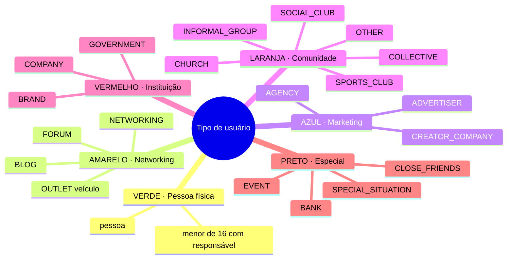

**Selo de categoria** (`CategoryVerification`): `NOT_REQUIRED` → nada a conferir; `PENDING` → a conta lê e
interage, mas não publica como instituição/banco até a moderação conferir CNPJ, domínio e representante;
`VERIFIED` / `REJECTED` são decisões da moderação. Trocar nome, `@` ou dados do tipo de uma conta com selo
volta para `PENDING` (RF2). Máquina de estados em [MAQUINA_ESTADOS.md](MAQUINA_ESTADOS.md) §3.

---

## 3. Taxonomia de atributos

### 3.1 Facetas

Todo atributo é classificado nas sete facetas abaixo. São elas que decidem onde o dado aparece, quem o
edita, como é guardado e o que acontece com ele na exclusão.

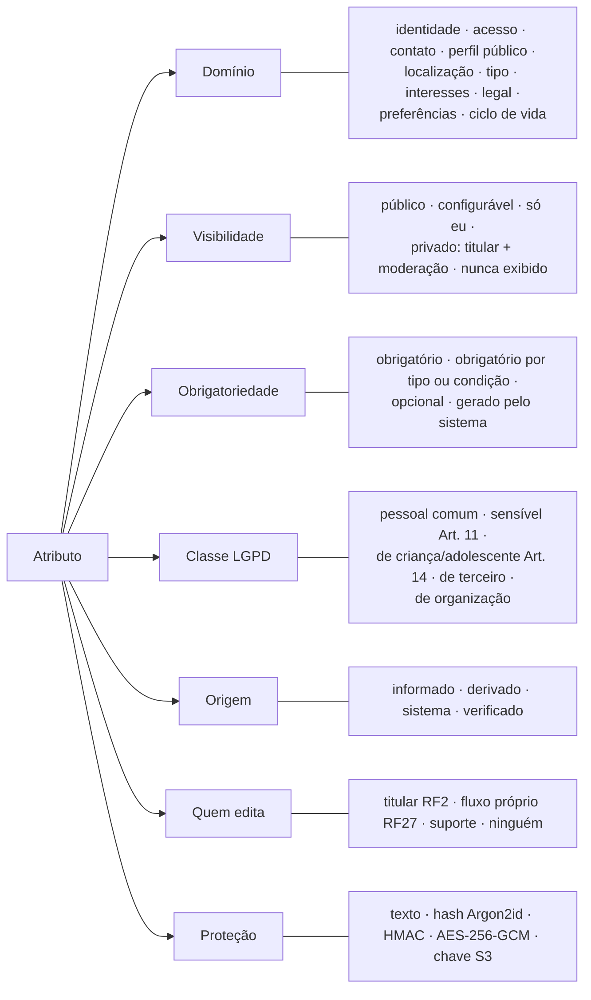

| Faceta | Valores | Regra que a faceta impõe |
|---|---|---|
| **Visibilidade** | `público` · `configurável` · `só eu` · `privado` · `nunca exibido` | `privado` = titular + moderação (`UserTypeDetailsValidator.PRIVATE_KEYS`); `nunca exibido` = segredo, nem o titular vê de volta |
| **Obrigatoriedade** | `obrigatório` · `por tipo/condição` · `opcional` · `sistema` | Faltar obrigatório = `422` com todos os erros juntos |
| **Classe LGPD** | `comum` · `sensível` · `criança/adolescente` · `de terceiro` · `organização` | Sensível exige consentimento específico (`SENSITIVE_PROFILE_DATA`); criança/adolescente segue o ECA Digital |
| **Origem** | `informado` · `derivado` · `sistema` · `verificado` | Derivado não é editável (ex.: idade vem do nascimento) |
| **Quem edita** | `titular (RF2)` · `fluxo próprio (RF27)` · `suporte` · `ninguém` | E-mail e senha passam pelo modo sudo; nascimento e tipo só pelo suporte |
| **Proteção** | `texto` · `Argon2id` · `HMAC` · `AES-256-GCM` · `chave S3` | O banco nunca guarda segredo reversível sem cifra |

### 3.2 Atributos da conta (`VSusercontrolist` e tabelas ligadas)

| Atributo (campo) | Domínio | Obrig. | Visibilidade | Classe LGPD | Origem | Quem edita | Proteção |
|---|---|---|---|---|---|---|---|
| `id` | identidade | sistema | interno | comum | sistema | ninguém | — |
| `name` (nome de exibição) | perfil público | obrigatório | público | comum | informado | titular | texto |
| `handle` (`@usuário`, único, `a-z 0-9 . _`, 3–30) | perfil público | obrigatório | público | comum | informado | titular | texto |
| `email` (minúsculas, único) | acesso | obrigatório | só eu | comum | informado | fluxo próprio | texto |
| `emailVerifiedAt` | acesso | sistema | só eu | comum | sistema | ninguém | — |
| `passwordHash` (12–128) | acesso | obrigatório | nunca exibido | comum | informado | fluxo próprio | Argon2id |
| `userDateOfBirth` | identidade | obrigatório | só eu (ano configurável) | comum · define criança/adolescente | informado | suporte | texto |
| `userType` | tipo | obrigatório | público | comum | informado | suporte | texto |
| `typeDetails` (§3.3) | tipo | por tipo | público ou privado por chave | comum · de terceiro · organização | informado | titular (revalida) | JSONB |
| `categoryVerification` | tipo | sistema | público (selo) | — | verificado | moderação | — |
| `accountStatus` | ciclo de vida | sistema | interno | — | sistema | ninguém | — |
| `bio` (≤ 150) | perfil público | opcional | público | comum | informado | titular | texto |
| `pronouns` (≤ 4, lista) | perfil público | opcional | configurável | comum | informado | titular | texto |
| `links` (≤ 5, `https`) | perfil público | opcional | público | comum | informado | titular | texto |
| `photoObjectKey` | perfil público | opcional | público | comum (biometria só com `FACIAL_RECOGNITION`) | informado | titular | chave S3 |
| `citizenship` | identidade | opcional | só eu | comum | informado | titular | texto |
| `countryOfResidence`, `stateOfResidence`, `cityOfResidence` | localização | opcional | configurável | comum | informado | titular | texto |
| `address` | localização | opcional | só eu | comum | informado | titular | texto |
| `lastSavedLocation` (lat, lng, timestamp) | localização | opcional | só eu | comum · exige `LOCATION_TRACKING` | derivado (GPS) | titular | JSON |
| `cellphoneNumber` (E.164) | contato | opcional | só eu | comum | informado | titular | texto |
| `recoveryEmail` | contato | opcional | só eu | comum | informado | titular | texto |
| `gender` | identidade | opcional | só eu | comum | informado | titular | texto |
| `sexualPreference` | identidade | opcional | só eu | **sensível (Art. 11)** | informado | titular, com consentimento | texto |
| `listOfInterestsAndHobbies` | interesses | opcional | configurável | comum | informado | titular | lista |
| `listOfJobsInterests` | interesses | opcional | configurável | comum | informado | titular | lista |
| `listOfCommunitiesOfInterest` (tipo → país → cidade) | interesses | opcional | configurável | comum (religião pode revelar dado sensível) | informado | titular | JSON |
| `createdAt`, `updatedAt`, `version` | ciclo de vida | sistema | interno ("membro desde" é público) | — | sistema | ninguém | — |
| `deletionRequestedAt`, `deletionScheduledFor`, `statusBeforeDeletion` | ciclo de vida | sistema | só eu | — | sistema | ninguém | — |
| `deletedAt` | ciclo de vida | sistema | interno | — | sistema | ninguém | — |
| **`terms_acceptance`**: `document`, `version`, `acceptedAt`, `channel`, `ipHash` | legal | obrigatório | só eu | comum | sistema | ninguém (append-only) | HMAC do IP |
| **`consent_event`** × 6: `purpose`, `legalBasis`, `granted`, `policyVersion` | legal | sistema (todos `false`) | só eu | comum | informado | titular (RF3) | — |
| **`user_mfa`**: `secret`, `lastUsedStep`, `enabledAt` | acesso | opcional | nunca exibido | comum | sistema | fluxo próprio | AES-256-GCM (AAD = id) |
| **`user_recovery_code`** × 10: `codeHash`, `usedAt` | acesso | com 2FA | mostrado 1 vez | comum | sistema | fluxo próprio | Argon2id |
| **`user_preference`** (§3.5) | preferências | sistema (padrões) | só eu | comum | informado | titular | — |
| **Sessão** (Valkey): principal, `authAt`, `device`, `channel`, criação, último acesso | acesso | sistema | só eu (sem o id real) | comum | sistema | titular encerra | id opaco; `handle` = HMAC |

Finalidades de consentimento (`consent_event.purpose`, todas começam `false`): `MARKETING`,
`LOCATION_TRACKING`, `PERSONALIZED_FEED`, `THIRD_PARTY_SHARING` (Art. 7º, I) e `FACIAL_RECOGNITION`,
`SENSITIVE_PROFILE_DATA` (Art. 11, I).

### 3.3 Atributos por tipo (`type_details`)

**O** = obrigatório · **o** = opcional · **—** = recusado (minimização: chave fora da lista dá `422`).
🔒 = privado (só titular e moderação). Texto até 200 caracteres.

| Chave | VERDE | AMARELO | AZUL | LARANJA | VERMELHO | PRETO | Valores / formato |
|---|---|---|---|---|---|---|---|
| `subtype` | — | O | — | — | O | O | ver §2 |
| `segment` | — | — | O | — | — | — | `AGENCY` · `ADVERTISER` · `CREATOR_COMPANY` |
| `communityType` | — | — | — | O | — | — | `CHURCH` · `SPORTS_CLUB` · `SOCIAL_CLUB` · `COLLECTIVE` · `INFORMAL_GROUP` · `OTHER` |
| `outletName` | — | O | — | — | — | — | nome do veículo |
| `role` | — | O | — | — | — | — | função (repórter, editora…) |
| `occupation`, `education` | o | — | — | — | — | — | texto |
| `website` | o | O | O | o | O | — | `https://…` |
| `cnpj` | — | o | O | o | O | o (O se `BANK`) | 14 caracteres, **alfanumérico** (IN RFB 2.229/2024) |
| `legalName` | — | — | O | — | O | — | razão social |
| `tradeName` | — | — | o | — | — | — | nome fantasia |
| `sector` | — | — | — | — | O | — | setor |
| `size` | — | — | — | — | o | — | `1-10` · `11-50` · `51-200` · `201-1000` · `1000+` |
| `headquarters` | — | — | — | o | o | — | sede |
| `city`, `state` | o | o | o | **O** | o | o | cidade, UF |
| `organizer` | — | — | — | — | — | O | organizador ou conta responsável |
| `eventName`, `eventStart`, `eventLocation` | — | — | — | — | — | o (O se `EVENT`) | `eventStart` em ISO-8601 |
| `bcbCode` | — | — | — | — | — | o (O se `BANK`) | 3 dígitos (ex.: `001`) |
| `expiresAt` | — | — | — | — | — | o | data (contas de evento temporárias) |
| 🔒 `mtbRegistration` | — | o | — | — | — | — | registro profissional |
| 🔒 `contactName`, `contactEmail` | — | — | O | O | — | — | responsável (adulto) |
| 🔒 `contactRole` | — | — | O | — | — | — | cargo |
| 🔒 `representativeName`, `representativeRole`, `representativeEmail` | — | — | — | — | O | — | representante legal |
| 🔒 `guardianEmail` | o (O se < 16) | — | — | — | — | — | e-mail do responsável (ECA Digital) |

### 3.4 Atributos de conteúdo

| Objeto | Atributo | Obrig. | Visibilidade | Observação |
|---|---|---|---|---|
| **Post** | `id` (UUID v7) | sistema | público | Ordena por tempo; vai no link `/p/{id}` |
| | `authorUserId`, `authorUserType` | sistema | público | Cor do autor copiada na publicação (filtro sem join) |
| | `feedType` | O | público | `PROFILE` · `POST` · `AUDIO` · `ALERT` |
| | `mediaType` | O | público | `TEXT` · `IMAGE` · `VIDEO` · `AUDIO` |
| | `title` | O | público | Sempre presente em todo card |
| | `subtitle`, `body` | o | público | Card corta; modal mostra tudo |
| | `mediaObjectKey`, `durationSeconds` | por mídia | público | Chave no S3; duração para áudio e vídeo |
| | `ageRating` | O (padrão `LIVRE`) | público | `LIVRE` · `12+` · `16+` · `18+` · `Sensível` |
| | `status` | sistema | autor | `DRAFT` · `PUBLISHED` · `ARCHIVED` · `REMOVED` |
| | `country`, `city` | o | público | Filtros País e Cidade |
| | `likeCount`, `commentCount`, `shareCount`, `viewCount` | sistema | público | Só leitura no JPA; mudam em UPDATE atômico |
| | `createdAt`, `updatedAt`, `removedAt` | sistema | `createdAt` = `publishedAt` | — |
| | ⏳ `sponsored`, `mediaAlt` | propostos | público | Selo de publicidade (CDC art. 36) e texto alternativo |
| | ⏳ `background` (JSONB) | o (nulo = moldura padrão) | público | Moldura do post ([RF28](rf/RF28-moldura-post.md)): só ids do catálogo e chaves de asset, nunca URL nem CSS; `ALERT` ignora |
| **AudioContent** ⏳ | `kind`, `transcript`, `tags`, picos da onda | — | público | `PODCAST` · `PERSONAL_AUDIO` · `MUSIC` |
| **AlertContent** ⏳ | `category`, `severity`, `epicenter`, `radiusKm`, `expiresAt`, `verifiedSource`, `instruction` | — | público | `EMERGENCY` · `NATURAL_DISASTER` · `OFFICIAL_COMMUNICATION` · `JOB_OPENING`; severidade segue o CAP 1.2 (`Extreme` · `Severe` · `Moderate` · `Minor`) |
| **Comentário** | `body` (1–2.000), `status`, `createdAt`, `removedAt` | O | público | Removido: texto apagado, id mantido |
| **Reação** | `kind` | — | `LIKE` público (contado) · `SAVE` privado | Uma por pessoa e tipo |
| **Compartilhamento** | `channel`, `userId?` | — | só o total | `COPY_LINK` · `NATIVE` · `WHATSAPP` · `TELEGRAM` · `X` · `EMAIL`; conta 1× por pessoa e canal |

### 3.5 Preferências (`user_preference`)

| Grupo | Atributo | Valores (padrão em **negrito**) | Menor de 16 |
|---|---|---|---|
| Exibição | `theme` | **`SYSTEM`** · `DARK` · `LIGHT` | livre |
| | `appBackground` | **`PLAIN`** · `NETWORK` · `MOSAIC` · `MOSAIC_CLASSIC` · `MOSAIC_DEEP` · `MOSAIC_GLOW` · `MOSAIC_SKY` · `MOSAIC_SAND` | livre |
| | `language` | **`pt-BR`** · `en` · `es` | livre |
| | `fontScale` | 85–150 (**100**) | livre |
| | `reduceMotion` | **`false`** | livre |
| Privacidade | `profilePrivate` | **`false`** | nasce `true`; desligar dá `403` |
| | `whoCanComment` | **`EVERYONE`** · `FOLLOWERS` · `NOBODY` | nasce `FOLLOWERS`; `EVERYONE` dá `403` |
| | `showBirthYear` | **`false`** | livre |
| Conteúdo | `defaultFeed` | `PROFILE` · **`POST`** · `AUDIO` · `ALERT` | livre |
| | `sensitiveContent` | **`LIMIT`** · `ALLOW` | `ALLOW` dá `403` |
| Bem-estar | `usageReminderMinutes` | 10–600 ou vazio (**vazio**) | nasce 60; ajustável, mas não desliga |
| Notificações | `notifications` (curtidas, comentários, compartilhamentos, alertas oficiais) | todos **ligados** | livre |
| Segurança | `loginAlerts` | **`true`** | livre |

### 3.6 Vocabulários controlados (enums)

| Enum | Valores | Onde aparece |
|---|---|---|
| `UserCategoryEnum` | `VERDE` · `AMARELO` · `AZUL` · `LARANJA` · `VERMELHO` · `PRETO` | bolinha, borda, filtro Categoria |
| `AccountStatus` | `PENDING_VERIFICATION` · `ACTIVE` · `SUSPENDED` · `PENDING_DELETION` · `ANONYMOUS_LGPD_DELETED` | acesso (§1.4) |
| `CategoryVerification` | `NOT_REQUIRED` · `PENDING` · `VERIFIED` · `REJECTED` | selo |
| `FeedType` | `PROFILE` · `POST` · `AUDIO` · `ALERT` | Segmented Switcher |
| `MediaType` | `TEXT` · `IMAGE` · `VIDEO` · `AUDIO` | chip de tipo |
| `AgeRating` | `LIVRE` · `AGE_12` · `AGE_16` · `AGE_18` · `SENSITIVE` | chip de classificação |
| `PostStatus` | `DRAFT` · `PUBLISHED` · `ARCHIVED` · `REMOVED` | visibilidade e interações |
| `CommentStatus` | `VISIBLE` · `REMOVED` | comentário |
| `ReactionKind` | `LIKE` · `SAVE` | ações |
| `ShareChannel` | `COPY_LINK` · `NATIVE` · `WHATSAPP` · `TELEGRAM` · `X` · `EMAIL` | folha de compartilhar |
| `UserPreference.*` | `Theme`, `AppBackground`, `CommentAudience`, `SensitiveContent` | §3.5 |
| ⏳ `AudioKind`, `AlertCategory`, `Severity` | §3.4 | cards de áudio e alerta |
| ⏳ Moldura (RF28) | `auraHypeStyle`: `OFF` · `SCANNER` · `BRILHO`; `metamorphose.mode`: `OFF` · `PRISMA` · `CONSTELACAO` · `FIO_VIVO` · `HOLOGRAFIA`; `aura.format`: `IMAGEM_UNICA` · `MOSAICO`; `layoutId`: `CLASSICO` · `POLAROID` · `POSTER`; `customArt.origin`: `UPLOAD` · `IA` | Background Studio |

---

## 4. Tipologia de conteúdo e de cards

Cada card nasce de uma combinação de feed, tipo de mídia e subtipo. As regras de cor, glifo e acesso valem
para todos.

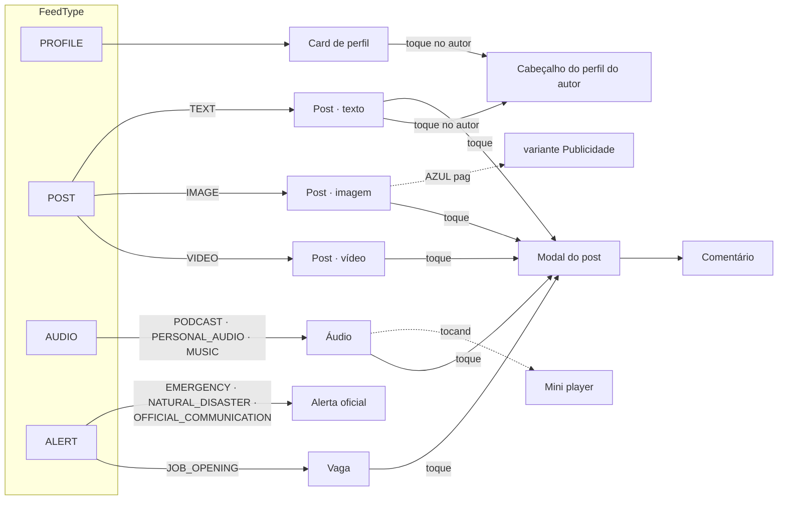

| Card | Feed / origem | Quem publica | Interações | Classificação | Desenho |
|---|---|---|---|---|---|
| Post · texto | `POST` · `TEXT` | qualquer conta ativa | curtir · comentar · compartilhar · salvar | sim | [01](../design/prototype/anatomia/01-post-texto.png) |
| Post · vídeo | `POST` · `VIDEO` | qualquer conta ativa | idem | sim | [02](../design/prototype/anatomia/02-post-video.png) |
| Post · imagem / publicidade | `POST` · `IMAGE` (+ ⏳ `sponsored`) | qualquer; publicidade = AZUL ou VERMELHO | idem | sim | [03](../design/prototype/anatomia/03-post-imagem-publicidade.png) |
| Vaga | `ALERT` · `JOB_OPENING` | VERMELHO ou AMARELO | idem | não | [04](../design/prototype/anatomia/04-vaga.png) |
| Áudio | `AUDIO` · `AudioKind` | qualquer conta ativa | idem + ouvir | sim | [05](../design/prototype/anatomia/05-audio.png) |
| Mini player | estado do player | — | play/pausa | — | [06](../design/prototype/anatomia/06-mini-player.png) |
| Alerta oficial | `ALERT` · CAP 1.2 | **só VERMELHO verificado** ou curadoria | **só compartilhar** | não | [07](../design/prototype/anatomia/07-alerta.png) |
| Perfil | `PROFILE` | — (é a conta) | seguir ⏳ | — | [08](../design/prototype/anatomia/08-perfil.png) |
| Cabeçalho do perfil do autor | RF25 | — | — | — | [09](../design/prototype/anatomia/09-perfil-cabecalho.png) |
| Modal do post | RF24 | — | as 4 ações com rótulo | sim | [10](../design/prototype/anatomia/10-modal-post.png) |
| Comentário | RF26 | conta ativa | apagar (autor ou dono do post) | — | [11](../design/prototype/anatomia/11-comentario.png) |
| Opção de tipo de usuário | RF1 | — | selecionar | — | [12](../design/prototype/anatomia/12-opcao-tipo.png) |
| Sessão ativa | RF27 | — | encerrar | — | [13](../design/prototype/anatomia/13-sessao.png) |
| **Moldura do post** (envolve os cards de conteúdo, exceto `ALERT`) | RF28 | o autor escolhe; o Hype vem do ranking | — | — | [15](../design/prototype/anatomia/15-moldura.png) |

---

## 5. Anatomia dos cards

### 5.1 Estrutura comum (slots)

Todos os cards de conteúdo seguem a mesma grade; cada tipo só preenche ou troca slots.

**Slot 0 · Moldura** ([RF28](rf/RF28-moldura-post.md), opcional): uma faixa de arte de 11 px em volta do card. Quando há
moldura, o card inteiro vira o **container** opaco. Filete, bolinha e rótulo da categoria, "em alta" e selos ficam
sempre dentro dele, nunca na arte.

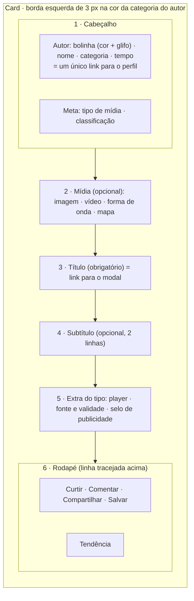

| Slot | Post | Vídeo/Imagem | Vaga | Áudio | Alerta | Perfil |
|---|---|---|---|---|---|---|
| Borda da categoria | ✅ | ✅ | ✅ VERMELHO | ✅ | ✅ VERMELHO + fundo | — (bolinha no avatar) |
| Autor | ✅ | ✅ | ✅ | ✅ | trocado por **severidade** | é o próprio card |
| Tipo de mídia | ✅ | ✅ | VAGA | tipo de áudio | tempo de emissão | — |
| Classificação | ✅ | ✅ | — | ✅ | — | — |
| Mídia | — | ✅ | — | forma de onda | mapa | avatar |
| Título | ✅ | ✅ | cargo | ✅ | ✅ | nome |
| Subtítulo | ✅ | o | requisitos e prazo | — | — | categoria + local |
| Extra | — | publicidade | — | player | fonte, área, validade, o que fazer | interesses |
| Ações | 4 | 4 | 4 | 4 | só compartilhar | seguir |
| Tendência | ✅ | ✅ | ✅ | ✅ | aviso "sem curtidas" | — |
| Moldura (slot 0) | o | o | — | o | **nunca** | ⏳ fase 5 |

### 5.2 Estados

| Estado | Como aparece | Regra |
|---|---|---|
| Padrão | como nos desenhos | — |
| Foco | contorno laranja de 2 px, afastado 2 px | Todo elemento interativo tem foco visível (WCAG 2.4.7) |
| Curtido / salvo | ícone preenchido + texto laranja; `aria-pressed="true"` | A mudança não depende só da cor: o ícone fica cheio |
| Visitante ou conta pendente | botões ativos; ao tocar, pede login (401) ou confirmação de e-mail (403) | Nada some: a pessoa entende o que falta |
| Post arquivado | ações desabilitadas com explicação | `interactionsOpen = false` (RF24) |
| Autor indisponível | nome sem link; "Conta excluída" após a eliminação | `author.available = false` (RF25) |
| Carregando | skeleton nos slots; o modal abre com os dados do card | RF24 |
| Removido | o card sai do feed; link direto responde "não está mais disponível" | 404 sem motivo |
| Conteúdo 18+ ou sensível ⏳ | mídia coberta + aviso + "Mostrar" | `sensitiveContent = LIMIT`; menor de 16 nunca vê (OS-49) |
| Tema claro | variantes 700 da paleta | [desenho 14](../design/prototype/anatomia/14-post-tema-claro.png) |
| Fundo do app | véu escuro entre o fundo e os cards | Contraste dos cards não muda (RF2) |
| Moldura animada (Aura Plus) | toca até 5 s quando o card aparece, depois pôster; com Reduzir movimento, só pôster | WCAG 2.2.2 e 2.3.1 (RF28) |
| Em alta com Hype | anel na borda + texto "em alta" | A cor e o brilho nunca são o único sinal |

### 5.3 Desenhos

Os desenhos são gerados a partir do protótipo por `design/prototype/anatomy.mjs` (numeração em ordem de leitura,
de cima para baixo; a lista fica em `design/prototype/anatomia/partes.json`). Mudou um card? Rode o script e
atualize a tabela do card.

### Post · texto

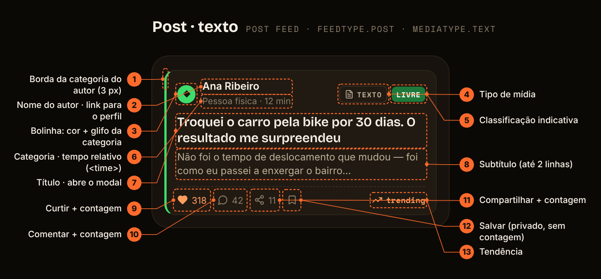

| # | Parte | Dado (API / domínio) | Regra |
|---|---|---|---|
| 1 | Borda da categoria do autor (3 px) | `author.category.color` | Nunca sozinha: vem com glifo e rótulo (WCAG 1.4.1) |
| 2 | Nome do autor · link para o perfil | `author.name`, `author.profilePath` | Foto + nome = um único `<a>` com `aria-label="Ver perfil de {nome}"`; sem link se `author.available = false` |
| 3 | Bolinha: cor + glifo da categoria | `author.category.code` | `role=img` + `aria-label="Categoria: {rótulo}"`; PRETO ganha anel `#D6D0C8` no escuro |
| 4 | Tipo de mídia | `mediaType` | Ícone Lucide + texto; nunca só ícone |
| 5 | Classificação indicativa | `ageRating`, `ageRatingLabel` | Chip com texto visível; cor por faixa (`rating.*`) |
| 6 | Categoria · tempo relativo (`<time>`) | `author.category.label`, `publishedAt` | `<time datetime>` ISO; absoluta no `title` (RF24) |
| 7 | Título · abre o modal | `title`, `detailPath` | Obrigatório; é o link acessível do card (o card inteiro também abre) |
| 8 | Subtítulo (até 2 linhas) | `subtitle` | Opcional; corta em 2 linhas com reticências |
| 9 | Curtir + contagem | `counts.likes`, `viewer.liked` | `aria-pressed`; número por extenso no `aria-label`; exige conta ACTIVE (RF26) |
| 10 | Comentar + contagem | `counts.comments` | Abre a caixa de comentários (RF26) |
| 11 | Compartilhar + contagem | `counts.shares`, `shareUrl` | Abre a folha de compartilhar; conta 1× por pessoa e canal |
| 12 | Salvar (privado, sem contagem) | `viewer.saved` | Privado: ninguém vê quem salvou; sem número |
| 13 | Tendência | ZSET `trending:{feed}` (⏳ campo na API) | Ícone + texto (em alta · trending · estável); discreto |

### Post · vídeo

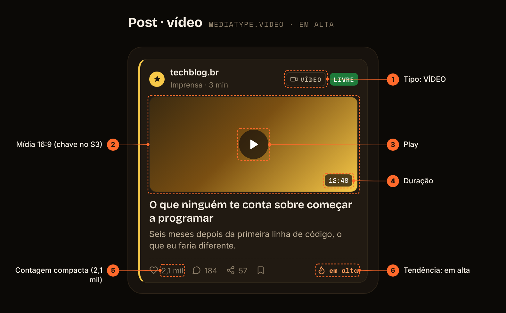

| # | Parte | Dado (API / domínio) | Regra |
|---|---|---|---|
| 1 | Tipo: VÍDEO | `mediaType = VIDEO` | Ícone `video` + texto |
| 2 | Mídia 16:9 (chave no S3) | `mediaUrl` | Altura fixa no card; poster antes do play; respeita `reduceMotion` |
| 3 | Play | — | Botão com rótulo "Reproduzir vídeo"; nunca autoplay com som |
| 4 | Duração | `durationSeconds` | `mm:ss`; lida por extenso pelo leitor de tela |
| 5 | Contagem compacta (2,1 mil) | `counts.likes` | `Intl.NumberFormat` compacto no card; número exato no modal |
| 6 | Tendência: em alta | ZSET (⏳) | Ícone `flame` + texto |

### Post · imagem de marca

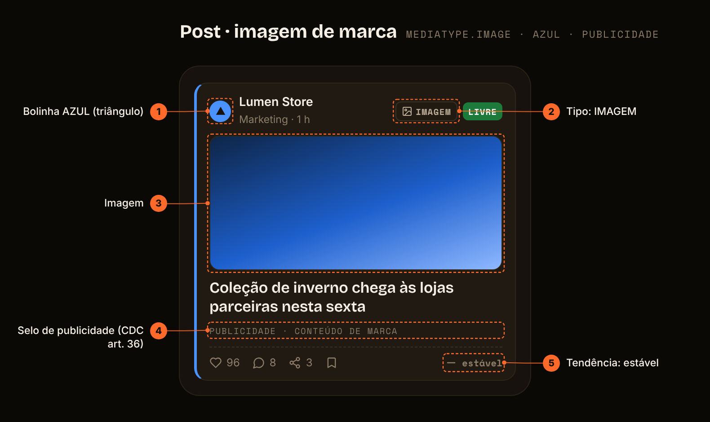

| # | Parte | Dado (API / domínio) | Regra |
|---|---|---|---|
| 1 | Bolinha AZUL (triângulo) | `author.category = AZUL` | Glifo triângulo |
| 2 | Tipo: IMAGEM | `mediaType = IMAGE` | — |
| 3 | Imagem | `mediaUrl` | `alt` escrito pelo autor (⏳ campo `mediaAlt`) |
| 4 | Selo de publicidade (CDC art. 36) | ⏳ `sponsored` (proposto) | Obrigatório em conteúdo pago: publicidade identificável de imediato (CDC art. 36, CONAR) |
| 5 | Tendência: estável | ZSET (⏳) | Cor neutra |

### Vaga

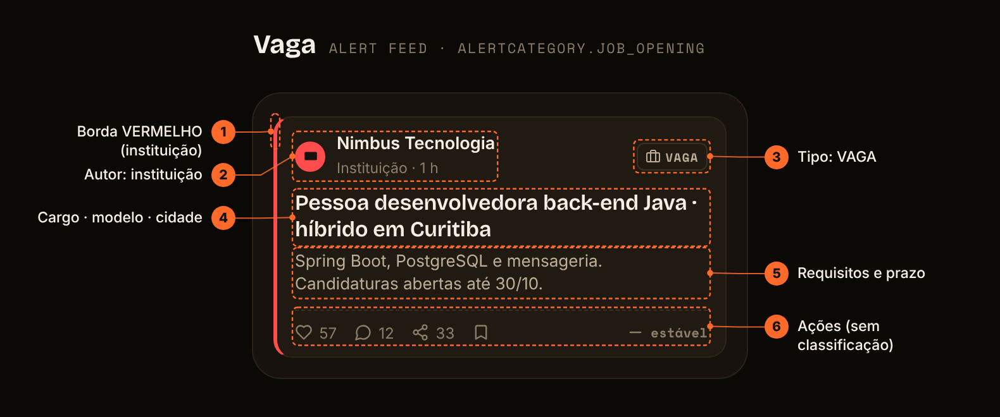

| # | Parte | Dado (API / domínio) | Regra |
|---|---|---|---|
| 1 | Borda VERMELHO (instituição) | `author.category.color` | — |
| 2 | Autor: instituição | `author` | Mesmo link do post |
| 3 | Tipo: VAGA | ⏳ `AlertCategory.JOB_OPENING` | Ícone `briefcase` + texto |
| 4 | Cargo · modelo · cidade | `title` | Formato sugerido: cargo · presencial/híbrido/remoto · cidade |
| 5 | Requisitos e prazo | `subtitle` | Prazo explícito ("até 30/10") |
| 6 | Ações (sem classificação) | `counts` | Vaga não leva chip de classificação |

### Áudio

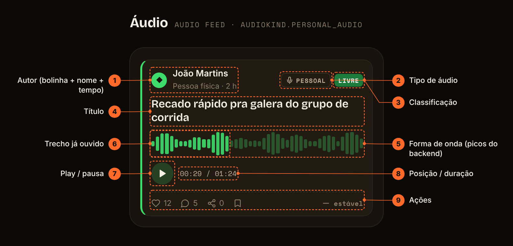

| # | Parte | Dado (API / domínio) | Regra |
|---|---|---|---|
| 1 | Autor (bolinha + nome + tempo) | `author`, `publishedAt` | Igual ao post |
| 2 | Tipo de áudio | ⏳ `AudioKind` (PODCAST · PERSONAL_AUDIO · MUSIC) | Ícone `mic` + texto |
| 3 | Classificação | `ageRating` | — |
| 4 | Título | `title` | Obrigatório |
| 5 | Forma de onda (picos do backend) | ⏳ JSON de ~1.000 picos | Decorativa (`aria-hidden`); a cor é a da categoria |
| 6 | Trecho já ouvido | posição local do player | Opacidade cheia × 30 %; o tempo em texto é o sinal acessível |
| 7 | Play / pausa | `mediaUrl` | Botão com rótulo que muda (Reproduzir/Pausar) |
| 8 | Posição / duração | `durationSeconds` | Texto `mm:ss / mm:ss` |
| 9 | Ações | `counts`, `viewer` | Iguais às do post |

### Tocando agora

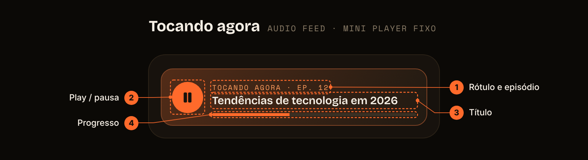

| # | Parte | Dado (API / domínio) | Regra |
|---|---|---|---|
| 1 | Rótulo e episódio | estado do player | Fica fixo acima do feed enquanto toca |
| 2 | Play / pausa | — | Alvo de 42 px; texto escuro sobre laranja (6,51:1) |
| 3 | Título | `title` | Uma linha com reticências |
| 4 | Progresso | posição / `durationSeconds` | `role=progressbar` com `aria-valuenow` |

### Alerta oficial

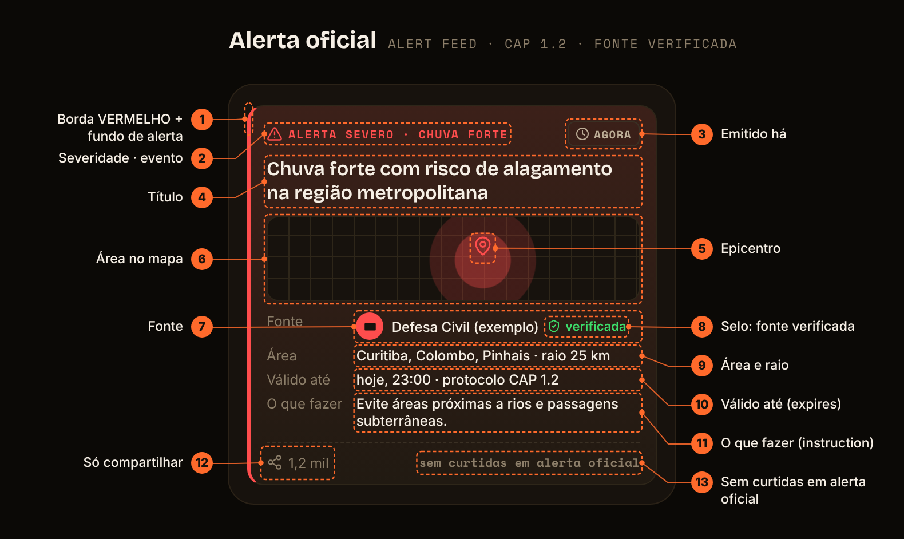

| # | Parte | Dado (API / domínio) | Regra |
|---|---|---|---|
| 1 | Borda VERMELHO + fundo de alerta | autor VERMELHO verificado | A página do Alert Feed ainda tem a faixa listrada (hazard) no topo |
| 2 | Severidade · evento | ⏳ `severity`, `category` (CAP `severity`, `event`) | Ícone `alert` + texto; nunca sensacionalista |
| 3 | Emitido há | `publishedAt` (CAP `sent`) | "AGORA" até 5 min |
| 4 | Título | `title` (CAP `headline`) | — |
| 5 | Epicentro | ⏳ `epicenter` (GeoLocation) | Pin com rótulo textual da área ao lado |
| 6 | Área no mapa | ⏳ `radiusKm` | Mapa decorativo; a área também vem por extenso (9) |
| 7 | Fonte | `author` | Só fonte verificada publica com notificação |
| 8 | Selo: fonte verificada | `categoryVerification = VERIFIED` | Ícone + texto "verificada" |
| 9 | Área e raio | ⏳ `areaDesc` + `radiusKm` | Texto |
| 10 | Válido até (expires) | ⏳ `expiresAt` (CAP `expires`) | Depois disso o card sai do feed |
| 11 | O que fazer (instruction) | ⏳ `instruction` (CAP) | Frase curta e acionável |
| 12 | Só compartilhar | `counts.shares` | Compartilhar é a única interação |
| 13 | Sem curtidas em alerta oficial | regra de domínio | Sem curtir/comentar: alerta não é palco de engajamento |

### Perfil

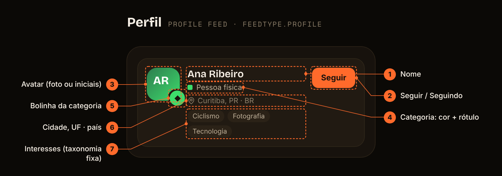

| # | Parte | Dado (API / domínio) | Regra |
|---|---|---|---|
| 1 | Nome | `name` | — |
| 2 | Seguir / Seguindo | ⏳ seguir (novo RF) | Primário laranja × fantasma "Seguindo" |
| 3 | Avatar (foto ou iniciais) | `avatarUrl` (`photoObjectKey`) | Iniciais quando não há foto |
| 4 | Categoria: cor + rótulo | `category.label` | Quadradinho de cor + texto |
| 5 | Bolinha da categoria | `category.code` | Sobre o canto do avatar |
| 6 | Cidade, UF · país | `cityOfResidence`, `stateOfResidence`, `countryOfResidence` | Só se a visibilidade do titular permitir (configurável) |
| 7 | Interesses (taxonomia fixa) | `listOfInterestsAndHobbies` | Configurável; taxonomia fixa, nada de texto livre |

### Cabeçalho do perfil do autor

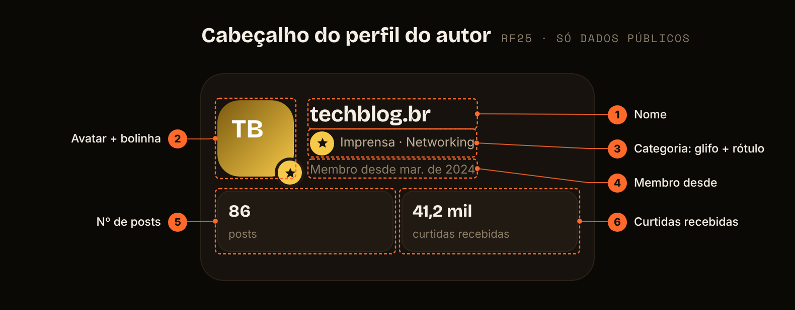

| # | Parte | Dado (API / domínio) | Regra |
|---|---|---|---|
| 1 | Nome | `PublicProfileView.name` | — |
| 2 | Avatar + bolinha | `avatarUrl`, `category` | — |
| 3 | Categoria: glifo + rótulo | `category` | — |
| 4 | Membro desde | `memberSince` | Mês e ano |
| 5 | Nº de posts | `postCount` | PUBLISHED + ARCHIVED |
| 6 | Curtidas recebidas | ⏳ não está na API | Proposta: soma de `like_count` dos posts públicos |

### Modal do post

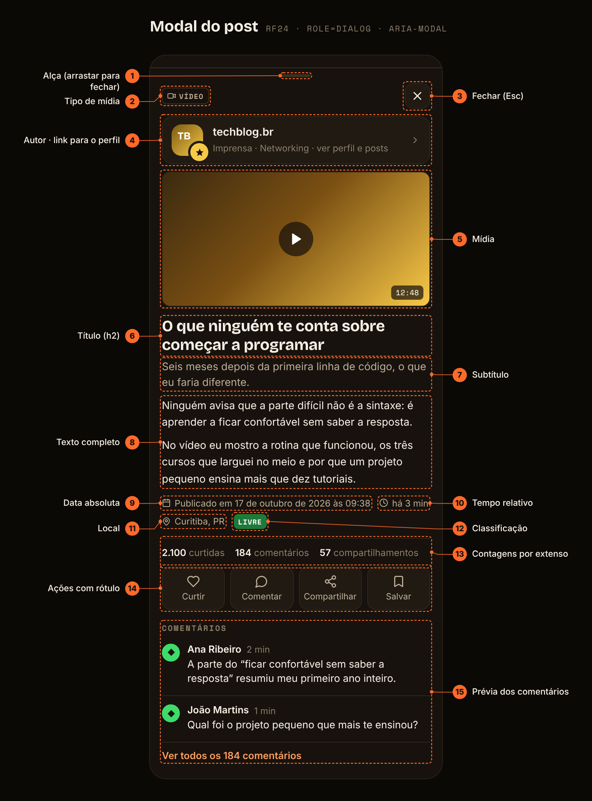

| # | Parte | Dado (API / domínio) | Regra |
|---|---|---|---|
| 1 | Alça (arrastar para fechar) | — | Gesto; o botão Fechar continua sendo o caminho acessível |
| 2 | Tipo de mídia | `mediaType` | — |
| 3 | Fechar (Esc) | — | Foco inicial; `Esc` fecha e devolve o foco ao card |
| 4 | Autor · link para o perfil | `author` | Foto + nome + categoria + "ver perfil e posts" |
| 5 | Mídia | `mediaUrl` | — |
| 6 | Título (h2) | `title` | `aria-labelledby` do diálogo |
| 7 | Subtítulo | `subtitle` | Sem corte |
| 8 | Texto completo | `body` | Sem corte; parágrafos |
| 9 | Data absoluta | `publishedAt` | "Publicado em 17 de outubro de 2026 às 09:38" no fuso do aparelho |
| 10 | Tempo relativo | `publishedAt` | "há 3 min" |
| 11 | Local | `city`, `country` | Só se o post tiver local |
| 12 | Classificação | `ageRating` | — |
| 13 | Contagens por extenso | `counts` | Número exato (2.100) |
| 14 | Ações com rótulo | `viewer`, `interactionsOpen` | Desabilitadas com explicação quando `interactionsOpen = false` |
| 15 | Prévia dos comentários | `GET …/comments?limit=2` | "Ver todos os N comentários" abre a caixa |

### Comentário

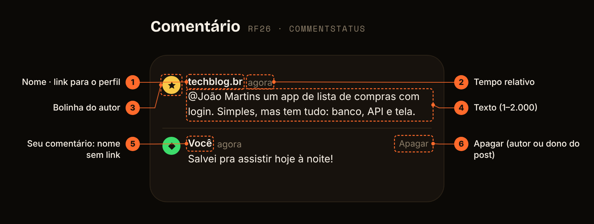

| # | Parte | Dado (API / domínio) | Regra |
|---|---|---|---|
| 1 | Nome · link para o perfil | `CommentView.author` | Bolinha + nome levam ao perfil (RF25) |
| 2 | Tempo relativo | `createdAt` | Absoluta no `title` |
| 3 | Bolinha do autor | `author.category` | — |
| 4 | Texto (1–2.000) | `body` | Texto puro; removido vira "Comentário removido" |
| 5 | Seu comentário: nome sem link | `author.id = viewer` | "Você" |
| 6 | Apagar (autor ou dono do post) | `canDelete` | Só aparece para quem pode apagar |

### Opção de tipo de usuário

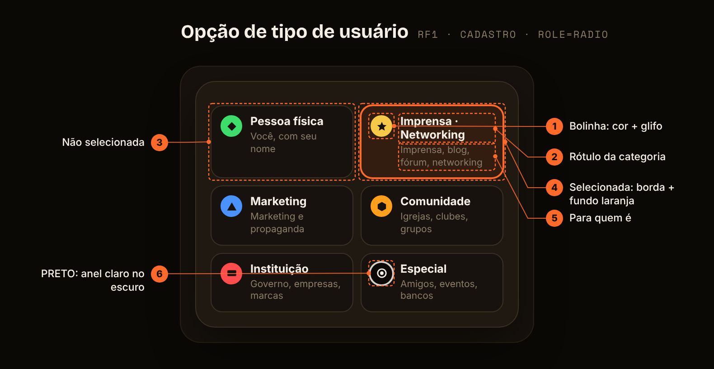

| # | Parte | Dado (API / domínio) | Regra |
|---|---|---|---|
| 1 | Bolinha: cor + glifo | `UserCategoryEnum` | Mesmo componente do feed |
| 2 | Rótulo da categoria | `label` | — |
| 3 | Não selecionada | — | Borda neutra |
| 4 | Selecionada: borda + fundo laranja | `aria-checked=true` | `role=radio` dentro de `radiogroup`; setas trocam a opção |
| 5 | Para quem é | `description` | Ajuda a escolher |
| 6 | PRETO: anel claro no escuro | — | Contraste 1,06:1 sem anel (DESIGN_SYSTEM §3) |

### Sessão ativa

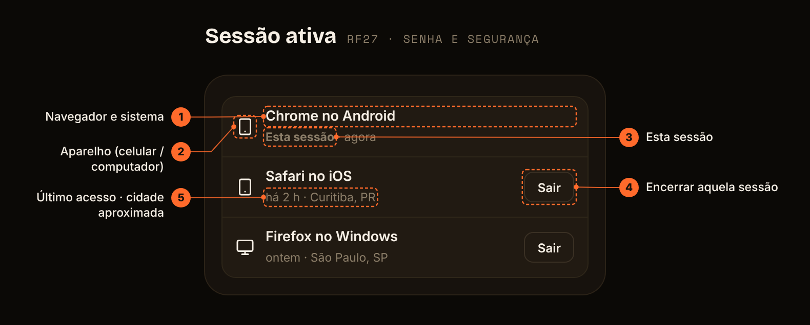

| # | Parte | Dado (API / domínio) | Regra |
|---|---|---|---|
| 1 | Navegador e sistema | `SessionView.device` | Resumo do User-Agent, nunca o UA cru |
| 2 | Aparelho (celular / computador) | `device` | Ícone `smartphone`/`monitor` |
| 3 | Esta sessão | `current` | Não tem botão Sair (usa "Sair desta conta") |
| 4 | Encerrar aquela sessão | `DELETE /api/v1/me/sessions/{id}` | O `id` exposto é um HMAC: o id real da sessão nunca sai do servidor |
| 5 | Último acesso · cidade aproximada | `lastAccessAt` · cidade ⏳ (geo-IP não implementado) | — |

### Post · tema claro

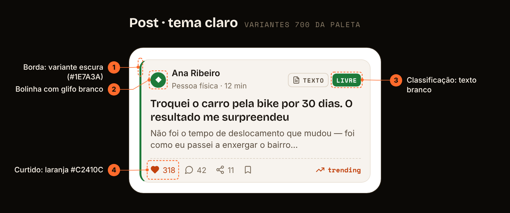

| # | Parte | Dado (API / domínio) | Regra |
|---|---|---|---|
| 1 | Borda: variante escura (#1E7A3A) | tema claro | Variantes 700 da paleta (≥ 5:1 sobre branco) |
| 2 | Bolinha com glifo branco | tema claro | `--glyph-on-dot: #FFFFFF` |
| 3 | Classificação: texto branco | — | Igual nos dois temas |
| 4 | Curtido: laranja #C2410C | `viewer.liked` | Laranja de texto do tema claro (5,18:1) |

### Moldura do post

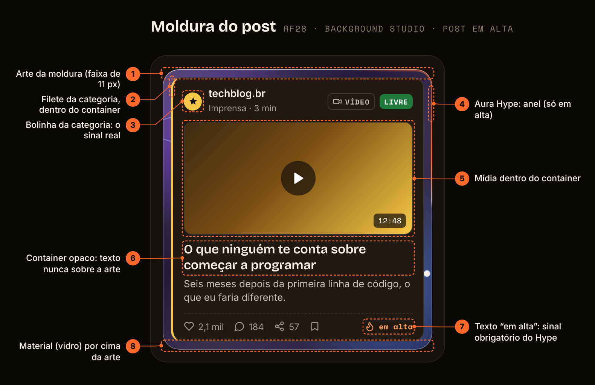

| # | Parte | Dado (API / domínio) | Regra |
|---|---|---|---|
| 1 | Arte da moldura (faixa de 11 px) | `background` resolvido: aura, cor, cartela, Aura Plus (vídeo + pôster) ou arte própria | Decorativa (`aria-hidden`); nunca imita sozinha uma cor de categoria |
| 2 | Filete da categoria, dentro do container | `author.category.color` | Sai da borda do card e fica dentro do container |
| 3 | Bolinha da categoria: o sinal real | `author.category.code` | Cor + glifo + rótulo, como em todo card |
| 4 | Aura Hype: anel (só em alta) | `auraHypeStyle` + ranking | O autor escolhe o estilo; o efeito só liga com o post em alta; anima ≤ 5 s |
| 5 | Mídia dentro do container | `mediaUrl` | A arte nunca cobre a mídia |
| 6 | Container opaco: texto nunca sobre a arte | `container.color`, `container.ink` | Contraste ≥ 4,5:1 conferido no cliente e no servidor |
| 7 | Texto "em alta": sinal obrigatório do Hype | ranking | O brilho é enfeite; o texto é o sinal |
| 8 | Material (vidro) por cima da arte | `materialId` | No feed, vidro "falso" sem `backdrop-filter` (desempenho) |

---

## 6. Manutenção

- **Ator novo** (ex.: papel de moderação no código) → §1.1, §1.2, §1.4 e o [diagrama de casos de uso](DIAGRAMA_CASOS_DE_USO.md).
- **Atributo novo** → classificar nas 7 facetas (§3.1) antes de criar a coluna; dado sensível ou de criança exige
  revisão de base legal ([RF3](rf/RF03-consentimento-privacidade.md)).
- **Chave nova em `type_details`** → `UserTypeDetailsValidator.RULES` (e `PRIVATE_KEYS` se for privada), §3.3 e
  [PESQUISA_DADOS_USUARIO.md](PESQUISA_DADOS_USUARIO.md) §3.
- **Card novo ou alterado** → protótipo, `anatomy.mjs` (spec do card), `node design/prototype/anatomy.mjs` e a tabela em §5.3.
