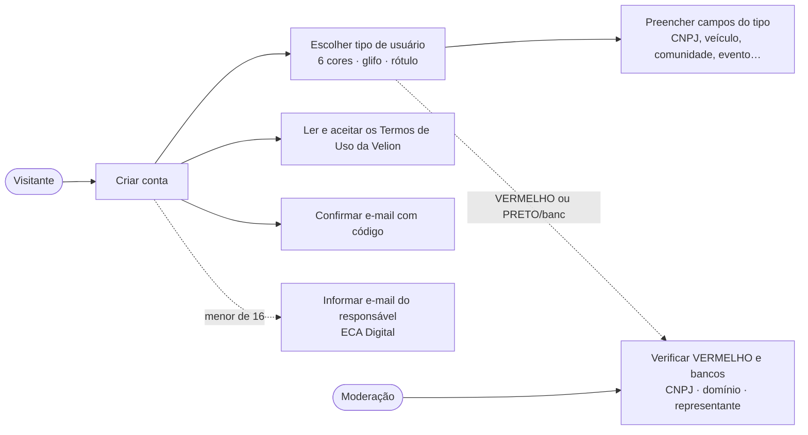
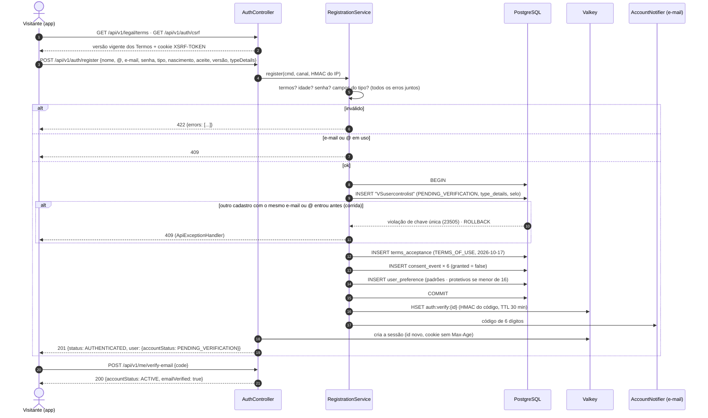
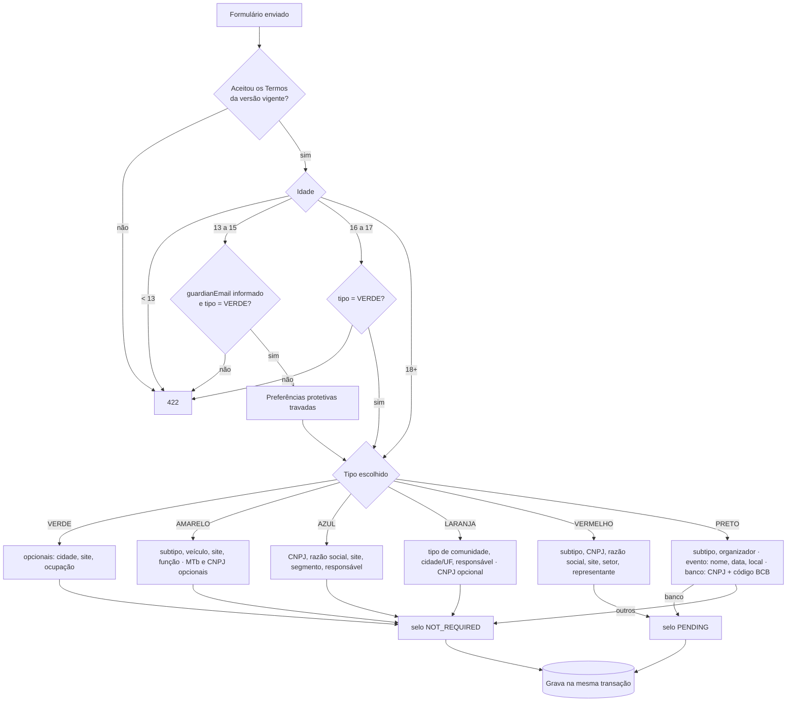
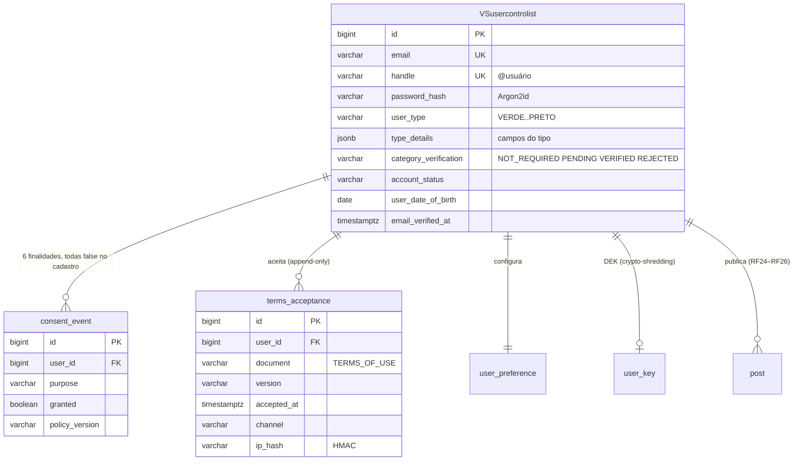

# RF1 · Cadastro de usuário

> **Como** visitante, **quero** criar uma conta escolhendo meu tipo de usuário (uma das 6 cores) e aceitando
> os Termos de Uso da Velion **para** publicar e ser encontrado nos feeds com a cor certa.

| | |
|---|---|
| **Base legal (LGPD)** | Art. 7º, V (execução de contrato) para os dados do cadastro e o aceite dos Termos; Art. 7º, I (consentimento) para os usos opcionais — todos começam desligados ([RF3](RF03-consentimento-privacidade.md)) |
| **Termos de Uso** | Texto da Velion (dona do Orange Social) em [`docs/legal/TERMOS_DE_USO.md`](../legal/TERMOS_DE_USO.md), com marcadores `{{…}}` para os dados da empresa; aceite obrigatório, caixa desmarcada |
| **ECA Digital** | Mínimo 13 anos; menor de 16 informa o e-mail do responsável e nasce com proteções travadas; organizações exigem responsável 18+ |
| **Campos por tipo** | [`PESQUISA_DADOS_USUARIO.md`](../PESQUISA_DADOS_USUARIO.md) §3 — validados por `UserTypeDetailsValidator` |
| **Status** | 🟡 Parcial — API, regras, verificação de e-mail testes e protótipo prontos; envio real de e-mail (OS-12), vínculo completo com o responsável (OS-49) e telas no app (OS-39) ainda não |

## Critérios de aceite

1. Dados mínimos: nome de exibição, `@usuário` único (3–30, `a-z 0-9 . _`), e-mail único (minúsculas),
   senha de 12 a 128 caracteres (Argon2id), data de nascimento, **tipo de usuário** e aceite da **versão vigente**
   dos Termos de Uso da Velion.
2. Campos específicos do tipo em `type_details`; chave fora da lista é recusada (minimização).
   CNPJ aceita o formato **alfanumérico** (IN RFB 2.229/2024).
3. VERMELHO e PRETO/banco nascem com selo `PENDING` (verificação manual antes de publicar).
4. Idade: < 13 recusado; < 16 exige `guardianEmail` e preferências protetivas; tipo diferente de VERDE exige 18+.
5. Na mesma transação: usuário `PENDING_VERIFICATION`, linha em `terms_acceptance` (versão, canal, HMAC do IP),
   **6 consentimentos com `granted = false`** e preferências padrão.
6. O cadastro já abre a sessão; um código de 6 dígitos vai por e-mail (30 min, 5 tentativas, reenvio 1/min)
   e confirmar leva a conta a `ACTIVE`. Sem confirmar, a pessoa lê mas não interage (403).
7. Todos os erros de validação voltam juntos (`422` com `errors[]`) para o formulário marcar cada campo.
8. **Cadastros simultâneos** com o mesmo e-mail ou `@usuário` (duas abas, clique duplo, robô): todos passam pela
   checagem prévia, mas as chaves únicas do banco (`uk_vsusercontrolist_email`, `uk_vsusercontrolist_handle`) deixam
   entrar só um; os outros recebem `409`, nunca `500`, e nada fica gravado pela metade.

## Caso de uso

## Sequência

## Atividades — regras por tipo de usuário

## Modelo de dados envolvido

Fluxo de atividades geral do cadastro: [`DIAGRAMA_ATIVIDADES.md`](../DIAGRAMA_ATIVIDADES.md) · estados da conta:
[`MAQUINA_ESTADOS.md`](../MAQUINA_ESTADOS.md) · login e sessão: [RF27](RF27-autenticacao-sessao.md).

## Rastreabilidade

| Camada | Artefato | Situação |
|---|---|---|
| Domínio | `UserControlList` (e-mail normalizado, `markEmailVerified`), `CategoryVerification`, `Cnpj`, `TermsAcceptance` | ✅ |
| Regras | `RegistrationService`, `UserTypeDetailsValidator`, `AgePolicy`, `PasswordPolicy`, `EmailVerificationService`, `LegalDocuments` | ✅ |
| Persistência | `V1__baseline.sql`, `V3__auth_terms_mfa_deletion.sql` (handle, type_details, selo, `terms_acceptance`) | ✅ |
| API | `POST /api/v1/auth/register`, `GET /api/v1/legal/terms`, `POST /api/v1/me/verify-email` (+ `/resend`), `POST /api/v1/me/terms` | ✅ |
| Testes | `AccountRulesTest` (CNPJ alfanumérico, senha, campos por tipo), `AuthApiIT.registerWithChosenTypeAndTermsStartsASessionThatAnIncognitoWindowDoesNotSee`, `AuthApiIT.registrationRulesTermsTypeFieldsAgeAndUniqueness`, `AuthApiIT.minorsKeepProtectiveDefaults`, `AuthApiIT.simultaneousRegistrationsWithTheSameEmailOrHandleCreateOneAccountAndTheRestGet409` (6 cadastros ao mesmo tempo: um 201, o resto 409) | ✅ |
| Corrida | `ApiExceptionHandler.race`: chave única violada (SQLState 23505) ou lock otimista → `409`; CHECK ou FK violado continua `500` e vai para o log | ✅ |
| Termos | [`docs/legal/TERMOS_DE_USO.md`](../legal/TERMOS_DE_USO.md) — preencher os `{{…}}` e passar por revisão jurídica | 🟡 |
| Pendências | e-mail transacional real (OS-12); eliminar cadastro não confirmado em 7 dias; vínculo do responsável (OS-49); consulta automática de CNPJ | ⏳ |
| Tela | Protótipo sobre o mosaico laranja com o logo oficial: [14-cadastro](../../design/prototype/screens/14-cadastro.png) (dados + escolha do tipo, cor + glifo + rótulo) e [15-cadastro-termos](../../design/prototype/screens/15-cadastro-termos.png) (campos do tipo + caixa dos Termos **desmarcada**; "Criar conta" só habilita depois do aceite) | ✅ protótipo |
| App | telas em Next.js/Expo | ⏳ OS-39 |
