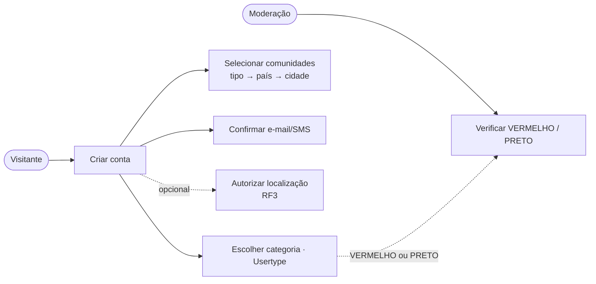
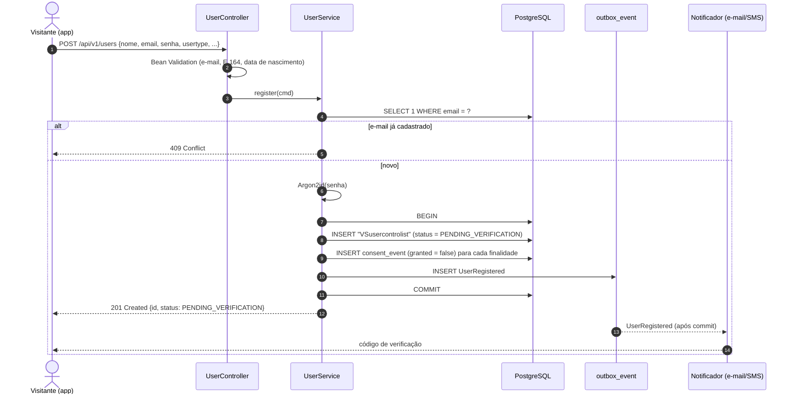
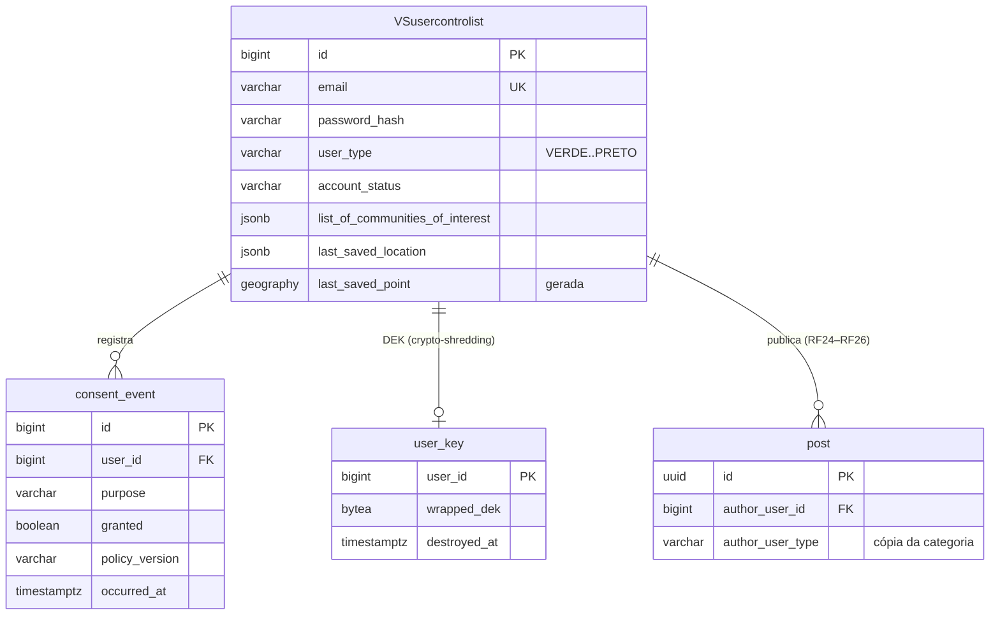

# RF1 · Cadastro de usuário

> **Como** visitante, **quero** criar uma conta escolhendo minha categoria (Usertype) **para** publicar e
> ser encontrado nos feeds com a cor certa.

| | |
|---|---|
| **Base legal (LGPD)** | Art. 7º, V (execução de contrato) para os dados obrigatórios; Art. 7º, I (consentimento) para os opcionais — ver [RF3](RF03-consentimento-privacidade.md) |
| **Dados sensíveis** | `sexual_preference` (Art. 11) — opcional, só com consentimento específico |
| **ECA Digital** | Aferição de idade no cadastro; conta de menor entra em modo restrito (OS-49) |
| **Status** | 🟡 Parcial — entidade, schema e testes prontos; endpoint `POST /api/v1/users` e verificação ainda não |

## Critérios de aceite

1. E-mail único; senha forte guardada como hash **Argon2id** (`password_hash`).
2. Conta nasce em `PENDING_VERIFICATION`; vira `ACTIVE` só após código de e-mail/SMS (7 dias de validade).
3. Todos os consentimentos opcionais nascem **desligados** (Privacy by Default).
4. `VERMELHO` e `PRETO` entram com verificação manual antes do selo.
5. Cadastro não confirmado em 7 dias é eliminado (princípio da necessidade, Art. 6º, III).

## Caso de uso

## Sequência

## Modelo de dados envolvido

Só conta `ACTIVE` aparece como autor com link para o perfil público ([RF25](RF25-perfil-publico-autor.md)) e
pode curtir, comentar ou compartilhar ([RF26](RF26-interacoes-post.md)); o cadastro em
`PENDING_VERIFICATION` lê, mas recebe 403 ao interagir.

Fluxo de atividades completo do cadastro (por Usertype, comunidades e GPS):
[`DIAGRAMA_ATIVIDADES.md`](../DIAGRAMA_ATIVIDADES.md) · estados da conta: [`MAQUINA_ESTADOS.md`](../MAQUINA_ESTADOS.md).

## Rastreabilidade

| Camada | Artefato | Situação |
|---|---|---|
| Domínio | `UserControlList`, `UserCategoryEnum`, `AccountStatus`, `GeoLocation`, `CommunityInterest` | ✅ |
| Persistência | `V1__baseline.sql` (parte de `schema.sql`), `UserControlListRepository` | ✅ |
| Testes | `DomainModelTest`, `UserControlListRepositoryIT` (PostGIS real) | ✅ |
| API | `POST /api/v1/users`, verificação de código | ⏳ OS-11, OS-12 |
| Tela | Protótipo: [Perfis](../../design/prototype/screens/04-profile-feed.png) (resultado do cadastro) | 🟡 tela de cadastro ainda não desenhada |
