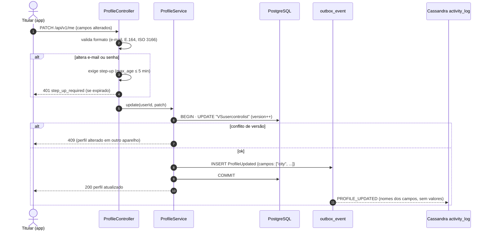
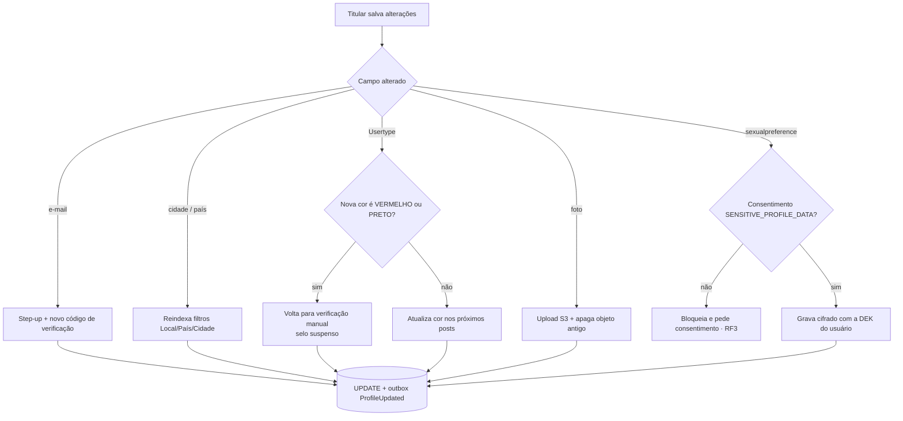

# RF2 · Editar informações pessoais e preferências do perfil

> **Como** titular, **quero** corrigir meus dados e ajustar minhas preferências **para** manter meu perfil
> exato e decidir o que o app usa sobre mim.

Este é o RF citado no material de LGPD: o comportamento do sistema é, ao mesmo tempo, o **direito de
correção** do titular.

| | |
|---|---|
| **Base legal (LGPD)** | Art. 18, III — correção de dados incompletos, inexatos ou desatualizados |
| **Controles de UI** | Inputs editáveis → Art. 18, III; preferências com efeito de consentimento → [RF3](RF03-consentimento-privacidade.md) |
| **Status** | 🟡 Parcial — modelo e tela de configurações prototipados; endpoint e auditoria ainda não |

## Critérios de aceite

1. Todos os 19 campos de `VSusercontrolist` são editáveis pelo titular, exceto `id` e o histórico.
2. Trocar **e-mail** ou **senha** exige reautenticação recente (step-up, OS-19).
3. Comunidades seguem a cadeia `typeofcommunity → selectcountry → selectcity` (OS-15).
4. Foto é trocada por URL pré-assinada; o banco guarda só `photo_object_key` (OS-18).
5. Cada alteração gera evento em `activity_log` **sem o valor em claro** (prestação de contas).

## Sequência

## Atividades — o que muda junto com cada campo

## Rastreabilidade

| Camada | Artefato | Situação |
|---|---|---|
| Domínio | setters de `UserControlList`, `CommunityInterest`, `GeoLocation` (validação de lat/lng) | ✅ |
| Testes | `DomainModelTest.geoLocationRejectsInvalidCoordinates` | ✅ parcial |
| API | `PATCH /api/v1/me`, step-up | ⏳ OS-14, OS-19 |
| Auditoria | `activity_log` (Cassandra) | ⏳ OS-45 |
| Tela | Protótipo: [Configurações → Dados do perfil](../../design/prototype/screens/05-config-lgpd.png) | ✅ protótipo |
