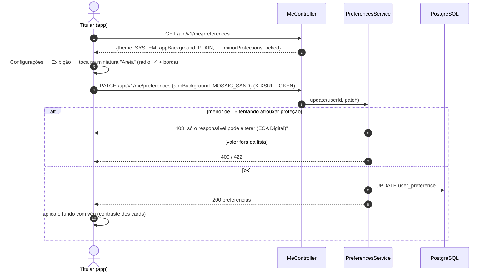
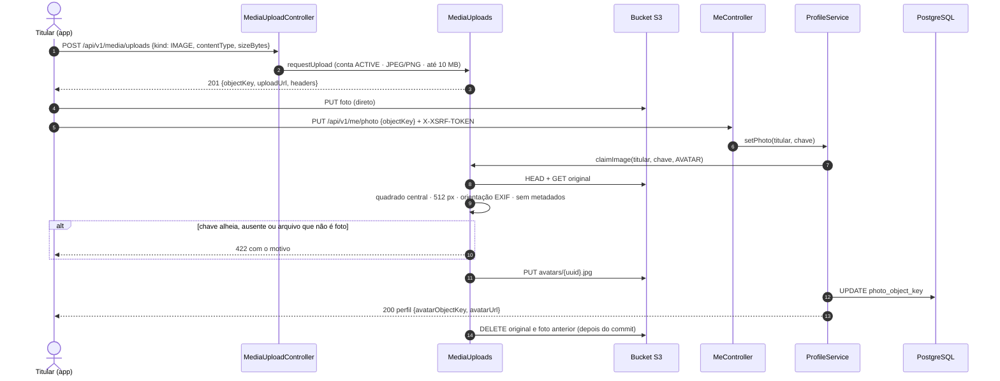
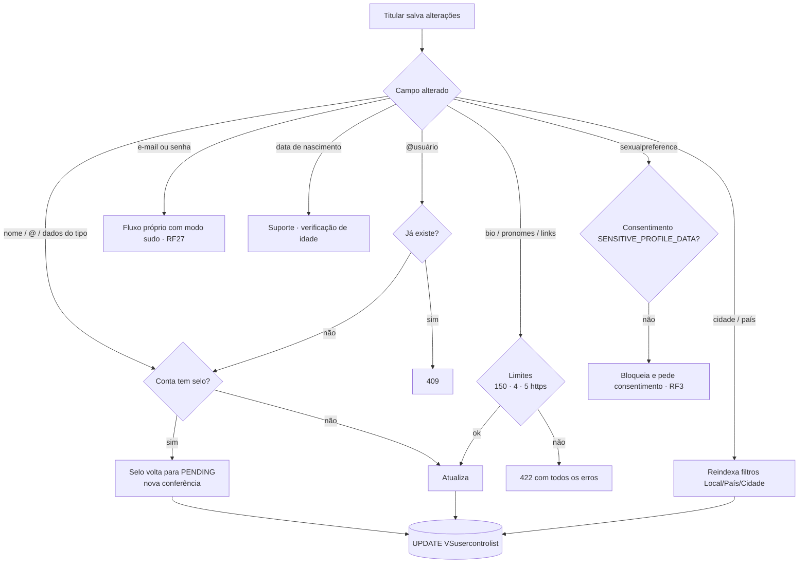

# RF2 · Editar informações pessoais, preferências e configurações

> **Como** titular, **quero** corrigir meus dados e ajustar minhas preferências — inclusive tema, fundo do app,
> privacidade, notificações e segurança — **para** manter meu perfil exato e decidir o que o app usa sobre mim.

Este é o RF citado no material de LGPD: o comportamento do sistema é, ao mesmo tempo, o **direito de
correção** do titular.

| | |
|---|---|
| **Base legal (LGPD)** | Art. 18, III — correção de dados incompletos, inexatos ou desatualizados |
| **Controles de UI** | Inputs editáveis → Art. 18, III; preferências com efeito de consentimento → [RF3](RF03-consentimento-privacidade.md); senha, 2FA e sessões → [RF27](RF27-autenticacao-sessao.md); excluir conta → [RF23](RF23-direitos-titular-lgpd.md) |
| **Configurações** | 9 seções ([`PESQUISA_DADOS_USUARIO.md`](../PESQUISA_DADOS_USUARIO.md) §4): Conta · Senha e segurança · Privacidade · Bloqueados · Notificações · Conteúdo · Bem-estar · Exibição e acessibilidade · Seus dados |
| **Status** | 🟡 Parcial — `GET/PATCH /api/v1/me/profile`, `/preferences` e a **foto de perfil** (`PUT/DELETE /api/v1/me/photo`, OS-18) com testes; troca de e-mail e auditoria ainda não |

## Critérios de aceite

1. Editáveis pelo titular:
   - nome, `@usuário` (único);
   - bio (até 150 caracteres), até 4 pronomes, até 5 links `https`;
   - país/UF/cidade, gênero, e-mail de recuperação, celular E.164;
   - campos do tipo de usuário, revalidados como no cadastro.
2. **Não** editáveis por aqui:
   - e-mail e senha (fluxo próprio com modo sudo, RF27);
   - data de nascimento (suporte, por causa da verificação de idade);
   - tipo de usuário.
3. Conta **com selo** que troca nome, `@` ou dados da categoria volta para `PENDING` (nova conferência).
4. Preferências em `PATCH` parcial (campo ausente = mantém):
   - **Exibição:** tema (sistema/escuro/claro), **fundo do app**, idioma (pt-BR, en, es), fonte 85–150 %, reduzir movimento.
   - **Privacidade:** perfil privado, quem comenta, mostrar o ano de nascimento.
   - **Conteúdo e bem-estar:** feed inicial, conteúdo sensível, lembrete de 10 a 600 min.
   - **Notificações:** curtidas, comentários, compartilhamentos e alertas oficiais.
   - **Segurança:** alertas de login.
5. **Fundo do app:** `PLAIN` (liso, padrão), `NETWORK` (logo em rede), `MOSAIC` (mosaico laranja, também o fundo do login), `MOSAIC_CLASSIC`, `MOSAIC_DEEP`, `MOSAIC_GLOW`, `MOSAIC_SKY` e `MOSAIC_SAND`.
   - As artes ficam em [`design/brand/backgrounds/`](../../design/brand/backgrounds/) e levam o logo oficial no lugar do genérico.
   - O app aplica um véu por cima para manter o contraste dos cards (WCAG 1.4.3).
6. **Menor de 16** (ECA Digital): perfil privado, comentários só de seguidores e lembrete de uso ficam travados (`403`); tema e fundo continuam livres.
7. **Foto de perfil** (OS-18), com conta `ACTIVE`:
   - O app pede o envio em `POST /api/v1/media/uploads` (o mesmo da foto do post, [RF29](RF29-publicar-post.md)) e
     manda o arquivo direto ao bucket.
   - `PUT /api/v1/me/photo {objectKey}`: a chave precisa ser do titular e existir; senão `422` "Envie a foto de
     novo", sem dizer o motivo.
   - A foto é recortada em **quadrado no centro**, fica com **512 px** (menor que isso, só recorta) e sai **sem
     EXIF/GPS**, com a orientação já aplicada. A versão limpa vai para `avatars/…`.
   - A resposta é o perfil com `avatarObjectKey` e `avatarUrl`; a foto passa a aparecer como avatar nos posts e no
     perfil público.
   - Trocar a foto apaga a anterior do bucket depois do commit. `DELETE /api/v1/me/photo` volta às iniciais e
     apaga a foto.
   - Trocar a foto não mexe no selo da categoria.

## Sequência · editar preferências (fundo do app)

## Sequência · trocar a foto de perfil

## Atividades — o que muda junto com cada campo do perfil

## Rastreabilidade

| Camada | Artefato | Situação |
|---|---|---|
| Domínio | `UserControlList` (handle, bio, pronomes, links, `type_details`, selo), `UserPreference` (enums de tema, fundo, comentários, conteúdo) | ✅ |
| Localização | `GeoLocation` (`LastSavedLocation`, gravada só com `LOCATION_TRACKING`, [RF3](RF03-consentimento-privacidade.md)): latitude −90..90 e longitude −180..180 validadas na forma positiva, então `NaN` é recusado (`lat < -90 \|\| lat > 90` deixava passar, lição do Friendly Eats 6da8069); `DomainModelTest.geoLocationRejectsInvalidCoordinates` | ✅ |
| Aplicação / API | `ProfileService`, `PreferencesService`; `GET/PATCH /api/v1/me/profile`, `GET/PATCH /api/v1/me/preferences` | ✅ |
| Foto de perfil | `PUT/DELETE /api/v1/me/photo` → `ProfileService.setPhoto/removePhoto` → `MediaUploads.claimImage(…, Fit.AVATAR)` (`ImageSanitizer`: recorte central de 512 px, sem EXIF/GPS) e `MediaJanitor` (foto anterior e original saem depois do commit); `avatarUrl` no `ProfileView` | ✅ |
| Persistência | `user_preference` e colunas de perfil em `V3__auth_terms_mfa_deletion.sql` | ✅ |
| Testes | `AuthApiIT.preferencesIncludingAppBackgroundAndProfileEditing`, `AuthApiIT.minorsKeepProtectiveDefaults`, `DomainModelTest`; foto: `ImageSanitizerTest.avatarIsTheCenterSquareAt512Px`, `PostPublishingApiIT.profilePhotoIsASquareWithoutExifAndTheOldOneLeavesTheBucket` (Garage real) | ✅ |
| Artes | `design/brand/backgrounds/` (6 mosaicos), `orange-social-logo.svg` (rede) | ✅ |
| Pendências | troca de e-mail com reconfirmação; tela de recorte da foto no app (OS-39); `activity_log` sem valores (OS-45); comunidades encadeadas (OS-15) | ⏳ |
| Tela | Protótipo: [05-config-lgpd](../../design/prototype/screens/05-config-lgpd.png) (Configurações), [18-exibicao-fundo](../../design/prototype/screens/18-exibicao-fundo.png) (tema + seletor com as 8 miniaturas, escolha aplicada na hora) e [21-feed-fundo-areia](../../design/prototype/screens/21-feed-fundo-areia.png) (feed com o fundo e o véu) | ✅ protótipo |
