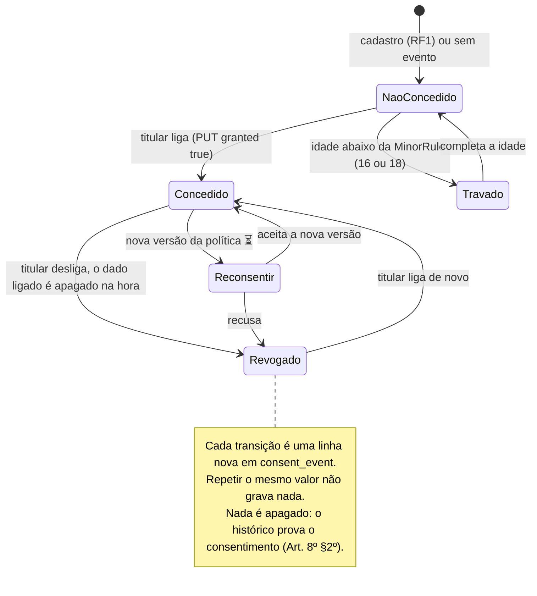
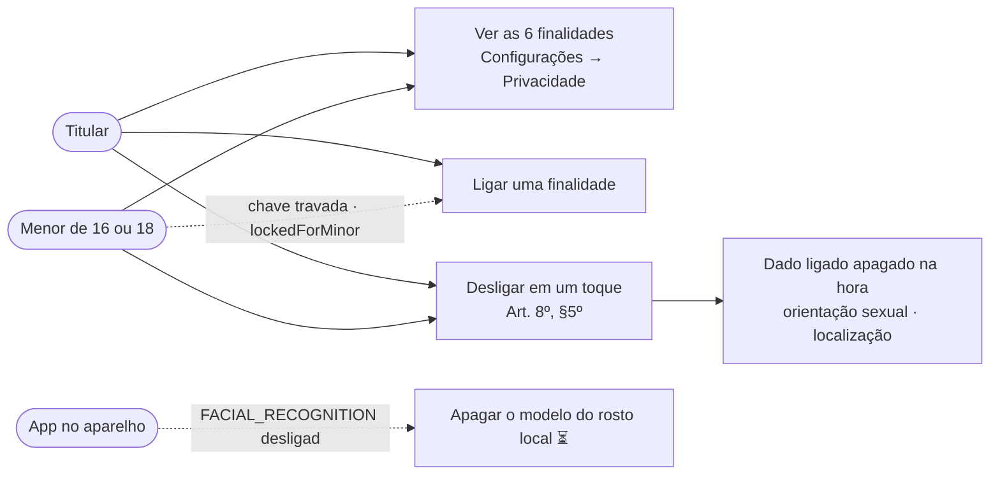
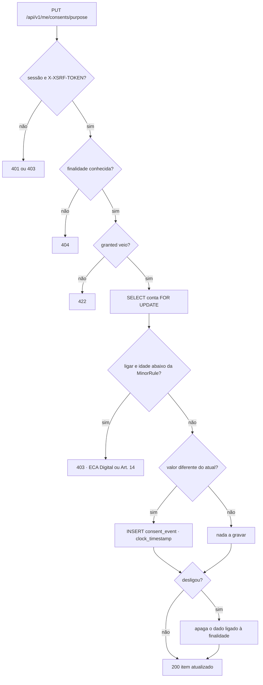
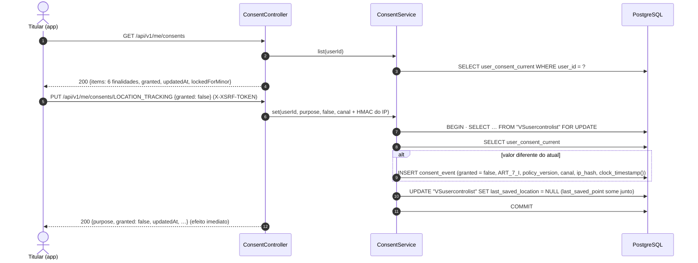
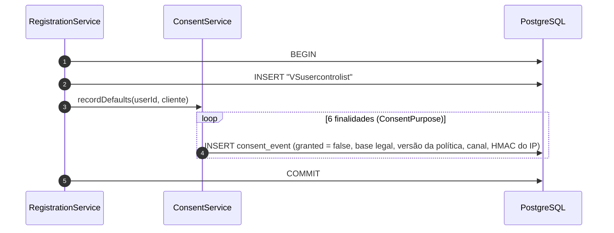

# RF3 · Gerenciar consentimentos e privacidade

> **Como** titular, **quero** ligar e desligar cada uso opcional dos meus dados **para** autorizar só o que
> eu quiser e revogar a qualquer momento.

> ⚠️ **Escopo inferido.** A especificação lista RF3 entre os RFs de LGPD sem descrevê-lo. Este documento
> assume que RF3 cobre os toggles de consentimento da tela de configurações. Confirmar com a lista oficial.

| | |
|---|---|
| **Base legal (LGPD)** | Art. 7º, I (consentimento) · Art. 8º, §5º (revogação facilitada) · Art. 11 (dado sensível) · Art. 14 (criança e adolescente) |
| **Princípio** | Privacy by Default — todo tratamento opcional começa **desligado** |
| **Contrato** | O mesmo do Friendly Eats (`GET /api/v1/me/consents`, `PUT /api/v1/me/consents/{purpose}`): o app web consome os dois com o mesmo código |
| **Status** | 🟡 Parcial — API de consentimentos (OS-40), revogação em um toque com efeito imediato (OS-41), histórico append-only e trava por idade prontos; reconsentimento por nova versão da política, consentimento do responsável e consumidores (feed, marketing, parceiros, app do reconhecimento facial) ainda não |

## Finalidades e regras

Fonte única: o enum `ConsentPurpose` (rótulo, descrição, base legal, `sensitive` e `MinorRule`). A ordem abaixo é a
ordem da tela e da lista da API.

| Finalidade (`purpose`) | Rótulo na tela | Base | `sensitive` | Padrão | Trava (`MinorRule`) | Ao revogar |
|---|---|---|---|---|---|---|
| `LOCATION_TRACKING` | Guardar minha localização | Art. 7º, I | não | desligado | menor de 16 (ECA Digital) | apaga `last_saved_location` (e o ponto PostGIS gerado) na mesma transação |
| `PERSONALIZED_FEED` | Feed pelos meus interesses | Art. 7º, I | não | desligado | menor de 16: sem perfilamento | o feed confere o estado atual a cada uso ⏳ |
| `SENSITIVE_PROFILE_DATA` | Orientação sexual no perfil | Art. 11, I | **sim** | desligado | menor de 18, até o consentimento do responsável (Art. 14) | apaga `sexual_preference` na mesma transação |
| `FACIAL_RECOGNITION` | Reconhecimento facial no aparelho (OS-42) | Art. 11, I | **sim** | desligado | menor de 18 (biometria; OS-49 "sem biometria") | nada no servidor: o modelo do rosto fica só no aparelho, e o app o apaga ao ver `granted = false` ⏳ |
| `MARKETING` | Novidades e ofertas da Velion e de marcas | Art. 7º, I | não | desligado | menor de 16 | quem envia confere o estado atual ⏳ |
| `THIRD_PARTY_SHARING` | Compartilhar com parceiros | Art. 7º, I | não | desligado | — | quem compartilha confere o estado atual ⏳; dado sensível nunca é compartilhado |

## Critérios de aceite

1. Toda conta nasce com as **6 finalidades desligadas** (`ConsentService.recordDefaults` no cadastro, [RF1](RF01-cadastro-usuario.md));
   sem evento gravado, a finalidade vale **desligada**.
2. `GET /api/v1/me/consents` → `{"items":[{"purpose","label","description","legalBasis","sensitive","granted",
   "updatedAt","lockedForMinor"}]}`, uma linha por finalidade, na ordem da tela. `updatedAt` é a hora do último
   evento (nulo se não houver nenhum).
3. `PUT /api/v1/me/consents/{purpose}` com `{"granted": true|false}` devolve o item atualizado. Mudar o valor grava
   uma linha nova em `consent_event` (base legal, versão da política, canal e HMAC do IP); **repetir o mesmo valor não
   grava nada**, mesmo vindo de várias abas ao mesmo tempo (a conta fica travada com `SELECT … FOR UPDATE` e o
   evento leva `clock_timestamp()`, então o histórico sai na ordem real). Finalidade desconhecida → `404`; sem
   `granted` → `422`; sem sessão → `401`; escrita sem `X-XSRF-TOKEN` → `403`.
4. Menor de 16 não liga `LOCATION_TRACKING`, `PERSONALIZED_FEED` nem `MARKETING` (`403`, ECA Digital); menor de 18
   não liga `SENSITIVE_PROFILE_DATA` nem `FACIAL_RECOGNITION` enquanto não houver o consentimento do responsável
   (`403`, LGPD Art. 14). **Desligar continua livre.** A tela mostra a chave travada pelo campo `lockedForMinor`.
5. **Revogar tem efeito imediato**, na mesma transação do evento: `SENSITIVE_PROFILE_DATA` apaga `sexual_preference`
   e `LOCATION_TRACKING` apaga `last_saved_location`.

## Estados de um consentimento

## Caso de uso

## Atividades — mudar um consentimento

## Sequência — revogar localização

## Sequência — no cadastro

## Rastreabilidade

| Camada | Artefato | Situação |
|---|---|---|
| Persistência | `consent_event`, view `user_consent_current` (`schema.sql`) | ✅ |
| Cadastro | `RegistrationService` → `ConsentService.recordDefaults` grava as 6 finalidades com `granted = false` na mesma transação do usuário (Privacy by Default) — `ConsentApiIT.registrationRecordsTheSixPurposesOffAndTheListShowsWhen` | ✅ |
| Domínio | `ConsentPurpose`: rótulo, descrição, base legal, `sensitive` e `MinorRule` (16 ou 18 anos); fonte única também do cadastro | ✅ |
| Preferências de privacidade | perfil privado, quem comenta e ano de nascimento em `user_preference` ([RF2](RF02-editar-perfil.md)); travadas para menor de 16 | ✅ |
| API | `GET /api/v1/me/consents` e `PUT /api/v1/me/consents/{purpose}` (`ConsentController` → `ConsentService`), mesmo contrato do Friendly Eats; `ConsentApiIT` (padrão desligado, 404/422/401/403 sem CSRF, histórico append-only, 6 abas mandando o mesmo valor gravam 1 evento) | ✅ OS-40, OS-41 |
| Efeitos imediatos | revogar apaga `sexual_preference` e `last_saved_location` na mesma transação (`ConsentApiIT`) | ✅ OS-41 |
| Corrida | `UserControlListRepository.lockById` (`SELECT … FOR UPDATE`) serializa as mudanças da mesma conta; o evento leva `clock_timestamp()` para a view `user_consent_current` pegar o último de verdade | ✅ |
| Menores | `MinorRule` com `AgePolicy`: 16 (ECA Digital) e 18 (dado sensível e biometria, Art. 14); `ConsentApiIT.minorsCannotTurnOnProfilingMarketingTrackingSensitiveDataOrBiometrics` | ✅ (consentimento do responsável ⏳ OS-49) |
| Reconhecimento facial | finalidade sensível e desligada; o modelo do rosto nunca vai para o servidor; app on-device | 🟡 só a finalidade · ⏳ OS-42 |
| Dado sensível no perfil | `sexual_preference` ainda não é editável pela API: entra junto com a cifra por usuário (OS-46) e só com `SENSITIVE_PROFILE_DATA` ligado | ⏳ OS-46 |
| Consumidores | GPS (OS-16), feed personalizado, marketing e parceiros conferem `ConsentService.granted` quando existirem | ⏳ OS-16 |
| Reconsentimento | nova `privacy-version` pede reconfirmação das finalidades ligadas | ⏳ |
| Tela | Protótipo: [Configurações → Privacidade](../../design/prototype/screens/05-config-lgpd.png) | ✅ protótipo |
