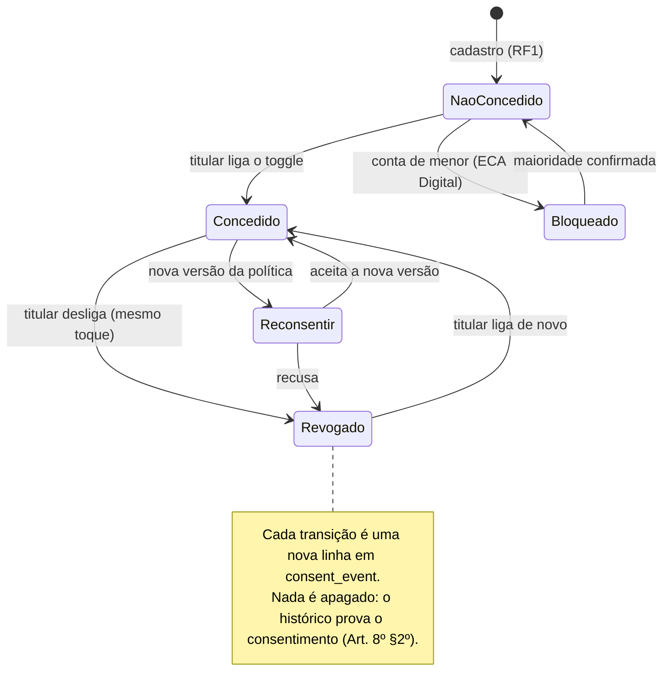
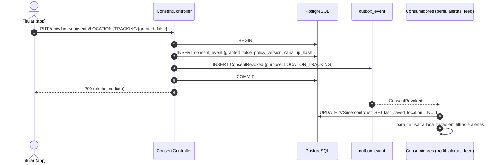

# RF3 · Gerenciar consentimentos e privacidade

> **Como** titular, **quero** ligar e desligar cada uso opcional dos meus dados **para** autorizar só o que
> eu quiser e revogar a qualquer momento.

> ⚠️ **Escopo inferido.** A especificação lista RF3 entre os RFs de LGPD sem descrevê-lo. Este documento
> assume que RF3 cobre os toggles de consentimento da tela de configurações. Confirmar com a lista oficial.

| | |
|---|---|
| **Base legal (LGPD)** | Art. 7º, I (consentimento) · Art. 8º, §5º (revogação facilitada) · Art. 11 (dado sensível) |
| **Princípio** | Privacy by Default — todo tratamento opcional começa **desligado** |
| **Status** | 🟡 Parcial — tabela `consent_event` (append-only) e view `user_consent_current` prontas; API e efeitos ainda não |

## Finalidades e regras

| Finalidade (`purpose`) | Base | Padrão | Bloqueios |
|---|---|---|---|
| `LOCATION_TRACKING` | Art. 7º, I | desligado | menores (ECA Digital) |
| `PERSONALIZED_FEED` | Art. 7º, I | desligado | menores: sem perfilamento |
| `MARKETING` | Art. 7º, I | desligado | menores |
| `FACIAL_RECOGNITION` | Art. 11, I | desligado | menores; processamento só no aparelho |
| `SENSITIVE_PROFILE_DATA` | Art. 11, I | desligado | — |
| `THIRD_PARTY_SHARING` | Art. 7º, I | desligado | — |

## Estados de um consentimento

## Sequência — revogar localização

## Rastreabilidade

| Camada | Artefato | Situação |
|---|---|---|
| Persistência | `consent_event`, view `user_consent_current` (`schema.sql`) | ✅ |
| API | `GET/PUT /api/v1/me/consents/{purpose}` | ⏳ OS-40, OS-41 |
| Efeitos | consumidores de `ConsentRevoked` | ⏳ OS-16, OS-42 |
| Menores | bloqueio por idade | ⏳ OS-49 |
| Tela | Protótipo: [Configurações → Privacidade](../../design/prototype/screens/05-config-lgpd.png) | ✅ protótipo |
