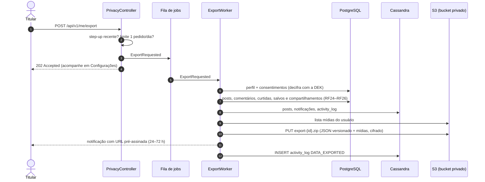
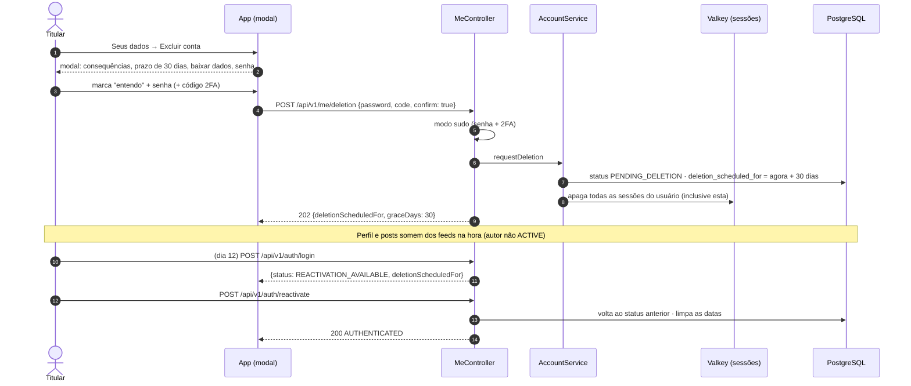
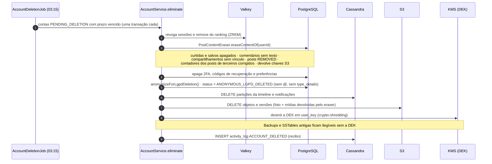
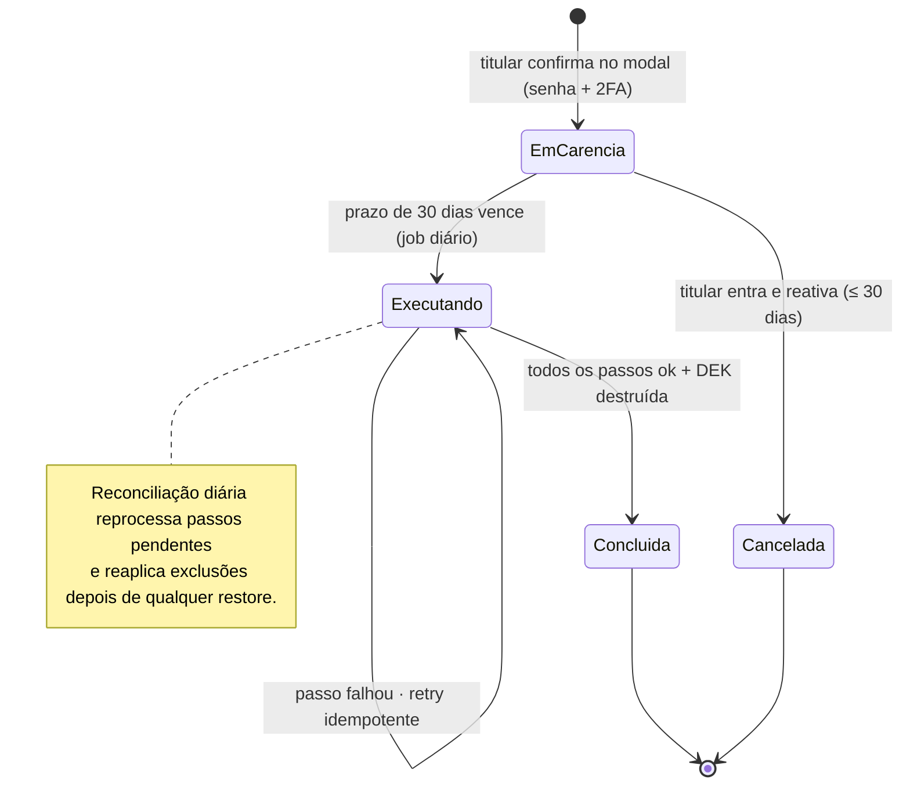

# RF23 · Direitos do titular — portabilidade e eliminação

> **Como** titular, **quero** baixar todos os meus dados e poder apagar minha conta **para** exercer os
> direitos que a LGPD me garante.

> ⚠️ **Escopo inferido.** A especificação cita RF23 como "LGPD Compliance & Segurança". Este documento
> cobre os controles **Exportar dados** e **Excluir conta**. Confirmar com a lista oficial de RFs.

| | |
|---|---|
| **Base legal (LGPD)** | Art. 18, V (portabilidade) · Art. 18, VI (eliminação) · Art. 16 (conservação permitida) · Art. 37 (registro das operações) |
| **Retenção legal** | Registros de acesso: 6 meses (Marco Civil, Art. 15) |
| **Exclusão com carência** | Modal explica as consequências e pede senha (+2FA) e confirmação; a conta fica `PENDING_DELETION` por **30 dias** (oculta, todas as sessões encerradas); entrar de novo no prazo oferece **reativar**; vencido o prazo, o job diário elimina |
| **Status** | 🟡 Parcial — carência de 30 dias com reativação, job de eliminação (posts, interações, 2FA, preferências, anonimização), `user_key` (DEK) e TTLs prontos; exportação, S3, Cassandra e destruição da DEK na saga ainda não |

## Exportar meus dados (Art. 18, V)

## Excluir conta — modal, carência de 30 dias e reativação

O modal (`role="alertdialog"`, foco inicial em **Cancelar**) diz, antes de confirmar:

- **O que será apagado:** perfil, publicações, fotos, comentários, curtidas, seguidores e configurações.
- **O que continua existindo:**
  - mensagens enviadas ficam com quem recebeu, como "Conta excluída";
  - registros de acesso são guardados por 6 meses (Marco Civil, art. 15).
- **Como reativar:** entrar de novo antes de DD/MM.
- **Antes de excluir:** link para baixar uma cópia dos dados.

Confirmar exige marcar "Entendo as consequências" e digitar a senha (e o código, com 2FA).

## Eliminação depois do prazo — saga idempotente

## Estados da saga

Ciclo de vida da conta: [`MAQUINA_ESTADOS.md`](../MAQUINA_ESTADOS.md) (estado terminal `Anonymous_LGPD_Deleted`).

## Rastreabilidade

| Camada | Artefato | Situação |
|---|---|---|
| Domínio | `UserControlList.anonymizeForLgpdDeletion`, `AccountStatus` (terminal) | ✅ |
| Persistência | `user_key` (DEK), TTL em `post_timeline`/`notification`, `TrendingScoreRepository.remove` | ✅ |
| Posts e interações | `PostContentEraser` + consultas de eliminação em `PostRepository` / `PostCommentRepository` (idempotente); a eliminação também apaga a moldura (`post.background`, V4 · [RF28](RF28-moldura-post.md)) | ✅ |
| Testes | `DomainModelTest.lgpdDeletionIsTerminalAndErasesPersonalData`, `TrendingScoreRepositoryIT.removeClearsEveryRankingOfTheFeed`, `PostApiIT.lgpdErasureRemovesContentAndFixesOtherPostsCounters` (inclui a moldura) | ✅ |
| Perfil público | conta eliminada some do perfil público e aparece como "Conta excluída" sem link ([RF25](RF25-perfil-publico-autor.md)) | ✅ |
| Exportação | job + ZIP cifrado + URL pré-assinada | ⏳ OS-43 |
| Exclusão com carência | `UserControlList.requestDeletion/reactivate`, `AccountService.requestDeletion/eliminate`, `AccountDeletionJob`, `POST /api/v1/me/deletion`, `POST /api/v1/auth/reactivate` | ✅ |
| Testes da carência | `AccountRulesTest.deletionGraceAllowsReactivationOnlyWithinTheWindow`, `AuthApiIT.deletionHidesAccountAllowsReactivationWithin30DaysAndEliminatesAfter` | ✅ |
| Exclusão — passos fora do PostgreSQL | S3, Cassandra, Valkey (ranking), destruição da DEK, reconciliação | ⏳ OS-44, OS-46 |
| Auditoria | registro de operações (Art. 37) | ⏳ OS-45, OS-4A |
| Tela | Protótipo: [Configurações → Seus dados](../../design/prototype/screens/05-config-lgpd.png); modal de exclusão [19-excluir-conta](../../design/prototype/screens/19-excluir-conta.png) (`alertdialog` com consequências, data final, "Baixar uma cópia", caixa "Entendo" + senha + código; o botão só habilita após marcar); oferta de reativação no login [20-reativar-conta](../../design/prototype/screens/20-reativar-conta.png) | ✅ protótipo |
