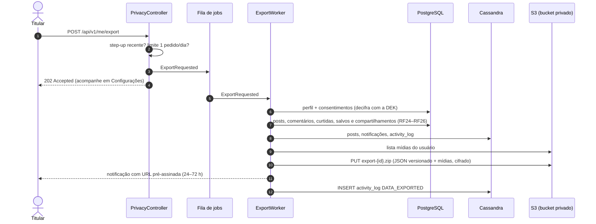
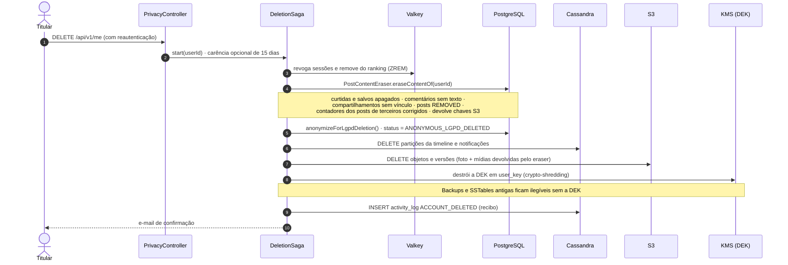
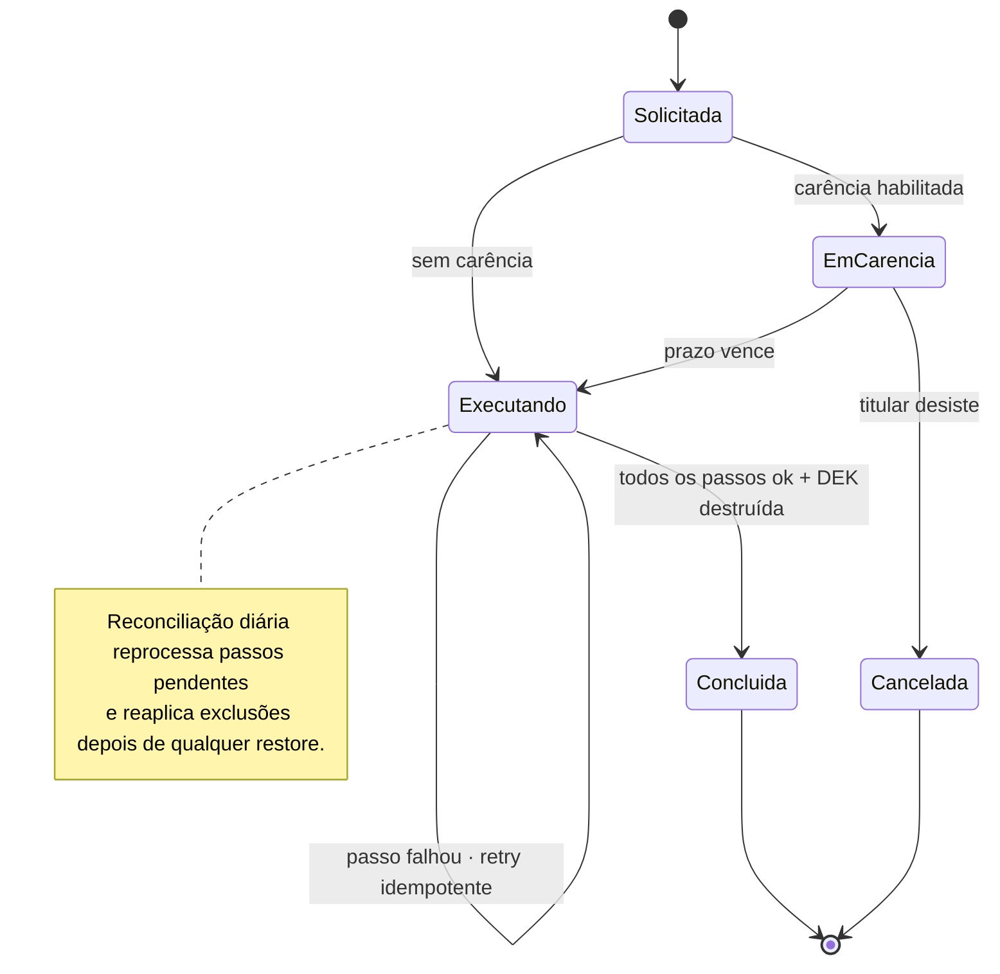

# RF23 · Direitos do titular — portabilidade e eliminação

> **Como** titular, **quero** baixar todos os meus dados e poder apagar minha conta **para** exercer os
> direitos que a LGPD me garante.

> ⚠️ **Escopo inferido.** A especificação cita RF23 como "LGPD Compliance & Segurança". Este documento
> cobre os controles **Exportar dados** e **Excluir conta**. Confirmar com a lista oficial de RFs.

| | |
|---|---|
| **Base legal (LGPD)** | Art. 18, V (portabilidade) · Art. 18, VI (eliminação) · Art. 16 (conservação permitida) · Art. 37 (registro das operações) |
| **Retenção legal** | Registros de acesso: 6 meses (Marco Civil, Art. 15) |
| **Status** | 🟡 Parcial — anonimização no domínio, estado terminal, `user_key` (DEK), TTLs e o passo de posts e interações (`PostContentEraser`) prontos; jobs de exportação e a orquestração da saga ainda não |

## Exportar meus dados (Art. 18, V)

## Excluir conta (Art. 18, VI) — saga idempotente

## Estados da saga

Ciclo de vida da conta: [`MAQUINA_ESTADOS.md`](../MAQUINA_ESTADOS.md) (estado terminal `Anonymous_LGPD_Deleted`).

## Rastreabilidade

| Camada | Artefato | Situação |
|---|---|---|
| Domínio | `UserControlList.anonymizeForLgpdDeletion`, `AccountStatus` (terminal) | ✅ |
| Persistência | `user_key` (DEK), TTL em `post_timeline`/`notification`, `TrendingScoreRepository.remove` | ✅ |
| Posts e interações | `PostContentEraser` + consultas de eliminação em `PostRepository` / `PostCommentRepository` (idempotente) | ✅ |
| Testes | `DomainModelTest.lgpdDeletionIsTerminalAndErasesPersonalData`, `TrendingScoreRepositoryIT.removeClearsEveryRankingOfTheFeed`, `PostApiIT.lgpdErasureRemovesContentAndFixesOtherPostsCounters` | ✅ |
| Perfil público | conta eliminada some do perfil público e aparece como "Conta excluída" sem link ([RF25](RF25-perfil-publico-autor.md)) | ✅ |
| Exportação | job + ZIP cifrado + URL pré-assinada | ⏳ OS-43 |
| Exclusão | saga + reconciliação + crypto-shredding | ⏳ OS-44, OS-46 |
| Auditoria | registro de operações (Art. 37) | ⏳ OS-45, OS-4A |
| Tela | Protótipo: [Configurações → Seus dados](../../design/prototype/screens/05-config-lgpd.png) | ✅ protótipo |
