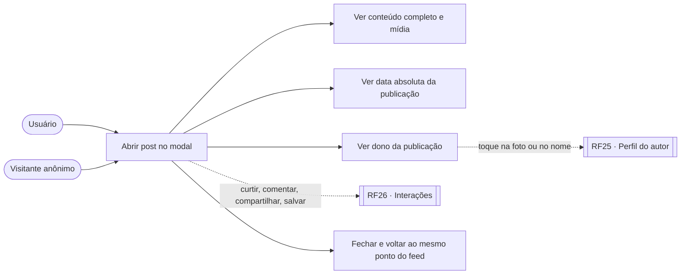
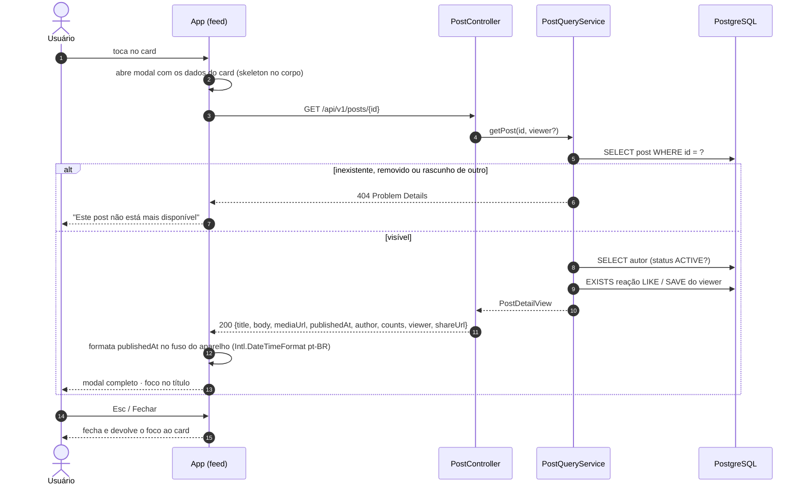
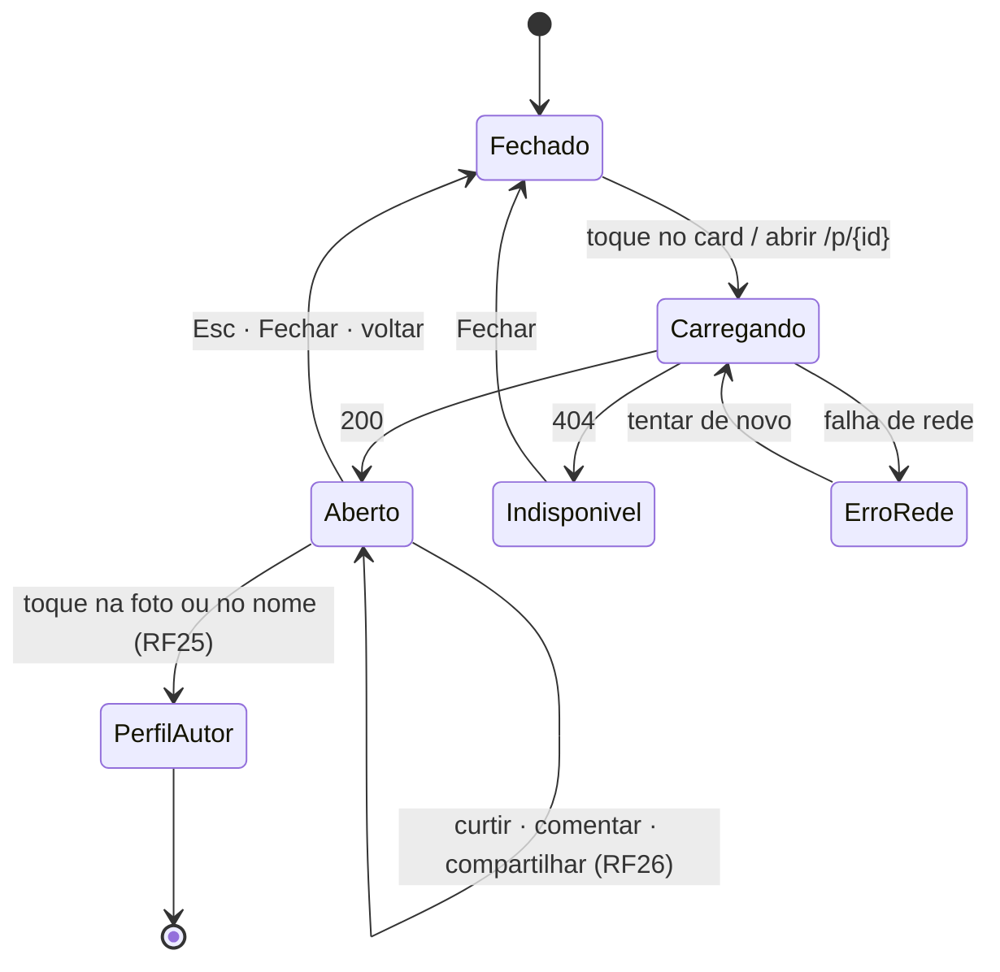
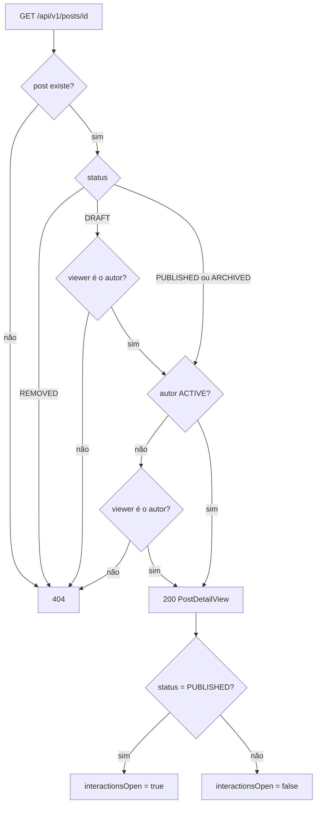

# RF24 · Visualizar post em detalhe

> **Como** usuário, **quero** tocar em um post do feed e ver tudo sobre ele num modal — conteúdo completo,
> dono da publicação, data e as interações — **para** decidir se curto, comento ou compartilho sem perder
> meu lugar no feed.

> ⚠️ **Numeração provisória.** RF4–RF22 não estão no repositório; RF24–RF26 foram numerados depois do
> último RF conhecido (RF23) para não colidir. Renumerar quando a lista oficial chegar.

| | |
|---|---|
| **Origem** | Auditoria de 2026-10-17: o card não abria nada; a data era só relativa |
| **Base legal (LGPD)** | Art. 7º, V (execução do serviço). Visitante anônimo lê post público sem nenhum dado pessoal tratado |
| **Status** | 🟡 Parcial — API, regras de visibilidade, testes e protótipo prontos; app web/mobile (OS-39) ainda não |

## Critérios de aceite

1. Tocar em qualquer parte do card (exceto botões de ação e autor) abre o **modal** com título, subtítulo,
   texto completo, mídia, classificação, local, autor, contagens e estado dos botões de quem está vendo.
2. **Data de publicação:** o card mostra o tempo relativo ("3 min") dentro de `<time datetime>` com a data
   absoluta no tooltip; o modal mostra a data absoluta no fuso do usuário ("17 de out. de 2026, 09:41").
   A API sempre devolve `publishedAt` em ISO-8601 UTC.
3. Modal acessível: `role="dialog"`, `aria-modal`, foco preso dentro, `Esc` e o botão "Fechar" devolvem o
   foco ao card de origem; a URL muda para `/p/{id}` (link compartilhável abre o mesmo modal).
4. Rascunho só abre para o autor; post removido ou de autor suspenso responde **404** sem dizer o motivo.
5. Post arquivado abre, mas com `interactionsOpen = false` (botões desabilitados com explicação).

## Caso de uso



## Sequência



## Estados do modal



## Regras de visibilidade



## Contrato (resumo)

`GET /api/v1/posts/{id}` → `200`

```json
{
  "id": "0192f0c2-8a00-7000-8000-000000000001",
  "feed": "POST", "mediaType": "VIDEO",
  "title": "O que ninguém te conta sobre começar a programar",
  "subtitle": "Seis meses depois", "body": "Texto completo…",
  "mediaUrl": "https://cdn…/posts/video.mp4", "ageRating": "LIVRE", "ageRatingLabel": "Livre",
  "publishedAt": "2026-10-17T12:41:00Z",
  "author": { "id": 1, "name": "techblog.br", "category": { "code": "AMARELO", "label": "Networking", "color": "#F7C948" },
              "avatarUrl": "https://cdn…/users/1/avatar.webp", "profilePath": "/api/v1/users/1/profile", "available": true },
  "counts": { "likes": 2100, "comments": 184, "shares": 57, "views": 0 },
  "viewer": { "liked": false, "saved": false, "isAuthor": false },
  "interactionsOpen": true,
  "shareUrl": "https://orange…/p/0192f0c2-…",
  "background": { "artKind": "AURA_PLUS", "artId": "brasa", "palette": [], "css": null,
                  "auraPlus": { "poster": "…/brasa-poster.webp", "av1": "…/brasa-hq.mp4", "h264": "…/brasa-leve.mp4", "loopSeconds": 4, "maxPlaySeconds": 5 },
                  "container": { "color": "#211A12", "ink": "#F5EDE3", "contrast": "14,8:1" }, "config": { "v": 1, "…": "…" } }
}
```

Erros em Problem Details (RFC 9457) com `detail` em pt-BR. Identidade: a sessão opaca criada pelo login
([RF27](RF27-autenticacao-sessao.md)); sem sessão — inclusive numa aba anônima — o modal abre como visitante.

## Rastreabilidade

| Camada | Artefato | Situação |
|---|---|---|
| Domínio | `Post` (`isVisibleTo`, `acceptsInteractions`, contadores somente leitura), `PostStatus`, `AgeRating`, `MediaType`, `UuidV7` | ✅ |
| Persistência | `V2__posts_interactions.sql` (`post`), `PostRepository` | ✅ |
| Aplicação / API | `PostQueryService.getPost`, `GET /api/v1/posts/{id}`, `ApiExceptionHandler` | ✅ |
| Testes | `PostDomainTest`, `PostApiIT.anonymousVisitorOpensFullPostWithAuthorDateAndCounts`, `PostApiIT.draftOfSomeoneElseRemovedPostAndSuspendedAuthorAnswer404` | ✅ |
| Tela | Protótipo: modal [09-post-modal](../../design/prototype/screens/09-post-modal.png); card com `<time>` e tooltip em [01-post-feed](../../design/prototype/screens/01-post-feed.png) | ✅ protótipo |
| App | modal em Next.js/Expo, rota `/p/{id}` | ⏳ OS-39 |
| Identidade | `ViewerResolver` lê a sessão autenticada ([RF27](RF27-autenticacao-sessao.md)); o cabeçalho de dev `X-Orange-Dev-User` foi removido e os testes entram com login real (sessão + CSRF) | ✅ |
| Moldura | `background` resolvido no detalhe ([RF28](RF28-moldura-post.md)): `null` = moldura padrão; a arte nunca cobre o conteúdo do modal | ✅ |
| Pendências | contagem de visualizações (HyperLogLog, OS-21); bloqueio por idade para conteúdo 16+/18+ (OS-49) | ⏳ |
