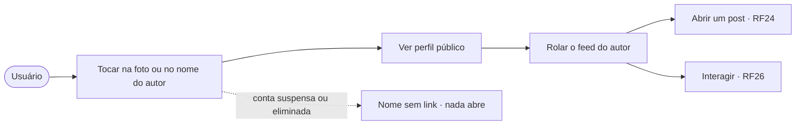
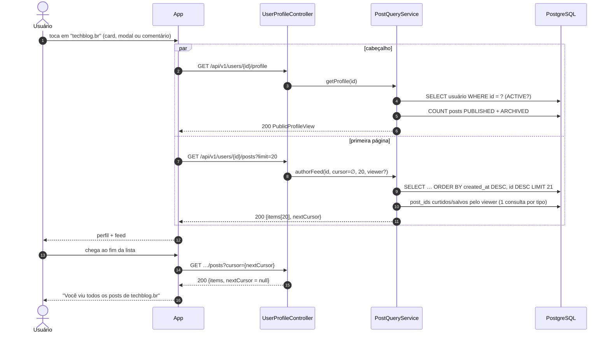
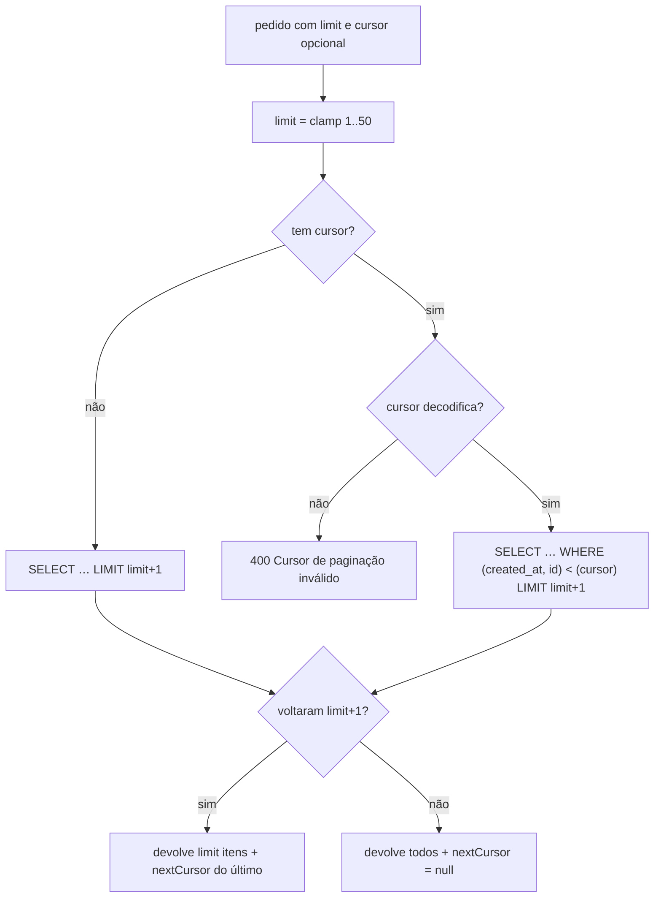

# RF25 · Perfil público do autor com o feed dele

> **Como** usuário, **quero** tocar na foto ou no nome de quem publicou **para** ver o perfil dessa pessoa e
> tudo o que ela publicou.

> ⚠️ **Numeração provisória** — ver [RF24](RF24-visualizar-post.md).

| | |
|---|---|
| **Base legal (LGPD)** | Art. 7º, V. **Minimização (Art. 6º, III):** o perfil público mostra só nome, categoria, foto, "membro desde" e número de posts — nunca cidade, e-mail, telefone ou interesses |
| **Status** | 🟡 Parcial — API, paginação por cursor, testes e protótipo prontos; seguir/deixar de seguir fica para outro RF |

## Critérios de aceite

1. Foto **e** nome do autor são um único link acessível (`<a>` com `aria-label="Ver perfil de {nome}"`) no
   card, no modal (RF24) e nos comentários (RF26).
2. O perfil mostra cabeçalho (foto, nome, glifo + rótulo da categoria, membro desde, nº de posts) e o
   **feed do autor**, mais recentes primeiro, com os mesmos cards e ações do feed principal.
3. Feed paginado por cursor opaco `(created_at, id)`: estável mesmo com posts novos chegando; 1–50 por página.
4. Entram `PUBLISHED` e `ARCHIVED`; rascunhos e removidos nunca.
5. Conta **suspensa** ou **eliminada**: o perfil responde 404; nos posts e comentários o nome aparece sem link
   ("Conta excluída" no caso de eliminação LGPD).

## Caso de uso

## Sequência

## Paginação por cursor

## Rastreabilidade

| Camada | Artefato | Situação |
|---|---|---|
| Persistência | índice parcial `idx_post_author_created`, `PostRepository.findAuthorFeed*`, `countByAuthorUserIdAndStatusIn` | ✅ |
| Aplicação / API | `PostQueryService.getProfile` / `authorFeed`, `AuthorDirectory`, `GET /api/v1/users/{id}/profile`, `GET /api/v1/users/{id}/posts` | ✅ |
| Testes | `PostApiIT.profileShowsOnlyPublicDataAndFeedPagesByCursor`, `FeedCursorTest` | ✅ |
| Tela | Protótipo: [10-perfil-autor](../../design/prototype/screens/10-perfil-autor.png); autor como link no card e no modal | ✅ protótipo |
| App | rota `/u/{id}` | ⏳ OS-39 |
| Identidade | `ViewerResolver` lê a sessão autenticada ([RF27](RF27-autenticacao-sessao.md)); o cabeçalho de dev `X-Orange-Dev-User` foi removido e os testes entram com login real (sessão + CSRF) | ✅ |
| Pendências | seguir/deixar de seguir e contagem de seguidores; bloquear/silenciar | ⏳ novo RF |
