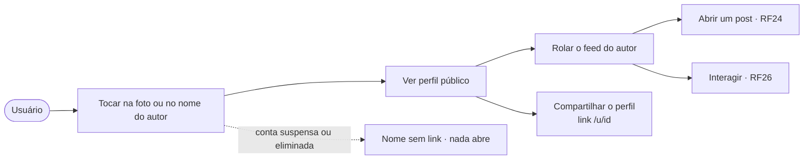
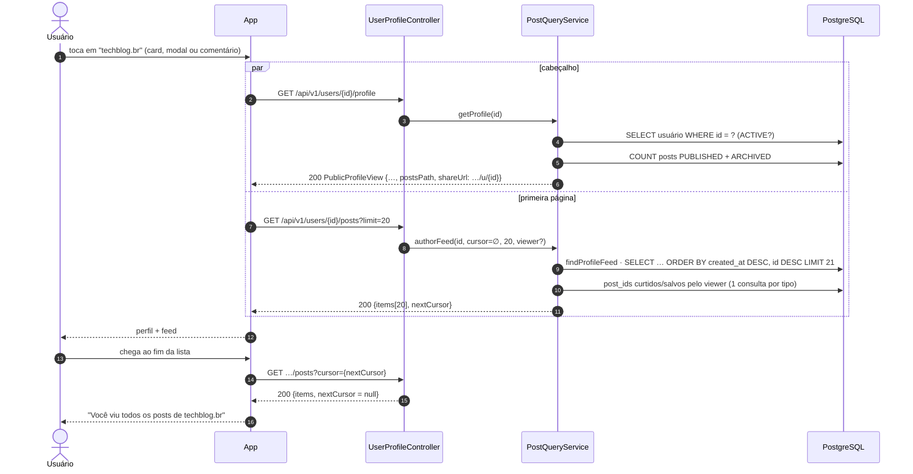
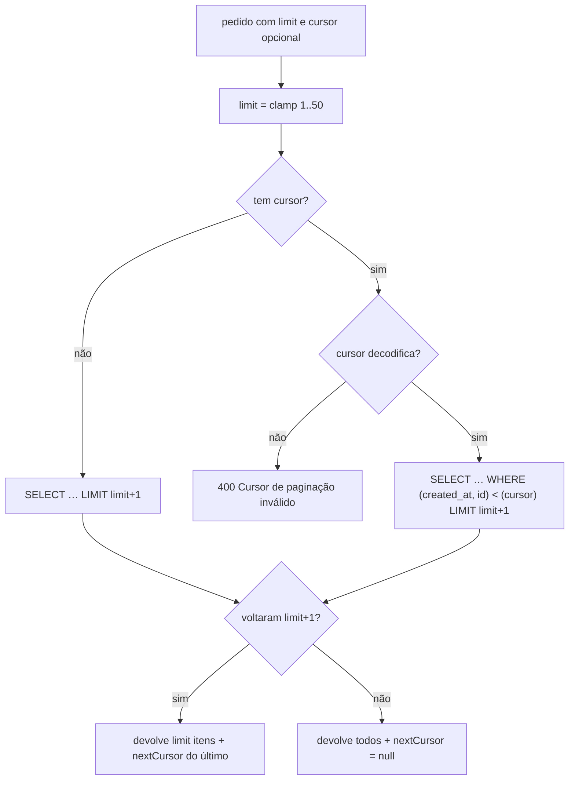
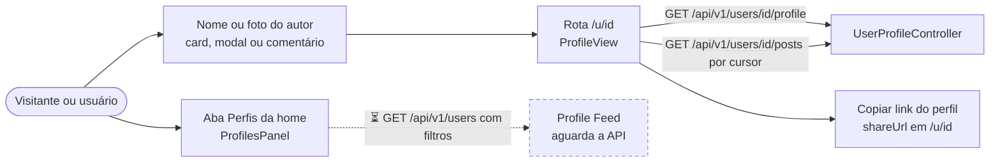

# RF25 · Perfil público do autor com o feed dele

> **Como** usuário, **quero** tocar na foto ou no nome de quem publicou **para** ver o perfil dessa pessoa e
> tudo o que ela publicou.

> ⚠️ **Numeração provisória** — ver [RF24](RF24-visualizar-post.md).

| | |
|---|---|
| **Base legal (LGPD)** | Art. 7º, V. **Minimização (Art. 6º, III):** o perfil público mostra só nome, categoria, foto, "membro desde" e número de posts — nunca cidade, e-mail, telefone ou interesses |
| **Status** | 🟡 Parcial — API, paginação por cursor, testes e protótipo prontos; seguir/deixar de seguir fica para outro RF |

## Critérios de aceite

1. Foto **e** nome do autor são um único link acessível (`<a>` com `aria-label="Ver perfil de {nome}"`) no
   card, no modal (RF24) e nos comentários (RF26).
2. O perfil mostra cabeçalho (foto, nome, glifo + rótulo da categoria, membro desde, nº de posts) e o
   **feed do autor**, mais recentes primeiro, com os mesmos cards e ações do feed principal.
3. Feed paginado por cursor opaco `(created_at, id)`: estável mesmo com posts novos chegando; 1–50 por página.
4. Entram `PUBLISHED` e `ARCHIVED`; rascunhos e removidos nunca.
5. Conta **suspensa** ou **eliminada**: o perfil responde 404; nos posts e comentários o nome aparece sem link
   ("Conta excluída" no caso de eliminação LGPD).
6. **Compartilhar o perfil:** o perfil traz `shareUrl` = `{orange-social.public-base-url}/u/{id}`, a rota do
   perfil no app web, sem rastrear quem compartilhou. Nada de `/@handle`, que não tem rota no app e dava 404 no
   Friendly Eats; o `@` também pode mudar, o id não.

## Caso de uso

## Sequência

## Paginação por cursor

## Telas no app web

`/u/[id]` (dentro do grupo dos feeds, então o modal do post também abre por cima do perfil): cabeçalho mínimo
(nome, categoria com glifo, foto ou iniciais, "membro desde", número de posts), o botão "Copiar link do perfil"
com o `shareUrl` e o feed do autor por cursor. Conta suspensa ou eliminada dá 404 com a mensagem de perfil
indisponível. A aba **Perfis** da home (Profile Feed) já tem a tela (`ProfilesPanel`), mas espera
`GET /api/v1/users`.

## Rastreabilidade

| Camada | Artefato | Situação |
|---|---|---|
| Persistência | índice parcial `idx_post_author_created`, `PostRepository.findProfileFeed*` (antes `findAuthorFeed*`: o CodeQL marca como sensível método com "auth" no nome escolhido por dado do pedido; o cursor só escolhe a página, o acesso é conferido antes), `countByAuthorUserIdAndStatusIn` | ✅ |
| Aplicação / API | `PostQueryService.getProfile` / `authorFeed`, `AuthorDirectory`, `GET /api/v1/users/{id}/profile`, `GET /api/v1/users/{id}/posts`; `PublicLinks.profileShareUrl` → `shareUrl` `/u/{id}` | ✅ |
| Testes | `PostApiIT.profileShowsOnlyPublicDataAndFeedPagesByCursor` (inclui `shareUrl` = `http://localhost:3000/u/{id}`), `FeedCursorTest` | ✅ |
| Tela | Protótipo: [10-perfil-autor](../../design/prototype/screens/10-perfil-autor.png); autor como link no card e no modal | ✅ protótipo |
| Telas (app web) | `/u/[id]` (`(feeds)/u/[id]/page.tsx`, `ProfileView`, `shareUrl` copiado); aba Perfis (`ProfilesPanel`); `e2e/perfil.spec.ts` (nome no card leva ao perfil, cabeçalho mínimo, membro desde, posts e link; arquivado só para o autor; inexistente dá 404) e o teste "perfis" de `e2e/feed.spec.ts` | ✅ web · ⏳ mobile (OS-39) |
| Profile Feed | `GET /api/v1/users` com categoria, local, país, cidade e nome → `ProfilePageView` de `ProfileCardView` (`verified`, cidade/UF/país só se a visibilidade do titular permitir, `interests`): contrato proposto em `frontend/packages/api/src/types.ts`, a tela diz que aguarda a API | ⏳ OS-26, OS-35 |
| Identidade | `ViewerResolver` lê a sessão autenticada ([RF27](RF27-autenticacao-sessao.md)); o cabeçalho de dev `X-Orange-Dev-User` foi removido e os testes entram com login real (sessão + CSRF) | ✅ |
| Moldura | cada card do feed do autor traz `background` resolvido ([RF28](RF28-moldura-post.md)), sem consulta extra (vem da linha do `post`) | ✅ |
| Pendências | seguir/deixar de seguir e contagem de seguidores; bloquear/silenciar | ⏳ novo RF |
