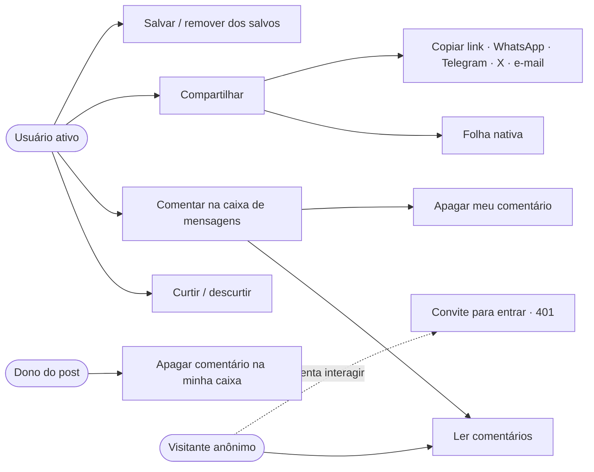
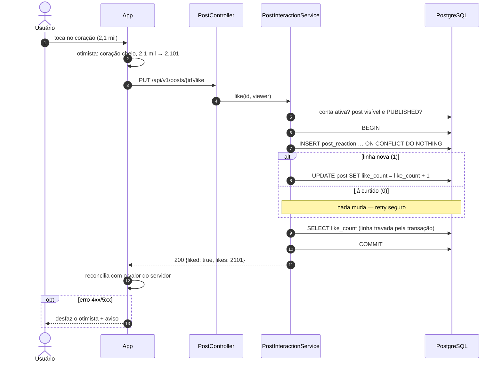
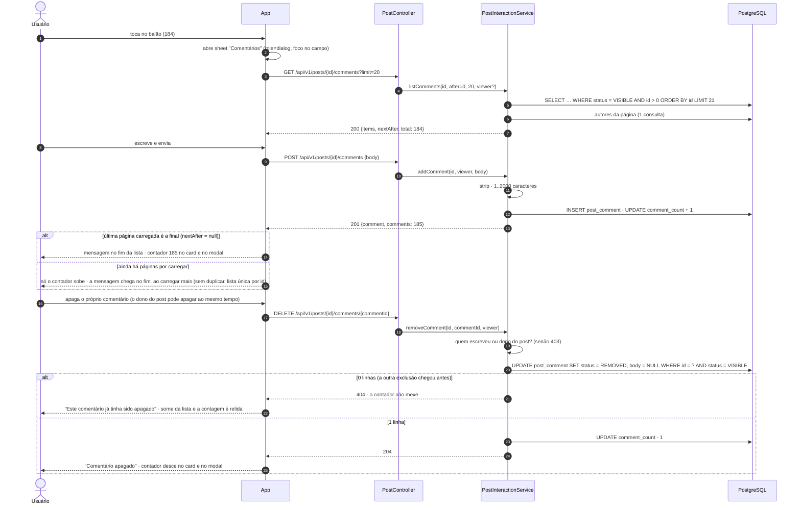
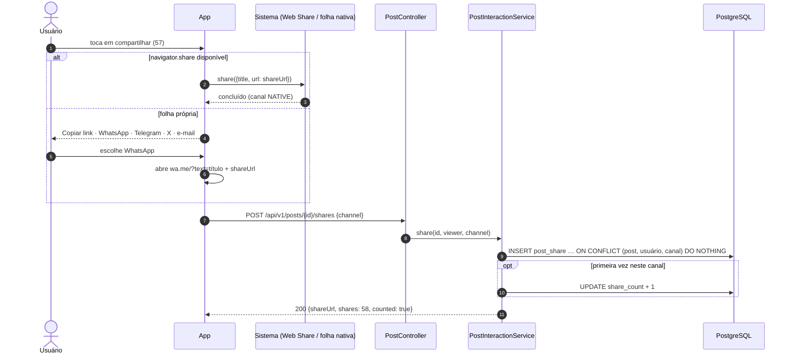
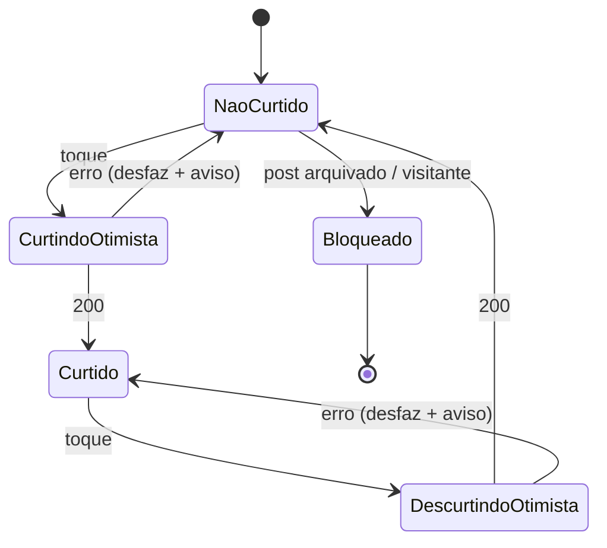
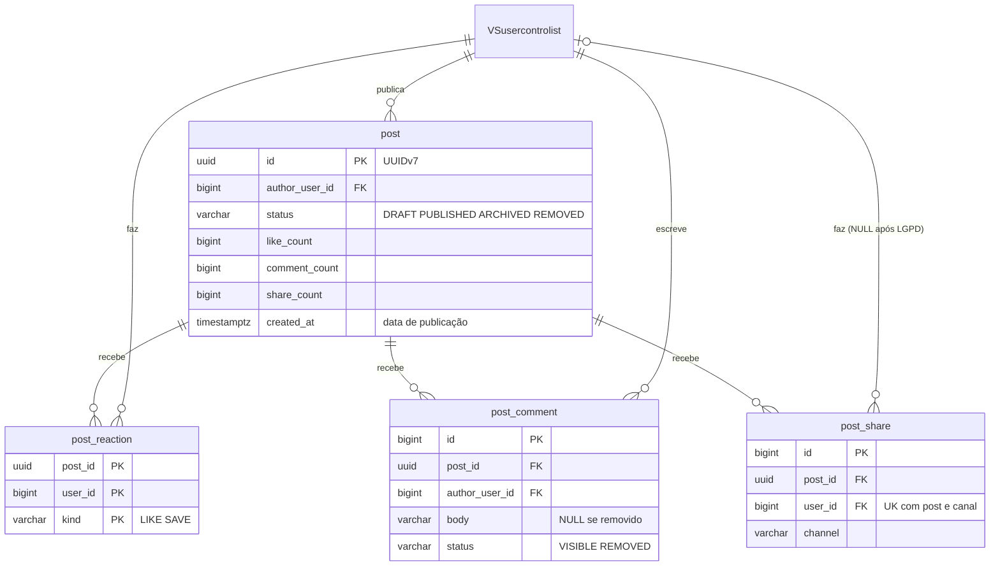
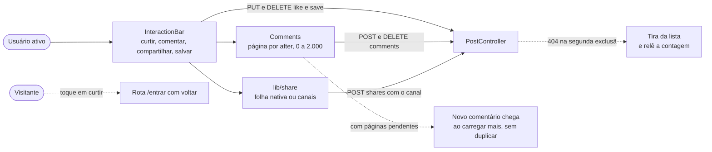

# RF26 · Interações com contagem

> **Como** usuário, **quero** curtir, comentar, compartilhar e salvar um post vendo quantas pessoas já
> fizeram o mesmo **para** participar da conversa e levar o conteúdo para fora do app.

> ⚠️ **Numeração provisória** — ver [RF24](RF24-visualizar-post.md).

| | |
|---|---|
| **Base legal (LGPD)** | Art. 7º, V. Curtidas e comentários são públicos; **salvar é privado** (ninguém mais vê nem conta). O link compartilhado não carrega quem compartilhou |
| **Eliminação** | Na exclusão de conta (RF23) curtidas somem, comentários perdem o texto, compartilhamentos perdem o vínculo e os contadores dos posts de terceiros são corrigidos (`PostContentEraser`) |
| **Status** | 🟡 Parcial — API idempotente, contadores atômicos, testes e protótipo prontos; tempo real, notificações e moderação ainda não |

## Critérios de aceite

1. **Um ícone, um significado** (DESIGN_SYSTEM.md §7), todos `<button>` com `aria-label` por extenso e
   `aria-pressed` quando alternam:

   | Ação | Ícone | Contagem | Ao tocar |
   |---|---|---|---|
   | Curtir | `heart` (preenchido quando ativo) | sim | alterna; número atualiza na hora |
   | Comentar | `message-circle` | sim | abre a **caixa de mensagens** (sheet) do post |
   | Compartilhar | `share-2` | sim | abre a **folha de compartilhamento** |
   | Salvar | `bookmark` (preenchido quando ativo) | não (privado) | alterna |

2. Curtir/descurtir e salvar são **idempotentes** (`PUT`/`DELETE`): repetir não muda o número.
3. Contador e linha de associação mudam **na mesma transação**; o contador só se move quando a linha
   entrou ou saiu de fato. Nunca `COUNT(*)` na leitura.
4. Caixa de mensagens: lista do mais antigo para o mais novo, paginada; campo com limite de 2.000
   caracteres e contador; quem escreveu ou o dono do post pode apagar; comentário vazio é recusado.
   A exclusão é **atômica** (`UPDATE … WHERE status = 'VISIBLE'`): se quem escreveu e o dono do post apagam ao
   mesmo tempo, só uma vale (`204`), a outra recebe `404` e o contador desce uma vez só.
5. Compartilhar: Web Share API / folha nativa quando houver; senão, folha própria com Copiar link,
   WhatsApp, Telegram, X e e-mail. O número conta **pares distintos (usuário, canal)**.
6. Exige conta **ativa**: anônimo recebe 401 ("Entre na sua conta…"), conta pendente/suspensa 403.
   Post arquivado: leitura sim, novas interações não (409).
7. Interface otimista: o botão muda na hora e volta atrás com aviso se a API falhar.
8. Alerta oficial do Alert Feed tem **só compartilhar** (sem curtidas e comentários); áudio e vaga têm as
   quatro ações.

## Caso de uso

## Sequência · curtir (idempotente)

## Sequência · caixa de mensagens

## Sequência · compartilhar

## Estados do botão de curtir

## Modelo de dados

## Telas no app web

A barra de interações (`InteractionBar`) fica no card, no modal e na página do post: curtir e salvar são
otimistas e reconciliam com o número do servidor (o nome acessível traz o número por extenso, ex.: "Curtir, 2,1 mil
(2.101 curtidas)"); visitante que toca em curtir vai para `/entrar?voltar=…`. A caixa de mensagens (`Comments`)
pagina por `after`, conta 0/2.000 caracteres e confirma antes de apagar; o comentário novo só entra direto na lista
quando a última página carregada é a final (senão chega na sua vez, ao carregar mais) e a lista é única por id; o `404` da segunda exclusão tira o
comentário da lista e relê a contagem. Compartilhar usa a folha nativa quando existe e senão a folha com os canais
(`lib/share.ts`). Post arquivado mostra as ações desabilitadas com o motivo; alerta oficial só tem compartilhar.

## Rastreabilidade

| Camada | Artefato | Situação |
|---|---|---|
| Domínio | `PostComment` (trim, limite, quem pode apagar), `ReactionKind`, `ShareChannel`, `CommentStatus` | ✅ |
| Persistência | `post_reaction`, `post_comment`, `post_share` (V2); `PostRepository` (insert/delete idempotentes, contadores), `PostCommentRepository` (`removeIfVisible`: exclusão atômica) | ✅ |
| Aplicação / API | `PostInteractionService`; `PUT/DELETE …/like`, `PUT/DELETE …/save`, `GET/POST …/comments`, `DELETE …/comments/{id}`, `POST …/shares` | ✅ |
| Testes | `PostDomainTest.commentIsTrimmedValidatedAndRemovableByWriterOrPostOwner`; `PostApiIT` (curtir idempotente, 401/403/409, caixa de comentários, compartilhar por canal, eliminação LGPD; `removingTheSameCommentTwiceDecrementsTheCounterOnce`: autor e dono do post apagam em paralelo em 5 rodadas) | ✅ |
| Tela | Protótipo: botões com contagem em [01-post-feed](../../design/prototype/screens/01-post-feed.png), [11-comentarios](../../design/prototype/screens/11-comentarios.png), [12-compartilhar](../../design/prototype/screens/12-compartilhar.png) | ✅ protótipo |
| Identidade | `ViewerResolver` lê a sessão autenticada ([RF27](RF27-autenticacao-sessao.md)); o cabeçalho de dev `X-Orange-Dev-User` foi removido e os testes entram com login real (sessão + CSRF) | ✅ |
| Telas (app web) | `InteractionBar`, `Comments`, `lib/share.ts` (no card, no modal e na página do post); `e2e/post.spec.ts` (curtir, salvar, comentar com contador, apagar e compartilhar com `aria-live`; número compacto e por extenso; visitante vai ao login; segunda exclusão com 404 tira da lista e avisa; comentar com páginas pendentes não duplica e o novo chega no fim) | ✅ web (OS-58) · ⏳ mobile (OS-39) |
| Pendências | tempo real dos contadores (SSE, OS-2B); notificação ao autor (OS-27); moderação de comentários (OS-4D); rate limit (OS-47); repost como ação separada | ⏳ OS-59 |
