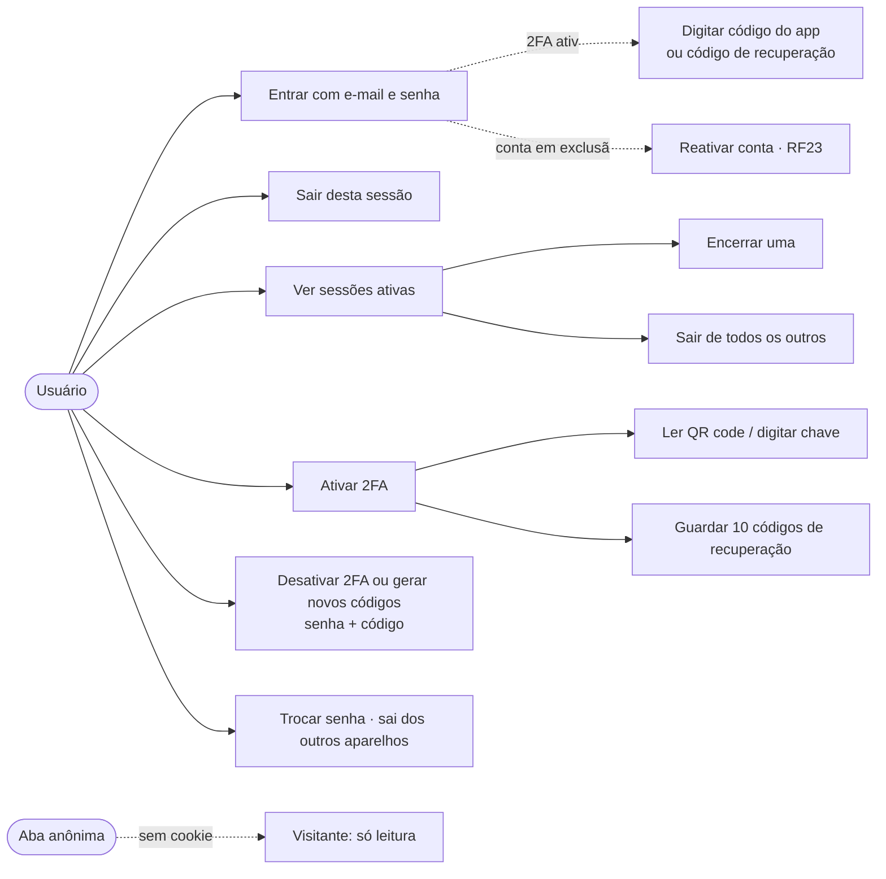
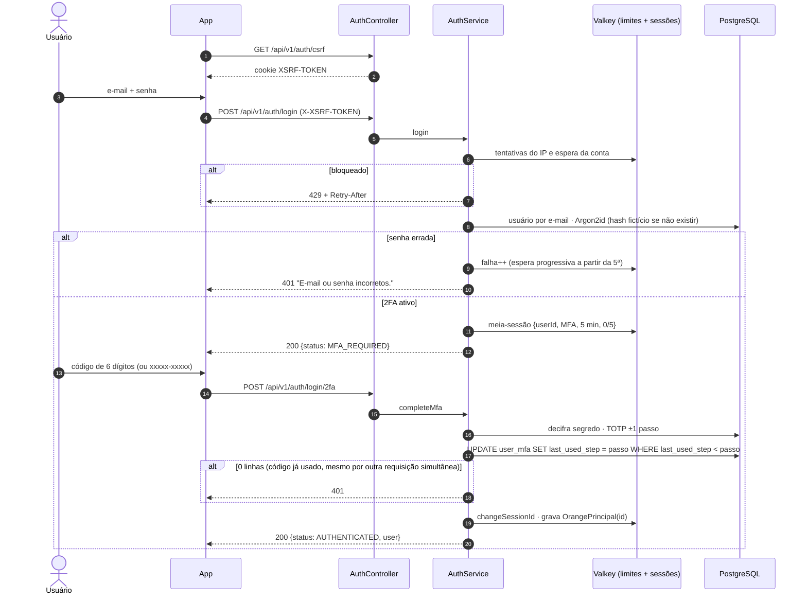
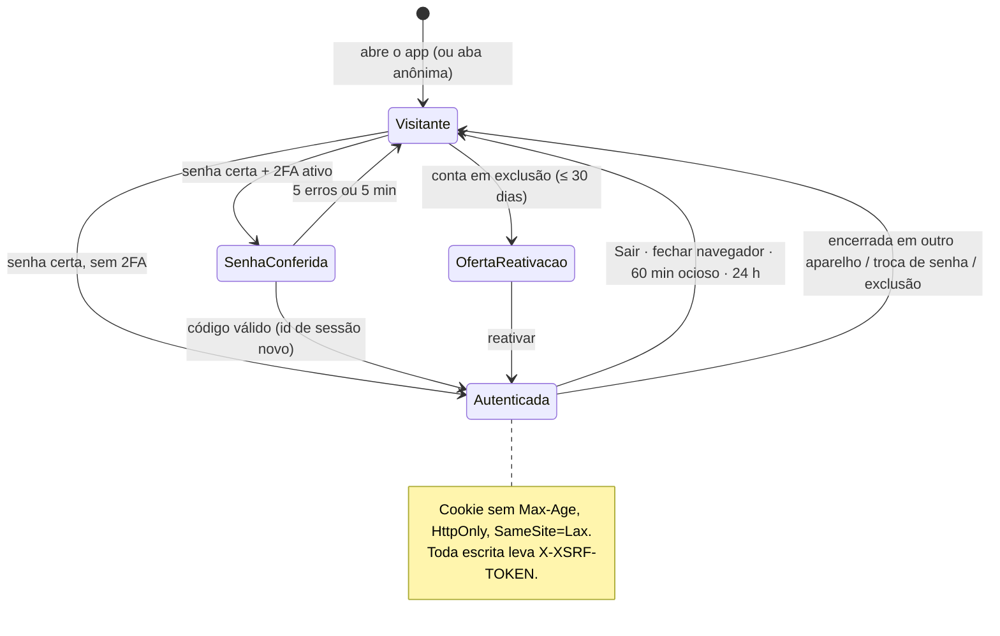
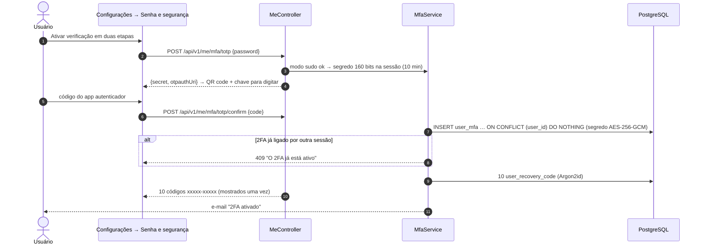

# RF27 · Login, sessão, controle de acesso e 2FA

> **Como** usuário, **quero** entrar com segurança, ver e encerrar minhas sessões e proteger a conta com um
> segundo fator **para** que ninguém use minha conta — e **sair de verdade** quando clico em "Sair" ou fecho o
> navegador, sem que uma aba anônima herde meu login.

> ⚠️ **Numeração provisória** — mesma regra de [RF24](RF24-visualizar-post.md).

| | |
|---|---|
| **Base** | OWASP Session/Authentication/MFA Cheat Sheets · NIST SP 800-63B-4 (AAL2) · RFC 6238 — detalhes em [`PESQUISA_DADOS_USUARIO.md`](../PESQUISA_DADOS_USUARIO.md) §5–6 |
| **Decisão de arquitetura** | Spring Security 7 + **sessão opaca no Valkey** (Spring Session indexado) agora; Keycloak continua o caminho para SSO entre apps Velion (ADR-09, atualizado) |
| **Status** | 🟡 Parcial — login em etapas, 2FA (TOTP + códigos de recuperação), sessões, CSRF, limite de tentativas e testes prontos; passkeys, "lembrar este navegador" e alertas por e-mail reais ainda não |

## Critérios de aceite

1. **Sessão opaca**, nunca JWT nem token em `localStorage`. O cookie de sessão:
   - não tem `Max-Age`;
   - é `HttpOnly`, `Secure` e `SameSite=Lax`;
   - em produção usa o nome `__Host-orange_session`.
2. **Aba anônima abre deslogada.** Ela tem cookies próprios e não herda a sessão da janela normal. Fechar o navegador encerra a sessão; o servidor a mata depois de 60 min ociosa ou 24 h de vida, mesmo se o navegador "restaurar" o cookie.
3. **Sair** (`POST /api/v1/auth/logout`) invalida a sessão no servidor:
   - outras abas da mesma janela recebem 401 na próxima chamada;
   - o app avisa as abas abertas via `BroadcastChannel('orange-auth')`.
4. **Login em etapas:** senha → código do 2FA, se ativo → oferta de reativação, se a conta estiver em exclusão ([RF23](RF23-direitos-titular-lgpd.md)) → sessão com **id novo**. A meia-sessão não acessa nada e expira em 5 min / 5 tentativas.
5. **Mensagens neutras** ("E-mail ou senha incorretos.") e o mesmo custo de hash para e-mail inexistente.
6. **Limite de tentativas:**
   - por conta: a partir da 5ª falha em 15 min, espera progressiva de até 15 min (`429` + `Retry-After`);
   - por IP: 20/min e 100/h.
7. **2FA por app autenticador:**
   - TOTP SHA-1, 6 dígitos, 30 s, ±1 passo, com anti-replay;
   - segredo de 160 bits cifrado com AES-256-GCM;
   - **10 códigos de recuperação** de uso único, guardados em Argon2id.
   - Ativar, regenerar e desativar exigem senha (+ código); cada mudança gera aviso por e-mail. **Sem SMS.**
   - **Uso único atômico:** o passo do TOTP e o código de recuperação são consumidos por `UPDATE` condicional no
     banco (`last_used_step < passo`; `used_at IS NULL`); com várias requisições ao mesmo tempo, só uma entra.
   - **Nunca sobrescreve o fator ativo:** confirmar uma configuração quando o 2FA já foi ligado em outra sessão dá
     `409` (`INSERT … ON CONFLICT DO NOTHING`), e o segredo que está valendo continua o mesmo.
8. **Controle de acesso:**
   - leitura de posts, perfis e Termos é pública;
   - todo o resto exige sessão;
   - escrita exige o token CSRF (`X-XSRF-TOKEN`);
   - interagir exige conta `ACTIVE` ([RF26](RF26-interacoes-post.md));
   - conta suspensa não entra.
9. **Sessões ativas:**
   - a lista mostra navegador/sistema, criação, último acesso e "esta sessão", **sem expor o id real**;
   - "Sair" encerra uma sessão e "Sair de todos os outros" encerra as demais;
   - trocar a senha encerra as outras sessões automaticamente.

## Caso de uso

## Sequência · login com 2FA

## Estados da sessão no navegador

## Ativar o 2FA

## Matriz de acesso

| Rota | Visitante | Sessão (conta pendente) | Sessão (conta ativa) |
|---|---|---|---|
| `GET /api/v1/posts/**`, `GET /api/v1/users/**`, `GET /api/v1/legal/**`, `GET /api/v1/backgrounds/**` | ✅ | ✅ | ✅ |
| `/api/v1/auth/**` (cadastro, login, 2FA, reativar, sair) | ✅ | ✅ | ✅ |
| `/api/v1/me/**` (perfil, preferências, sessões, 2FA, excluir) | 401 | ✅ | ✅ |
| Curtir, comentar, compartilhar, salvar | 401 | 403 | ✅ |
| Publicar, editar, arquivar, apagar post ([RF29](RF29-publicar-post.md)) | 401 | 403 | ✅ (instituição e banco só com selo conferido) |
| `POST /api/v1/media/uploads` (URL pré-assinada da foto · [RF29](RF29-publicar-post.md), [RF2](RF02-editar-perfil.md)) | 401 | 403 | ✅ |
| `PUT`/`DELETE /api/v1/me/photo` (foto de perfil, com a chave do envio) | 401 | ✅ (o `PUT` dá 422: sem conta ativa não há envio) | ✅ |
| `PUT` na URL pré-assinada (direto no bucket, fora da API) | 403 do bucket | 403 do bucket | ✅ com a assinatura recebida: até 15 min, mesmo tipo e tamanho |

## Rastreabilidade

| Camada | Artefato | Situação |
|---|---|---|
| Segurança | `SecurityConfig` (CSRF SPA, regras, cabeçalhos), `SessionService`, `AbsoluteSessionTimeoutFilter`, `LoginThrottle`, `PendingLogin`, `OrangePrincipal`, `ClientInfo`, `AppSecrets`, `SecretCipher`, `Totp`, `ProblemResponses` | ✅ |
| Aplicação | `AuthService` (login em etapas), `MfaService`, `StepUp` (modo sudo), `AccountNotifier` | ✅ |
| Concorrência do 2FA | `UserMfaRepository.consumeStep` / `enableIfAbsent` e `RecoveryCodeRepository.markUsed`: `UPDATE`/`INSERT` condicionais, 1 = aceito, 0 = já usado ou já ativo | ✅ |
| Persistência | `user_mfa`, `user_recovery_code` (V3); sessões no Valkey `orange:session` | ✅ |
| API | `/api/v1/auth/{csrf,session,register,login,login/2fa,reactivate,logout}`; `/api/v1/me/{password,sessions,mfa,…}` | ✅ |
| Testes | `TotpTest` (vetores da RFC 6238, cifra, timeout absoluto); `AuthApiIT` (aba anônima, cookie, CSRF, limite, logout entre abas, 2FA com anti-replay e códigos de recuperação, sessões; `secondFactorIsSingleUseUnderConcurrencyAndSetupNeverOverwritesAnActiveFactor`: 8 logins simultâneos com o mesmo código TOTP e de recuperação entram só uma vez, e duas configurações concorrentes dão 409 na segunda) | ✅ |
| Pendências | passkeys/WebAuthn; "lembrar este navegador por 30 dias"; e-mail transacional (OS-12); CAPTCHA após 20 falhas/24 h; SSO Velion via Keycloak (OS-13) | ⏳ OS-61, OS-62 |
| Tela | Protótipo: [13-login](../../design/prototype/screens/13-login.png) sobre o mosaico com o logo oficial, [16-login-2fa](../../design/prototype/screens/16-login-2fa.png), [17-seguranca](../../design/prototype/screens/17-seguranca.png) (2FA ativada, sessões por aparelho, "Sair" em cada uma, "Sair de todos os outros", "Sair desta conta" avisando as outras abas via `BroadcastChannel`) | ✅ protótipo |
