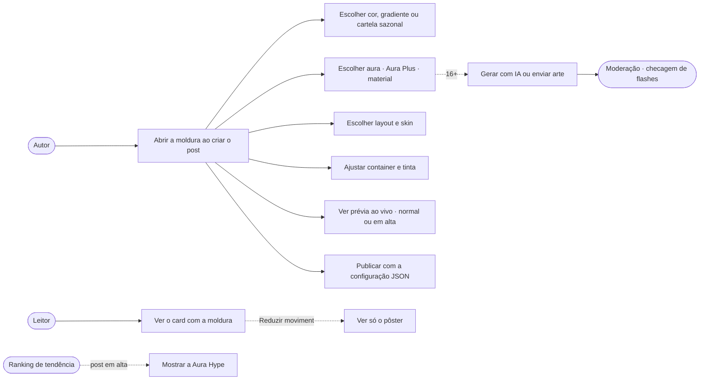
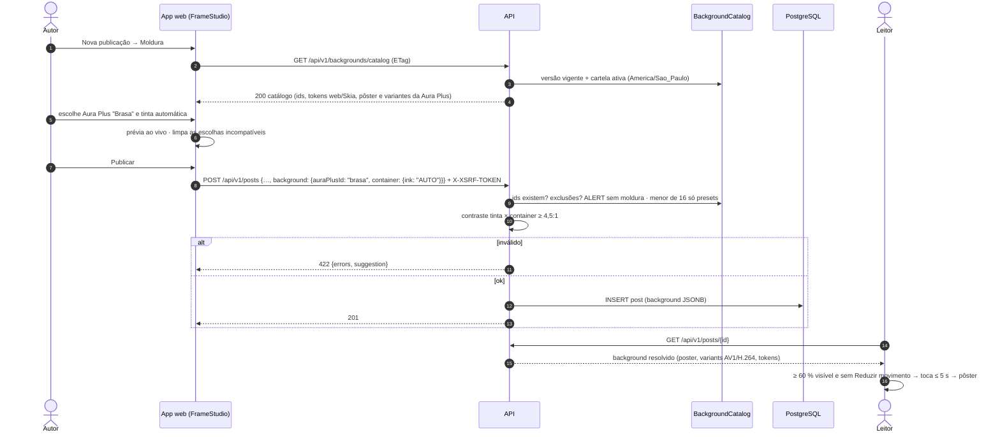
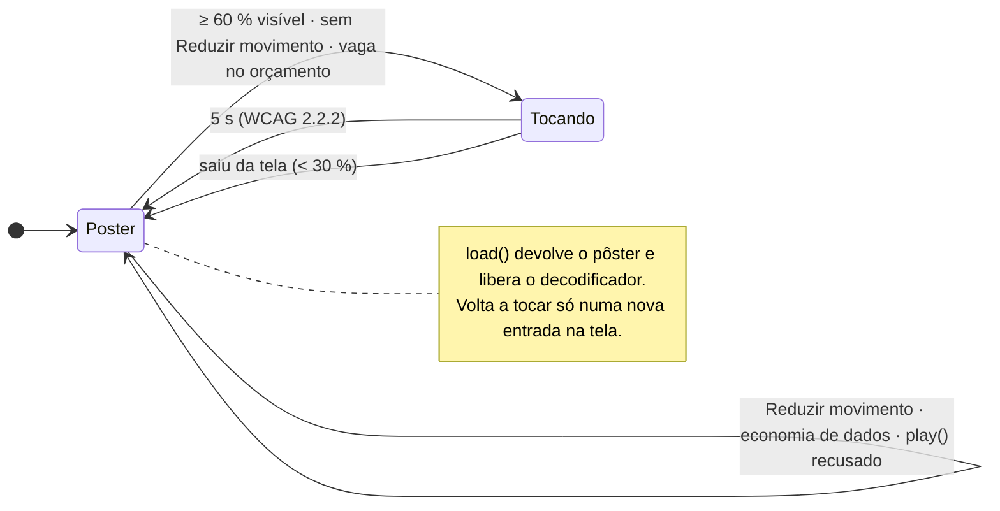
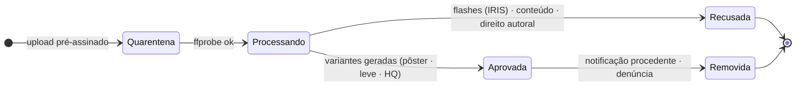
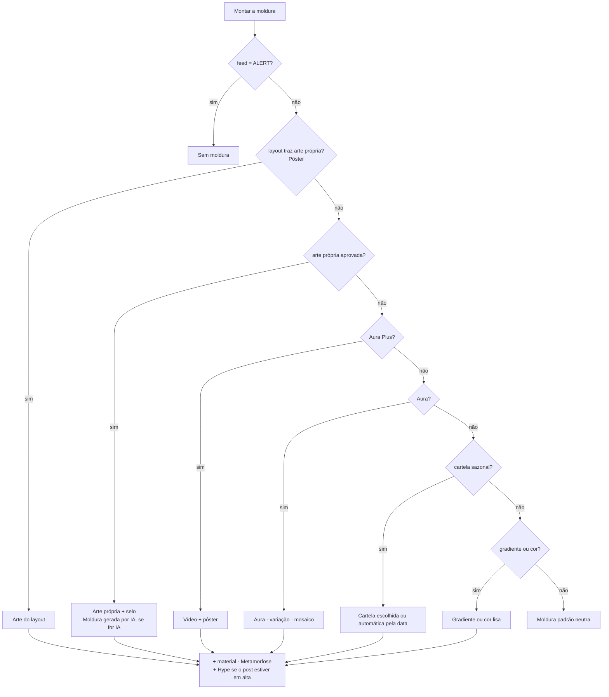
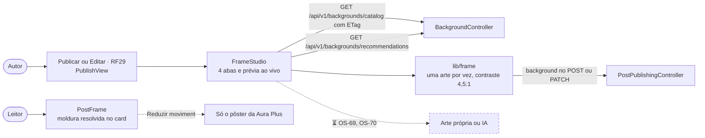

# RF28 · Moldura do post (Background Studio)

> **Como** autor, **quero** escolher a arte que decora a moldura do meu post — cor, aura, material, efeitos e
> animações — **para** dar personalidade ao card sem atrapalhar a leitura de quem vê.

> ⚠️ **Numeração provisória** — mesma regra de [RF24](RF24-visualizar-post.md).

| | |
|---|---|
| **Origem** | Proposta do Background Studio (FashionAI), adaptada ao Orange na pesquisa [`PESQUISA_BACKGROUND_STUDIO.md`](../PESQUISA_BACKGROUND_STUDIO.md) |
| **Base legal (LGPD)** | Art. 7º, V (execução do serviço). A configuração da moldura não é dado pessoal sensível. Arte enviada ou gerada por IA é conteúdo do usuário: moderação e notificação de direito autoral (§8 da pesquisa) |
| **Acessibilidade** | WCAG 1.4.3 (contraste do container), 2.2.2 (animação para em ≤ 5 s), 2.3.1 (no máximo 3 flashes/s), `prefers-reduced-motion` e preferência `reduceMotion` |
| **Status** | 🟡 Parcial. Pronto, com testes: protótipo com as 4 abas, artes da Aura Plus, coluna `post.background`, catálogo público com ETag, cartela automática, recomendações, validação no servidor e moldura resolvida no detalhe e no feed. Falta: arte própria (envio e IA), preferência "Animações de fundo", Hype pelo ranking e telas no app |

## Critérios de aceite

1. **Duas camadas.**
   - A arte fica só na faixa entre a borda externa e o container (11 px no feed).
   - O container é opaco e fica por cima, com autor, mídia, texto e ações.
   - Nenhum texto do usuário fica sobre a arte.
2. **A moldura nunca é sinal de informação.** Ficam no container, sempre visíveis:
   - a categoria do autor (filete, bolinha com glifo e rótulo);
   - o "em alta";
   - o selo de publicidade e o selo "Moldura gerada por IA".
3. **Quatro abas** (seletor segmentado):
   - **Cor:** lisa, gradientes, cartela sazonal com modal de rascunho e animação leve.
   - **Aura e Material:**
     - Aura, com variação e formato imagem única ou mosaico;
     - **Aura Plus**;
     - Material: papel, cetim, metal, vidro;
     - **Aura Hype**;
     - Metamorfose: Prisma, Constelação, Fio Vivo, Holografia;
     - arte própria, por IA ou upload;
     - direção recomendada.
   - **Layout e Estilo:** Clássico, Polaroid e Pôster, mais as skins.
   - **Container:** cor nativa, amostras ou personalizada; tinta automática ou fixa.
4. **Faixas de miniaturas.**
   - Cada opção é uma miniatura com prévia, nome curto, `aria-pressed` e rótulo acessível.
   - As faixas quebram linha no celular sem esconder opções.
5. **Uma fonte de arte por vez**, com limpeza automática:
   - cor, gradiente ou cartela ⇄ aura ⇄ Aura Plus ⇄ arte própria;
   - o layout Pôster (que traz arte própria) limpa aura, Aura Plus, material e Metamorfose, e desliga a aba Aura com
     uma frase explicando por quê.
6. **Modal sazonal com rascunho.** Nada muda no post até "Aplicar"; "Cancelar" descarta. "Automática pela data"
   segue o Hemisfério Sul e o fuso de São Paulo (Carnaval = Páscoa − 47).
7. **Contraste.**
   - A tinta automática escolhe entre clara e escura a de maior razão.
   - Os tons secundários sobem até passar de 4,5:1.
   - Abaixo de 4,5:1 aparece um aviso com sugestão. O servidor recusa com `422`.
8. **Aura Hype é conquistada.**
   - O autor só escolhe o estilo (Scanner ou Brilho).
   - O efeito aparece quando o post entra em alta pelo ranking.
   - O texto "em alta" continua sendo o sinal.
9. **Aura Plus nunca é GIF.**
   - Formato: vídeo em loop de 4 s, AV1 (≤ 400 KB) com H.264 de reserva (≤ 150 KB), mais pôster WebP (≤ 25 KB).
   - Toca com ≥ 60 % do card visível, por no máximo **5 s**, e volta ao pôster.
   - No máximo 3 animações ao mesmo tempo (2 no celular).
   - Fica no pôster com "Reduzir movimento", economia de dados ou falha de `play()`.
10. **O post salva só a configuração.**
    - O campo `background` é um JSON (§ modelo) com ids do catálogo e chaves de asset.
    - Nunca guarda URL externa nem CSS livre.
    - O catálogo vem de `GET /api/v1/backgrounds/catalog`.
11. **Restrições.**
    - Alerta oficial e vaga (`ALERT`) **não** têm moldura: a API recusa com `422` e o banco tem um CHECK.
    - Menor de 16 usa só presets do catálogo: sem upload, sem IA e sem Aura Plus de terceiros.

## Caso de uso



## Sequência · publicar com moldura e ver no feed



## Estados

### Reprodução da Aura Plus no leitor



### Arte própria e Aura Plus enviada (⏳ OS-69, OS-70)



## Atividades · de onde vem a arte da moldura



## Modelo de dados (`post.background`)

```json
{
  "v": 1,
  "color": null, "gradientId": null,
  "seasonal": { "presetId": null, "auto": false },
  "animationId": "NONE",
  "aura": null, "auraPlusId": "brasa",
  "auraHypeStyle": "SCANNER",
  "metamorphose": { "mode": "OFF", "presetId": null },
  "materialId": null, "customArt": null,
  "layoutId": "CLASSICO", "skinId": "PADRAO",
  "container": { "color": null, "ink": "AUTO" }
}
```

## Telas no app web

O Background Studio (`FrameStudio`) fica dentro de Publicar e Editar ([RF29](RF29-publicar-post.md)), com 4 abas
(Cor · Aura e Material · Layout e Estilo · Container) e a prévia ao vivo do card com o que já foi digitado (normal ou
"Em alta"). Uma arte por vez: escolher outra tira a anterior e avisa; o Pôster limpa arte, material e Metamorfose
com uma frase explicando. A cartela sazonal abre um diálogo de rascunho com Aplicar e Cancelar, ou fica automática
pela data. O contraste da tinta sobre o container é o mesmo cálculo do servidor (`lib/frame.ts`): abaixo de 4,5:1 a
tela avisa (`role="alert"`) e sugere a tinta que passa, sem mandar ao servidor. No feed e no post, `PostFrame`
desenha a moldura resolvida; a Aura Plus toca até 5 s e volta ao pôster, e com "Reduzir movimento" só o pôster.
Enviar arte própria ou gerar por IA aparece desabilitado com o motivo (⏳ OS-69, OS-70).



## Rastreabilidade

| Camada | Artefato | Situação |
|---|---|---|
| Pesquisa | [`PESQUISA_BACKGROUND_STUDIO.md`](../PESQUISA_BACKGROUND_STUDIO.md): tendências, formatos, licenças, receitas, cartelas e riscos | ✅ |
| Protótipo | [22-studio-cor](../../design/prototype/screens/22-studio-cor.png) · [23-studio-aura](../../design/prototype/screens/23-studio-aura.png) · [24-studio-aura-plus](../../design/prototype/screens/24-studio-aura-plus.png) · [25-studio-sazonal](../../design/prototype/screens/25-studio-sazonal.png) · [26-studio-container](../../design/prototype/screens/26-studio-container.png) · [27-studio-layout](../../design/prototype/screens/27-studio-layout.png) · [28-feed-molduras](../../design/prototype/screens/28-feed-molduras.png). Os renders mostram a versão estática, como vê quem usa "Reduzir movimento" | ✅ protótipo |
| Artes | Aura Plus "Brasa" e "Aurora" em [`design/brand/auras/`](../../design/brand/auras/): AV1 11–56 KB, H.264 21–66 KB, pôster 2–4 KB, checagem de flashes em `verificacao.json`; gerador `gerar_aura_plus.py`. 8 auras procedurais em CSS/SVG no protótipo | ✅ |
| Testes | `design/prototype/studio-smoke.mjs`: troca de aba, limpeza de escolhas incompatíveis, modal com rascunho, contraste automático, JSON e Aura Plus (toca, para em 5 s, pôster com Reduzir movimento) | ✅ protótipo |
| Banco | `V4__post_background.sql`: `post.background JSONB` (objeto ≤ 2 KB; `ALERT` sem moldura por CHECK). `remove()` e a eliminação LGPD apagam a moldura | ✅ OS-65 |
| Domínio e regras | `BackgroundCatalog` (ids do protótipo, versão por hash), `SeasonalCalendar` (Hemisfério Sul, Carnaval = Páscoa − 47, Black Friday só por escolha), `BackgroundValidator` (chaves e ids, uma arte por vez, Pôster, ALERT, menor de 16, contraste ≥ 4,5:1), `Contrast` | ✅ |
| Tabela de assets | `background_asset` para arte enviada ou gerada, com status de moderação | ⏳ OS-69, OS-70 |
| API | `GET /api/v1/backgrounds/catalog` (público, ETag = versão + cartela do dia, `304`), `GET /api/v1/backgrounds/recommendations`; `background` em `POST/PATCH /api/v1/posts` ([RF29](RF29-publicar-post.md)); `background` resolvido em `PostDetailView` e `PostCardView` (`artKind`, `palette`, `css`, `auraPlus` com pôster, AV1 e H.264, `container` com tinta e contraste) | ✅ OS-65, OS-66 |
| Envio de arte | `POST /api/v1/backgrounds/assets` | ⏳ OS-70 |
| Cartela automática no servidor | `SeasonalCalendar` + `BackgroundService.today()` em America/Sao_Paulo; a cartela é resolvida na leitura | ✅ OS-67 |
| Testes do backend | `BackgroundRulesTest` (cartelas, validação, contraste, catálogo), `PostPublishingApiIT` (publicar com moldura, 422, menor, catálogo com ETag, recomendações), `PostApiIT` (eliminação LGPD apaga a moldura) | ✅ |
| Aura Plus e upload | Pipeline ffprobe → ffmpeg → EA IRIS → moderação → variantes | ⏳ OS-69, OS-70 |
| Preferência do leitor | "Animações de fundo: Sempre / Só no Wi-Fi / Nunca" em Configurações → Exibição | ⏳ (RF2) |
| Jurídico | Parecer sobre licenças, IA, retirada por direito autoral e marcas | ⏳ OS-72 |
| Telas (app web) | `FrameStudio`, `SeasonDialog`, `Swatch`, `PostFrame`, `lib/frame.ts` (+ `frame.test.ts`), Aura Plus "Brasa" e "Aurora" em `public/brand/auras/` (cópias de `design/brand/auras/`); `e2e/estudio.spec.ts` (8 testes: 4 abas e prévia, uma arte por vez, cartela com rascunho e automática, aura com variação e mosaico, material, Aura Hype na prévia "Em alta", Metamorfose, Aura Plus com e sem "Reduzir movimento", Pôster, contraste baixo sem ir ao servidor, axe em cada aba) com o catálogo em `e2e/fixtures/catalogo-molduras.json` | ✅ web · ⏳ mobile (Skia, OS-39) · ⏳ arte própria (OS-69, OS-70) |
