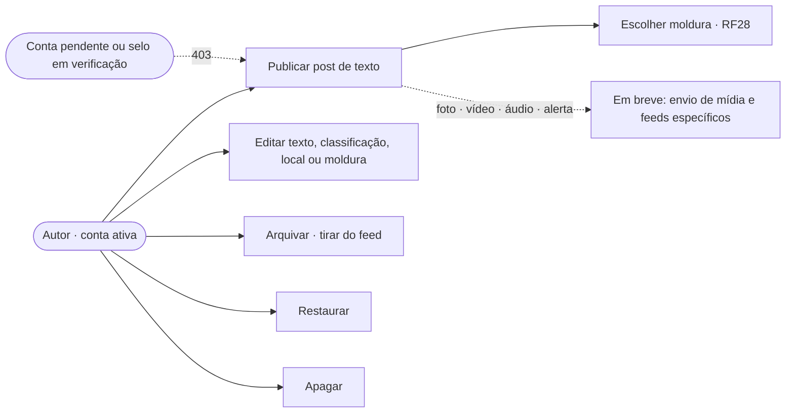
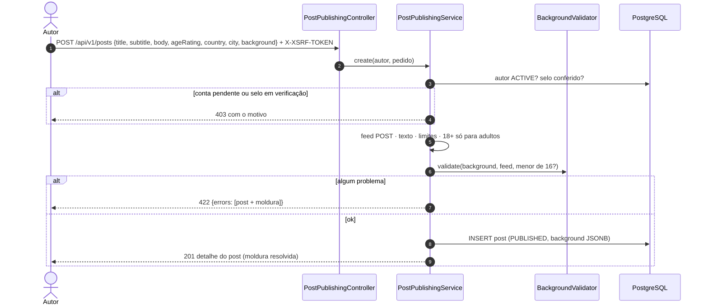
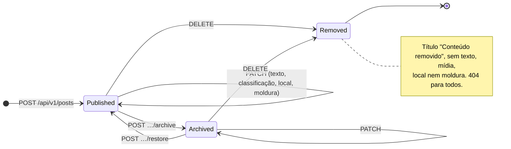
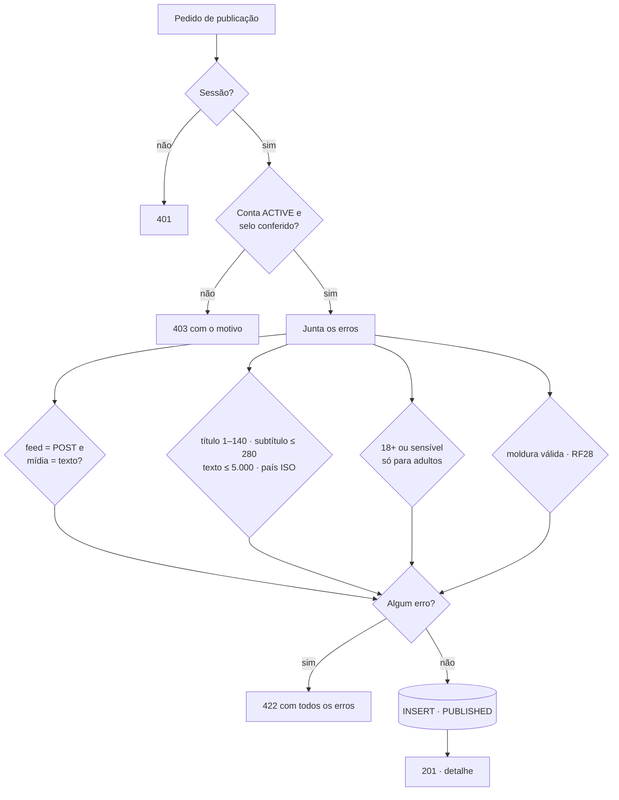

# RF29 · Publicar e gerenciar o próprio post

> **Como** autor, **quero** publicar um post, corrigir o que escrevi, tirar do feed por um tempo e apagar quando quiser,
> **para** controlar o que fica público em meu nome.

> ⚠️ **Numeração provisória** — mesma regra de [RF24](RF24-visualizar-post.md).

| | |
|---|---|
| **Base legal (LGPD)** | Art. 7º, V (execução do serviço). Apagar é também o direito de eliminação do titular para aquele conteúdo (Art. 18, VI). A exclusão da conta inteira fica no [RF23](RF23-direitos-titular-lgpd.md) |
| **ECA Digital** | Menor de 18 não publica conteúdo 18+ nem sensível. Menor de 16 só usa molduras do catálogo ([RF28](RF28-moldura-post.md)) |
| **Status** | 🟡 Parcial. Pronto, com testes: post de texto no Post Feed, edição, arquivamento, restauração, remoção e moldura. Falta: foto e vídeo (envio pré-assinado ao S3, OS-23 parte 2 / OS-18), áudio (OS-24), alerta (OS-25) e rascunho (pede reordenar o feed do autor por data de publicação) |

## Critérios de aceite

1. **Quem publica.**
   - Precisa de sessão e de conta `ACTIVE`: conta pendente recebe `403` ("confirme seu e-mail").
   - Instituição (VERMELHO) e banco (PRETO) só publicam com o selo **conferido**: `PENDING` ou `REJECTED` recebe `403`.
2. **Criação.**
   - Chamada: `POST /api/v1/posts`, que publica direto (`PUBLISHED`) e devolve `201` com o mesmo corpo do detalhe ([RF24](RF24-visualizar-post.md)).
   - Título obrigatório (1–140 caracteres, sem espaços nas pontas); subtítulo até 280; texto até 5.000.
   - País em duas letras (ISO 3166, maiúsculas); cidade até 120 caracteres.
   - Classificação com padrão `LIVRE`.
   - Moldura opcional (`background`), validada pelo [RF28](RF28-moldura-post.md).
3. **Fora por enquanto (`422`, com o motivo):**
   - foto, vídeo e áudio;
   - Audio Feed e Alert Feed;
   - Profile Feed, que mostra perfis e não posts.
4. **Todos os erros voltam juntos.** A resposta é `422` com `errors[]`: campos do post e da moldura numa resposta só.
5. **Edição.**
   - Chamada: `PATCH /api/v1/posts/{id}`, só pelo autor.
   - Chave ausente mantém o valor; `"background": null` volta à moldura padrão.
   - Campo que não é editável (autor, contadores, status…) dá `422`.
6. **Arquivar e restaurar.**
   - `POST …/archive` só vale para post `PUBLISHED`; `POST …/restore` só para `ARCHIVED`. Fora disso, `409`.
   - Arquivado continua no perfil, mas sem novas interações ([RF26](RF26-interacoes-post.md)).
7. **Apagar.** `DELETE /api/v1/posts/{id}` responde `204`. O post vira `REMOVED`: título, texto, mídia, local e moldura
   são apagados, e o link passa a responder `404` para todos.
8. **Post de outra pessoa.** Editar, arquivar ou apagar post alheio, ou que não existe, responde `404`, sem revelar
   qual dos dois (mesma regra do [RF24](RF24-visualizar-post.md)).

## Caso de uso

## Sequência · publicar

## Estados pelas ações do autor

O rascunho (`DRAFT`) existe no domínio, mas ainda não é criado pela API (⏳).

## Atividades · validação da criação

## Rastreabilidade

| Camada | Artefato | Situação |
|---|---|---|
| Aplicação / API | `PostPublishingService`, `PostPublishingController`: `POST /api/v1/posts`, `PATCH /api/v1/posts/{id}`, `POST …/archive`, `POST …/restore`, `DELETE /api/v1/posts/{id}` | ✅ |
| Domínio | `Post.publish/archive/remove` e transições de `PostStatus` (já existiam); `remove()` agora apaga também a moldura | ✅ |
| Erros | `PostExceptions.Invalid` (422 com `errors`) e `PostExceptions.Conflict` (409) no `ApiExceptionHandler` | ✅ |
| Testes | `PostPublishingApiIT`: publicar com moldura, 422 com tudo junto, quem pode publicar (pendente, selo, menor), editar, arquivar, restaurar, apagar | ✅ |
| Mídia | URL pré-assinada + `HEAD` no S3 antes de publicar ([DIAGRAMA_SEQUENCIA](../DIAGRAMA_SEQUENCIA.md)) | ⏳ OS-23 (parte 2), OS-18 |
| Áudio e alerta | Audio Feed (OS-24) e Alert Feed só para fontes verificadas (OS-25) | ⏳ |
| Rascunho | Criar `DRAFT` e publicar depois, com o feed do autor ordenado pela data de publicação | ⏳ |
| Tela | Protótipo do estúdio de moldura com "Publicar" ([RF28](RF28-moldura-post.md), telas 22–27); compositor de post | 🟡 / ⏳ OS-39 |
