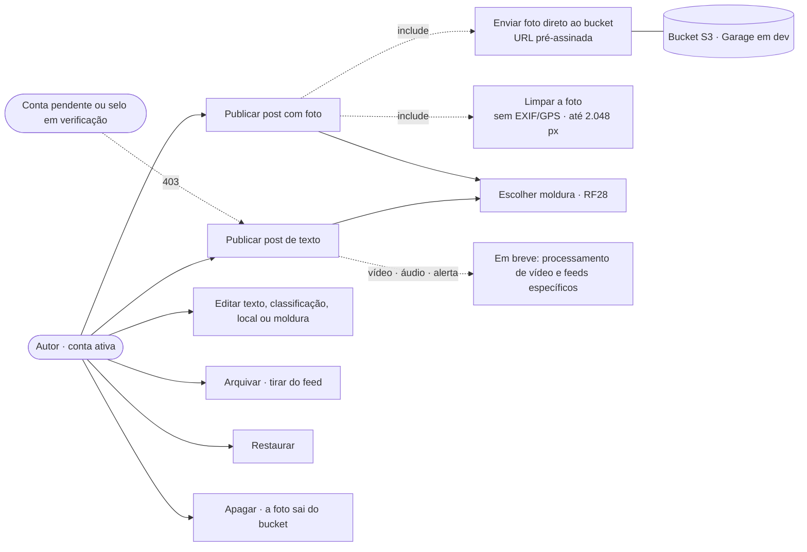
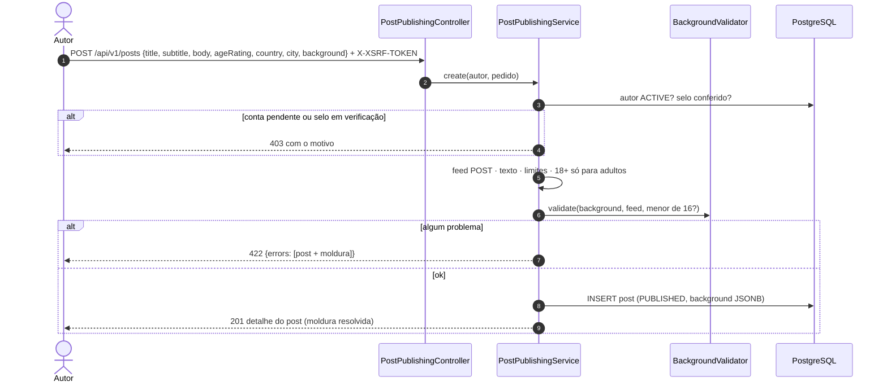
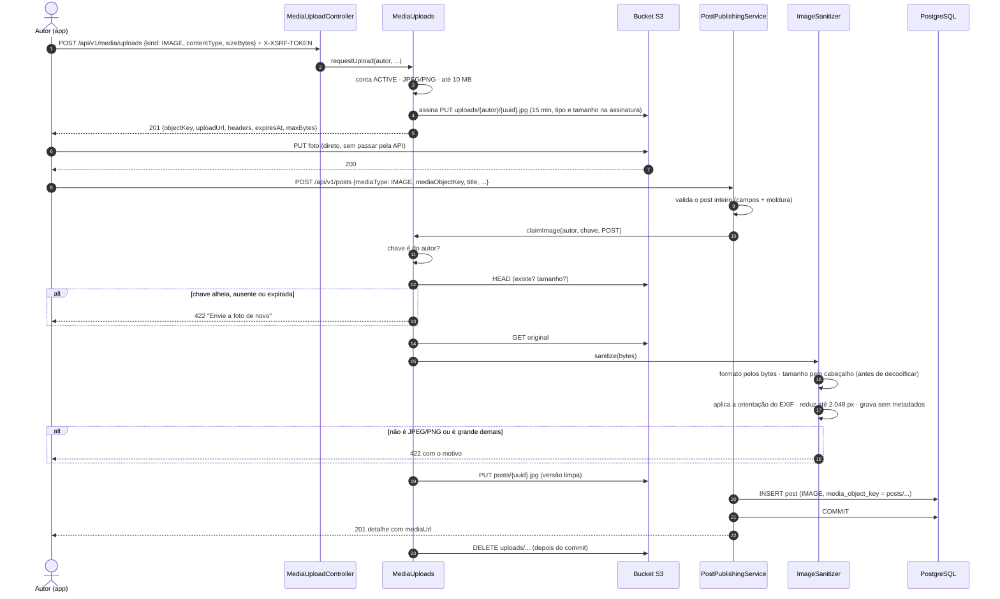
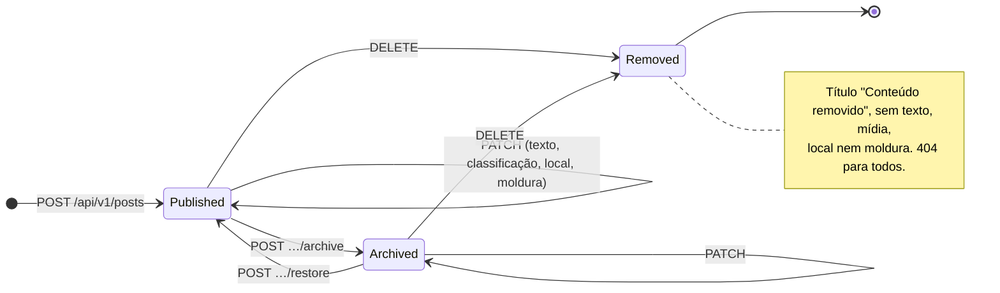
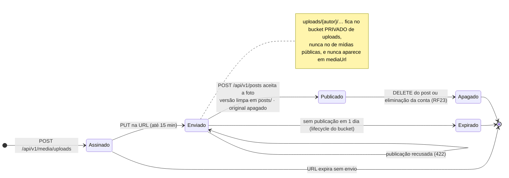
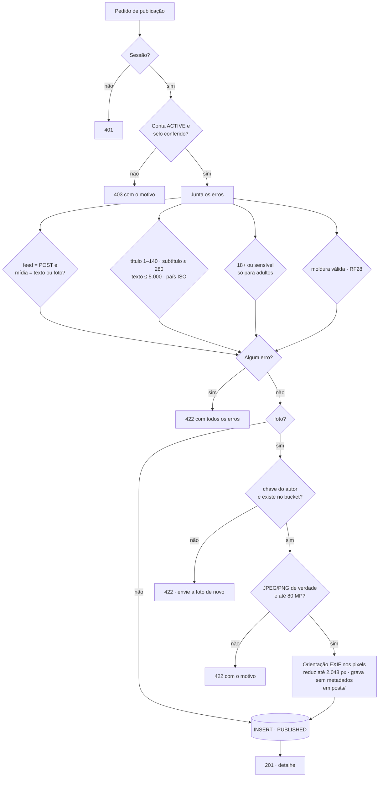

# RF29 · Publicar e gerenciar o próprio post

> **Como** autor, **quero** publicar um post, corrigir o que escrevi, tirar do feed por um tempo e apagar quando quiser,
> **para** controlar o que fica público em meu nome.

> ⚠️ **Numeração provisória** — mesma regra de [RF24](RF24-visualizar-post.md).

| | |
|---|---|
| **Base legal (LGPD)** | Art. 7º, V (execução do serviço). Apagar é também o direito de eliminação do titular para aquele conteúdo (Art. 18, VI). A exclusão da conta inteira fica no [RF23](RF23-direitos-titular-lgpd.md). Foto sai sem EXIF/GPS: o local exato e o aparelho não vão junto (Art. 6º, III, necessidade) |
| **ECA Digital** | Menor de 18 não publica conteúdo 18+ nem sensível. Menor de 16 só usa molduras do catálogo ([RF28](RF28-moldura-post.md)) |
| **Status** | 🟡 Parcial. Pronto, com testes: post de texto e de **foto** no Post Feed (envio pré-assinado ao S3, foto limpa de EXIF/GPS), edição, arquivamento, restauração, remoção (apaga a foto do bucket) e moldura. Falta: vídeo (processamento que tira metadados e gera pôster), áudio (OS-24), alerta (OS-25), rascunho (pede reordenar o feed do autor por data de publicação) e moderação da imagem antes de publicar |

## Critérios de aceite

1. **Quem publica.**
   - Precisa de sessão e de conta `ACTIVE`: conta pendente recebe `403` ("confirme seu e-mail").
   - Instituição (VERMELHO) e banco (PRETO) só publicam com o selo **conferido**: `PENDING` ou `REJECTED` recebe `403`.
2. **Criação.**
   - Chamada: `POST /api/v1/posts`, que publica direto (`PUBLISHED`) e devolve `201` com o mesmo corpo do detalhe ([RF24](RF24-visualizar-post.md)).
   - Título obrigatório (1–140 caracteres, sem espaços nas pontas); subtítulo até 280; texto até 5.000.
   - País em duas letras (ISO 3166, maiúsculas); cidade até 120 caracteres.
   - Classificação com padrão `LIVRE`.
   - Moldura opcional (`background`), validada pelo [RF28](RF28-moldura-post.md).
3. **Fora por enquanto (`422`, com o motivo):**
   - vídeo e áudio;
   - Audio Feed e Alert Feed;
   - Profile Feed, que mostra perfis e não posts.
4. **Todos os erros voltam juntos.** A resposta é `422` com `errors[]`: campos do post e da moldura numa resposta só.
5. **Edição.**
   - Chamada: `PATCH /api/v1/posts/{id}`, só pelo autor.
   - Chave ausente mantém o valor; `"background": null` volta à moldura padrão.
   - Campo que não é editável (autor, contadores, status…) dá `422`.
6. **Arquivar e restaurar.**
   - `POST …/archive` só vale para post `PUBLISHED`; `POST …/restore` só para `ARCHIVED`. Fora disso, `409`.
   - Arquivado continua no perfil, mas sem novas interações ([RF26](RF26-interacoes-post.md)).
7. **Apagar.** `DELETE /api/v1/posts/{id}` responde `204`. O post vira `REMOVED`: título, texto, mídia, local e moldura
   são apagados, e o link passa a responder `404` para todos. A foto sai do bucket depois do commit.
8. **Post de outra pessoa.** Editar, arquivar ou apagar post alheio, ou que não existe, responde `404`, sem revelar
   qual dos dois (mesma regra do [RF24](RF24-visualizar-post.md)).
9. **Foto, passo 1 · pedir o envio.**
   - Chamada: `POST /api/v1/media/uploads` `{kind: "IMAGE", contentType, sizeBytes}`, com conta `ACTIVE` (senão `403`).
   - Só JPEG ou PNG, até 10 MB; vídeo e áudio dão `422` com o motivo.
   - Resposta `201`: `objectKey` (`uploads/{autor}/{uuid}.jpg|png`), `uploadUrl` de `PUT` válida por 15 minutos,
     `headers` assinados (`Content-Type` e `Content-Length`), `expiresAt` e `maxBytes`.
   - O app envia o arquivo **direto ao bucket**; a API nunca recebe os bytes do envio. Tipo e tamanho fazem parte da
     assinatura: outro arquivo, de outro tamanho, é recusado pelo próprio bucket (`403`).
10. **Foto, passo 2 · publicar.** `POST /api/v1/posts` com `"mediaType": "IMAGE"` e `"mediaObjectKey"`.
    - A chave precisa ser do próprio autor e existir no bucket. Chave alheia, inexistente, expirada ou já usada dá
      a mesma resposta (`422` "Envie a foto de novo"), sem revelar qual.
    - A foto só é processada depois que o resto do post passou na validação.
    - O formato vem dos bytes, não do `Content-Type`: o que não é JPEG ou PNG dá `422`.
    - Largura e altura são lidas do cabeçalho antes de decodificar: acima de 80 MP ou 20.000 px de lado dá `422`.
    - A orientação do EXIF é aplicada aos pixels e a foto é gravada de novo **sem nenhum metadado** (EXIF, GPS,
      aparelho, miniatura, comentários). O lado maior vai até 2.048 px. Com transparência sai PNG; sem, JPEG 0,85.
    - Tudo em memória: o original nunca passa por arquivo temporário no disco da API.
    - A versão limpa vai para `posts/{uuid}.jpg|png` (pública, cache de um ano) e o original sai do bucket depois
      do commit. Se a publicação falhar, a versão limpa sai no rollback.
    - Post de texto com `mediaObjectKey`, ou foto sem a chave, dá `422`. A foto não é editável pelo `PATCH`.

## Caso de uso

## Sequência · publicar

## Sequência · publicar com foto

## Estados pelas ações do autor

O rascunho (`DRAFT`) existe no domínio, mas ainda não é criado pela API (⏳).

## Estados · objeto da foto no bucket

## Atividades · validação da criação

## Rastreabilidade

| Camada | Artefato | Situação |
|---|---|---|
| Aplicação / API | `PostPublishingService`, `PostPublishingController`: `POST /api/v1/posts`, `PATCH /api/v1/posts/{id}`, `POST …/archive`, `POST …/restore`, `DELETE /api/v1/posts/{id}` | ✅ |
| Domínio | `Post.publish/archive/remove` e transições de `PostStatus` (já existiam); `remove()` agora apaga também a moldura | ✅ |
| Erros | `PostExceptions.Invalid` (422 com `errors`) e `PostExceptions.Conflict` (409) no `ApiExceptionHandler` | ✅ |
| Testes | `PostPublishingApiIT`: publicar com moldura, 422 com tudo junto, quem pode publicar (pendente, selo, menor), editar, arquivar, restaurar, apagar e foto (abaixo) | ✅ |
| Foto · envio | `MediaUploadController` (`POST /api/v1/media/uploads`), `MediaUploads.requestUpload` (o mesmo envio serve à foto de perfil, [RF2](RF02-editar-perfil.md)), `MediaStorage`/`S3MediaStorage` (AWS SDK v2, endereço por caminho, `presign-endpoint`) | ✅ |
| Foto · publicação | `MediaUploads.claimImage(…, Fit.POST)` (dono, `HEAD`, tamanho; erro vira `422` do post), `ImageSanitizer` (formato pelos bytes, limite de pixels antes de decodificar, orientação EXIF, sem metadados, até 2.048 px), `MediaJanitor` (apaga o original depois do commit e a versão limpa no rollback) | ✅ |
| Foto · ao apagar | `PostPublishingService.remove` apaga a foto do bucket depois do commit; a eliminação da conta faz o mesmo com todas as fotos ([RF23](RF23-direitos-titular-lgpd.md)) | ✅ |
| Foto · testes | `ImageSanitizerTest` (EXIF/GPS some, 8 orientações, redução, PNG com transparência, "bomba" e arquivo falso); `PostPublishingApiIT` com Garage real: envio pré-assinado, chave alheia, tamanho fora da assinatura, arquivo que não é foto, apagar | ✅ |
| Ambiente | Garage no Compose e nos testes (`support/GarageContainer`), iniciado pela Admin API v2 (`infra/garage/init.sh`); leitura pública em `:3902` no papel da CDN | ✅ |
| Buckets | **Dois buckets**: o original enviado pelo app (`uploads/…`, com EXIF/GPS e dono ainda não conferido) vai para o bucket **privado** `orange-social.storage.uploads-bucket`; o bucket de mídias, com leitura pública (CDN; em dev a leitura pública do Garage), só recebe as versões limpas (`posts/`, `avatars/`, `backgrounds/`). `S3MediaStorage.bucketFor` escolhe pelo prefixo e recusa subir com os dois iguais. Em dev, `infra/garage/init.sh` cria os dois, liga a leitura pública só no de mídias, faz os originais expirarem em 1 dia e libera o `PUT` da origem web (`WEB_ORIGIN`) no de uploads; `S3MediaStorageTest` e `PostPublishingApiIT` (a URL de envio aponta para o bucket privado) | ✅ |
| Foto · próximos | AVIF/WebP e miniaturas (imgproxy, ADR-05), moderação antes de publicar, as mesmas regras de bucket na produção (infraestrutura como código) | ⏳ |
| Vídeo | Processamento que tira metadados e gera o pôster | ⏳ |
| Áudio e alerta | Audio Feed (OS-24) e Alert Feed só para fontes verificadas (OS-25) | ⏳ |
| Rascunho | Criar `DRAFT` e publicar depois, com o feed do autor ordenado pela data de publicação | ⏳ |
| Tela | Protótipo do estúdio de moldura com "Publicar" ([RF28](RF28-moldura-post.md), telas 22–27); compositor de post | 🟡 / ⏳ OS-39 |
